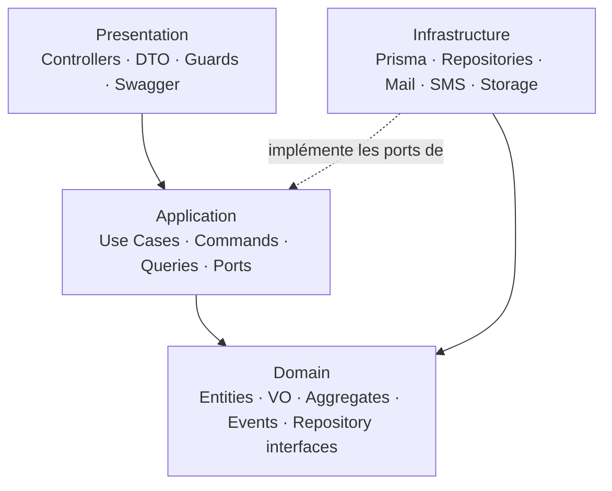
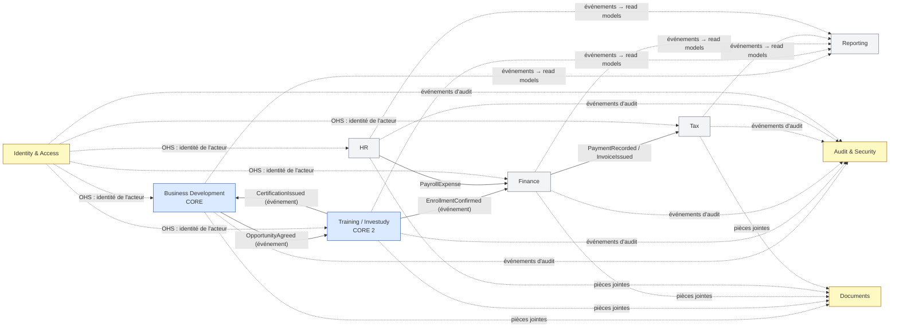

# Architecture — Investally Business Platform

> Statut : **brouillon Phase 1 (Sprint 0)**, en attente de validation. Les sections vides seront remplies par les phases suivantes.

## System Context
Investally Business Platform est l'ERP interne d'Investally (fintech : marchés financiers, produits structurés, conseil) et d'Investudy (formation professionnelle). Il couvre le parcours : entreprise cible → contact → offre → décharge → relances → RDV DAF/décideur → visite → accord de principe → agrément → inscription → session → formation → certification → suivi → ambassadeur, ainsi que Finance, RH, Fiscalité, Reporting, Sécurité/Audit.

Acteurs : SuperAdmin, Direction, HeadOfSales, AccountManager, Finance, RH, Fiscalité, Formateur, Support.

Intégrations externes (hypothèse v1) : e-mail, SMS/OTP, stockage de fichiers. Toutes derrière des *ports* du Domain/Application.

### Charge réelle (Phase 3, hypothèses à confirmer)
| Grandeur | Hypothèse | Résultat |
|---|---|---|
| Utilisateurs internes actifs | 80, 8 h/jour | |
| Actions par utilisateur et par jour | 300 (consultations incluses) | 24 000 requêtes/jour |
| QPS moyen | 24 000 ÷ 86 400 | ≈ 0,3 req/s |
| QPS de pointe (×5, dashboards, exports) | | ≈ 1,5 req/s ; marge de sécurité à 20 req/s |
| Lignes d'audit (lectures de documents et écritures tracées) | ≈ 20 000/jour × 1 Ko | ≈ 20 Mo/jour, **≈ 7 Go/an** |
| Données métier (CRM, formation, finance, RH) | < 1 Go/an | négligeable |
| Documents (PDF, décharges, contrats) | ≈ 5 000/an × 1 Mo | ≈ 5 Go/an, **hors base** (stockage objet) |

**Premier goulot** : la table `AuditLog` (croissance) et les requêtes d'agrégation des dashboards sur les tables transactionnelles. Pas le débit.

**Techniques adoptées maintenant** : PostgreSQL unique ; index sur clés de recherche ; pagination obligatoire ; partitionnement mensuel de `AuditLog` ; table *outbox* + worker pour e-mail/SMS/événements (travail lent découplé sans broker).
**Techniques différées (déclencheur chiffré)** :
| Technique | Déclencheur |
|---|---|
| Cache (Redis) | p95 d'un endpoint de lecture > 500 ms après indexation |
| Réplica de lecture | CPU primaire > 60 % soutenu ou requêtes de reporting gênant le transactionnel |
| File de messages dédiée (broker) | > 50 jobs/s ou besoin de livraison inter-services |
| Sharding / multi-région / CDN | Non applicable : usage interne, charge < 1 % de ces seuils |
| Extraction en microservice | Contexte prouvé avec équipe et cycle de release propres |

## Layer Map & Dependency Rule

Règle : **les dépendances de code source pointent vers l'intérieur**. Le Domain ne connaît personne.

> Précision sur le contrat initial : le diagramme « Presentation → Application → Domain → Infrastructure » se lit comme un *empilement visuel*, pas comme un sens de dépendance. L'Infrastructure **dépend du** Domain (elle implémente ses interfaces), elle n'est pas en dessous de lui.

```
            ┌────────────────────────────────────────────┐
            │  PRESENTATION  (Controllers, DTO, Guards,  │
            │                 Swagger, routes)           │
            └───────────────────┬────────────────────────┘
                                │ dépend de
                                ▼
            ┌────────────────────────────────────────────┐
            │  APPLICATION  (Use Cases, Commands/Queries,│
            │   Ports sortants : Clock, Mailer, Storage…)│
            └───────────────────┬────────────────────────┘
                                │ dépend de
                                ▼
            ┌────────────────────────────────────────────┐
            │  DOMAIN  (Entities, VO, Aggregates,        │
            │   Domain Services/Events, Repository ifaces)│
            └────────────────────────────────────────────┘
                                ▲
                                │ implémente les interfaces de
            ┌───────────────────┴────────────────────────┐
            │  INFRASTRUCTURE  (Prisma, repositories,    │
            │   Mail, SMS, Storage, Notifications)       │
            └────────────────────────────────────────────┘
   Composition root (module NestJS) : seul endroit qui câble les 4 couches.
```



### Règles par couche
| Couche | Contient | Interdit |
|---|---|---|
| Domain | Entities, Value Objects, Aggregates, Domain Services, Domain Events, interfaces de repository, règles métier | NestJS, Prisma, PostgreSQL, HTTP, DTO, Controllers, décorateurs de framework |
| Application | Use cases, Commands/Queries, services applicatifs, ports sortants (Mailer, Storage, Clock, IdGenerator, UnitOfWork) | Prisma, SQL, HTTP |
| Infrastructure | Prisma, repositories, adaptateurs e-mail/SMS/stockage | Règles métier |
| Presentation | Controllers, DTO + validation d'entrée, Guards, Swagger | Prisma/SQL direct, logique métier |

### Structure d'un module
```
src/modules/<contexte>/
  domain/          entities/ value-objects/ events/ services/ repositories/ (interfaces)
  application/     commands/ queries/ use-cases/ ports/
  infrastructure/  persistence/ (prisma + mappers) adapters/
  presentation/    controllers/ dto/ guards/
  <contexte>.module.ts   ← composition root du module
```
`src/shared-kernel/` : types minimaux partagés (Result, Id, Money, DomainEvent). Pas de logique métier d'un contexte.

### Communication entre modules
- Un module n'importe jamais le `domain/` ou `infrastructure/` d'un autre. Il consomme son **API publique** (`index.ts` : use cases exposés, événements) ou ses **événements de domaine**.
- Références entre agrégats **par identifiant** uniquement.
- Pas de jointure Prisma inter-contextes dans le code ; les lectures transverses (reporting) passent par des *read models* dédiés.

### Garde-fous automatiques (Sprint 1)
Tests d'architecture (`dependency-cruiser` ou `eslint-plugin-boundaries`) bloquant la CI si : Domain importe `@nestjs/*`, `@prisma/client`, `class-validator` ; Application importe `@prisma/client` ; Controller importe Prisma ; un module importe les internes d'un autre.

### Violations connues
| Violation | Location | Fix | Status |
|---|---|---|---|
| (aucune — dépôt vide) | | | |

## Bounded Contexts & Context Map
> Statut : **brouillon Phase 2** — à valider avec les utilisateurs métier (voir « Questions ouvertes »).

### Classification des sous-domaines
| Contexte | Type | Investissement de modélisation |
|---|---|---|
| **Business Development** (pipeline, offres, décharges, relances, RDV, visites, opportunités, ambassadeurs) | **Core** (hypothèse) | Modèle riche : machine à états, règles de transition, événements |
| **Training / Investudy** (programmes, sessions, inscriptions, présences, certifications) | **Core secondaire** | Modèle riche sur capacité, planning, inscription |
| Finance (factures, paiements, dépenses, fournisseurs, budgets) | Supporting | Invariants financiers solides, pas de sur-ingénierie |
| Tax (TVA, CNPS, échéances) | Supporting | Calendrier d'échéances + suivi de conformité |
| HR (employés, contrats, congés, absences) | Supporting | CRUD + règles de soldes de congés |
| Reporting | Supporting (lecture seule) | Read models, aucune règle métier propre |
| Identity & Access, Audit & Security, Documents, Notifications, Workflow/Calendar | **Generic** | Simple ; librairies/standards éprouvés (JWT, TOTP, argon2) |

### Carte des contextes


| Relation | Pattern | Détail |
|---|---|---|
| IAM → autres | Open Host Service | API publique : identité, rôles, permissions de l'acteur courant |
| BD → Training | Customer/Supplier, via événements | Training ne lit jamais les tables de BD ; il reçoit `OpportunityAgreed` avec les données utiles copiées (société, contacts, programme demandé) |
| Training → BD | Événements | `CertificationIssued` alimente le suivi post-formation et la création d'ambassadeur |
| Training → Finance | Événements | Finance crée la facture à partir de `EnrollmentConfirmed`, sans importer le modèle d'inscription (ACL côté Finance) |
| * → Audit | Published Language | Format d'événement d'audit unique et stable |
| * → Reporting | Conformist (lecture seule) | Reporting se conforme aux événements/vues publiés, ne dicte rien |
| Documents | Shared service (open host) | Référence par `documentId` + type d'entité propriétaire |

Sous-couches transverses **Workflow**, **Calendar**, **Notifications** : ports/services techniques génériques consommés par les contextes, sans logique métier propre.

## Domain Glossary (Ubiquitous Language)
Le même mot recouvre des concepts différents selon le contexte : **on ne les unifie pas** (pas de modèle omniscient).

| Term | Meaning | Code name |
|---|---|---|
| Entreprise cible | Société prospectée (BD) | `bd.Prospect` / `Company` dans BD |
| Client (Finance) | Partie facturée ; référence l'`companyId` BD mais possède son propre modèle | `finance.Customer` |
| Organisation cliente (Training) | Société qui finance l'inscription de ses apprenants | `training.SponsorOrganization` |
| Contact | Interlocuteur d'une entreprise dans BD (DAF, décideur…) | `bd.Contact` |
| Apprenant | Personne suivant une formation (peut être ou non un `Contact`) | `training.Learner` |
| Employé | Salarié d'Investally (RH) ≠ Utilisateur | `hr.Employee` |
| Utilisateur | Compte d'accès à la plateforme (IAM) | `iam.User` |
| Offre | Proposition commerciale déposée chez une entreprise | `bd.Offer` |
| Décharge | Accusé de réception signé de l'offre déposée | `bd.AcknowledgementReceipt` |
| Relance | Action de suivi planifiée après dépôt d'offre | `bd.FollowUp` |
| Rendez-vous | RDV avec DAF ou décideur | `bd.Appointment` (type `FinanceDirector` \| `DecisionMaker`) |
| Visite Investally | Visite du client chez Investally | `bd.Visit` |
| Opportunité | Parcours de qualification d'une entreprise jusqu'à l'accord | `bd.Opportunity` |
| Accord de principe | Engagement de principe du client, étape de l'opportunité | `OpportunityStage.AgreementInPrinciple` |
| Agrément formation | Validation permettant d'inscrire (**à préciser**, voir questions) | `training.TrainingApproval` |
| Programme | Catalogue de formation (offre pédagogique) | `training.TrainingProgram` |
| Formation | Programme décliné et planifié | `training.Training` |
| Session | Occurrence datée avec salle, formateur, capacité | `training.TrainingSession` |
| Inscription | Rattachement d'un apprenant à une session | `training.Enrollment` |
| Présence | Participation d'un apprenant à une séance | `training.Attendance` |
| Certification / Attestation | Certificat (réussite) / attestation (suivi) | `training.Certification` / `training.Attestation` |
| Ambassadeur | Client ou apprenant converti en relais commercial | `bd.Ambassador` |
| Caisse / Banque | Comptes de trésorerie | `finance.CashAccount` / `BankAccount` |
| Échéance fiscale | Date limite de déclaration (TVA, CNPS…) | `tax.FilingDeadline` |

## Agrégats et invariants (Core)
| Agrégat (racine) | Invariants | Références par ID |
|---|---|---|
| `Opportunity` | Étapes franchies dans l'ordre défini ; pas d'« Accord de principe » sans au moins un RDV décideur tenu (règle configurable) ; une opportunité clôturée est immuable | `companyId`, `ownerUserId` |
| `Offer` | Une seule décharge valide par offre ; relances impossibles après décharge refusée/offre retirée ; statut limité aux transitions permises | `companyId`, `opportunityId` |
| `TrainingSession` | Inscrits confirmés ≤ capacité ; pas de double réservation salle/formateur sur un créneau (service de domaine) ; session clôturée = présences figées | `programId`, `roomId`, `trainerId` |
| `Enrollment` | Un apprenant une seule fois par session ; inscription impossible sans agrément valide | `learnerId`, `sessionId`, `approvalId` |
| `Invoice` | Immuable une fois émise (correction = avoir) ; total = somme des lignes ; paiements cumulés ≤ total | `customerId`, `enrollmentId` |
| `LeaveRequest` | Solde suffisant ; pas de chevauchement | `employeeId` |

### Questions ouvertes (bloquantes pour valider cette phase)
1. **« Agrément formation »** : agrément délivré par une autorité/OPCO, ou validation interne du dossier du client ? Détermine s'il appartient à BD ou à Training.
2. **Le même client peut-il avoir plusieurs opportunités simultanées ?** (cardinalité Company ↔ Opportunity).
3. **Un apprenant est-il toujours un Contact BD ?** Si non, `Learner` reste indépendant, ce que je recommande.
4. **Qui crée l'ambassadeur** : automatique à la certification, ou décision manuelle de l'AccountManager ?

## Data & Storage Decisions
### Modèle et moteur
- **PostgreSQL unique**, système d'enregistrement. Modèle **relationnel** : relations nombreuses (société–contact–offre–opportunité), requêtes ad hoc de reporting, intégrité référentielle. Pas de polyglot persistence en v1.
- **Un schéma PostgreSQL par contexte** (`iam`, `audit`, `bd`, `training`, `finance`, `hr`, `tax`, `reporting`, `docs`) ; aucune clé étrangère entre schémas de contextes différents (références par ID applicatif, cohérence assurée par événements). Exception tolérée : `iam.user_id` référencé en simple colonne sans FK dans les autres contextes. À vérifier : support Prisma `multiSchema` selon la version retenue (sinon préfixes de tables `bd_…`).
- Identifiants **UUID v7** générés côté application (portable EF Core, triables par date, pas de séquence exposée). Numéros métier lisibles (facture, session) via séquences dédiées.
- Dates en `timestamptz` UTC. Montants en `numeric(18,2)` avec devise explicite (`Money` : montant + devise, XAF par défaut) ; jamais de flottant.

### Cohérence, isolation et chemins verrouillés
Isolation par défaut : **Read Committed**. Elle autorise le *write skew* sur les chemins « lire puis écrire » ; ils sont protégés explicitement :
| Chemin | Risque | Protection |
|---|---|---|
| Inscription à une session | dépasser la capacité | `SELECT … FOR UPDATE` sur la ligne de session dans la transaction d'inscription |
| Enregistrement d'un paiement | cumul > total facture | verrou sur la facture + contrainte `CHECK` |
| Numérotation des factures | doublons / trous | séquence PostgreSQL ; émission transactionnelle |
| Solde de congés | double validation | verrou sur le solde employé |
| Transition d'`Opportunity`, `Offer`, `TrainingSession` | mises à jour concurrentes | **verrou optimiste** : colonne `version` incrémentée, échec si version obsolète |
| Réservation salle/formateur | chevauchement | contrainte d'exclusion PostgreSQL (`EXCLUDE USING gist` sur plage de temps) en plus de la règle de domaine |
Tout le reste tolère la cohérence éventuelle (reporting, notifications, événements inter-contextes).

### Données transverses
- **Soft delete** (`deletedAt`, `deletedBy`) sur les entités métier ; **jamais** sur `AuditLog` (append-only, pas de suppression). Contraintes d'unicité partielles (`WHERE deletedAt IS NULL`).
- **Versioning** : `version` entier (concurrence optimiste) sur les agrégats ; historique des documents via table de versions.
- **AuditLog** : partitionné par mois, rôle applicatif sans `UPDATE`/`DELETE`, rétention à fixer avec le RSSI/juridique (proposition : 10 ans en ligne pour finance/fiscalité, archivage à froid au-delà). Masquage des champs sensibles dans `oldValue`/`newValue`.
- **Documents** : fichiers en stockage objet compatible S3 (MinIO en dev) ; en base, métadonnées, empreinte SHA-256, version et journal d'accès (création, consultation, modification, téléchargement, export, suppression).
- **Dérivé reconstructible** : tables/vues de `reporting` alimentées par événements et rafraîchies périodiquement ; perte tolérée car reconstruisibles depuis les sources. Pas de CDC ni de moteur de recherche externe en v1 ; recherche via index PostgreSQL (`pg_trgm`, full-text).
- **Outbox transactionnelle** : l'événement de domaine est écrit dans la même transaction que l'agrégat ; un worker le publie (au moins une fois) ; les consommateurs sont idempotents.

## Decision Log
| Date | Decision | Why | Alternatives rejected |
|---|---|---|---|
| 2026-10-20 | Monolithe modulaire, un déploiement, frontières par module (ADR-0001) | Équipe unique, charge modeste, contextes non encore éprouvés | Microservices (monolithe distribué, coût ops), monolithe en couches techniques (couplage) |
| 2026-10-20 | Prisma uniquement dans `infrastructure/` (ADR-0002) | Rend l'ORM remplaçable (EF Core) ; Domain testable sans base | Repositories dans Application, Prisma dans les use cases |
| 2026-10-20 | Entités Domain distinctes des modèles Prisma, mappers explicites (ADR-0003) | Domain pur, migration .NET sans réécriture métier | Réutiliser les types Prisma comme entités (rapide mais couplage fort) |
| 2026-10-20 | Audit par Domain Events + intercepteur applicatif (ADR-0004) | Traçabilité qui/quoi/quand/où/avant/après sans polluer le métier | Triggers SQL seuls (pas d'IP/session), audit manuel dans chaque use case |
| 2026-10-20 | Core = Business Development (+ Training en core secondaire) ; le reste supporting/generic | Là où se trouve l'avantage du parcours prospect → inscrit ; effort de modélisation concentré | Modélisation profonde uniforme (dilution) |
| 2026-10-20 | Pas de modèle unifié « Personne/Société » ; chaque contexte a son modèle, lié par ID et événements | Les mots (Client, Contact, Apprenant, Employé, Utilisateur) ont des invariants différents | Table `Person` partagée (couplage de tous les contextes) |
| 2026-10-20 | Intégration inter-contextes par événements de domaine avec données copiées (pas de lecture des tables d'autrui) | Autonomie des contextes, extraction future possible | Appels directs/joins cross-contexte |
| 2026-10-20 | Charge dimensionnée à ≈ 1,5 req/s de pointe : pas de cache, réplica, broker ni sharding (déclencheurs chiffrés) | Premier goulot = croissance d'AuditLog, pas le débit | Redis/broker d'emblée (complexité sans besoin) |
| 2026-10-20 | PostgreSQL unique, schéma par contexte, sans FK inter-contextes | Frontières appliquées jusqu'à la donnée ; extraction future facilitée | Schéma unique avec FK partout (couplage) |
| 2026-10-20 | Read Committed + verrous explicites + verrou optimiste ; contrainte d'exclusion pour les plannings | Chemins critiques protégés du write skew sans passer tout en Serializable | Serializable global (retries partout) |
| 2026-10-20 | UUID v7 générés côté application ; Money = numeric + devise | Portabilité EF Core, pas de flottants | Entiers auto-incrémentés, float |
| 2026-10-20 | Outbox transactionnelle pour événements, e-mail et SMS | Fiabilité sans broker | Publication directe après commit (perte possible) |
| 2026-10-20 | Collapse volontaire : pas de CQRS bus ni event sourcing en v1 | Ceremony non justifiée à cette charge ; commands/queries restent des use cases distincts | CQRS complet, event sourcing |
