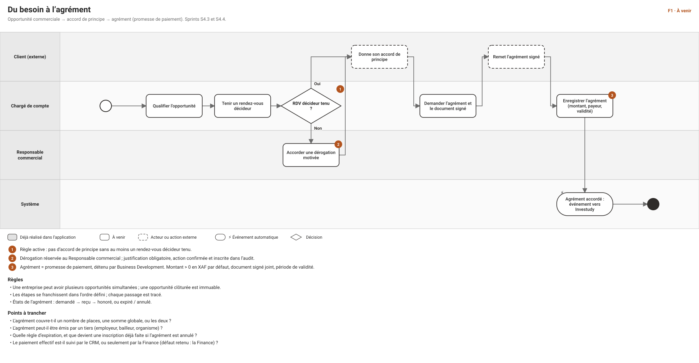
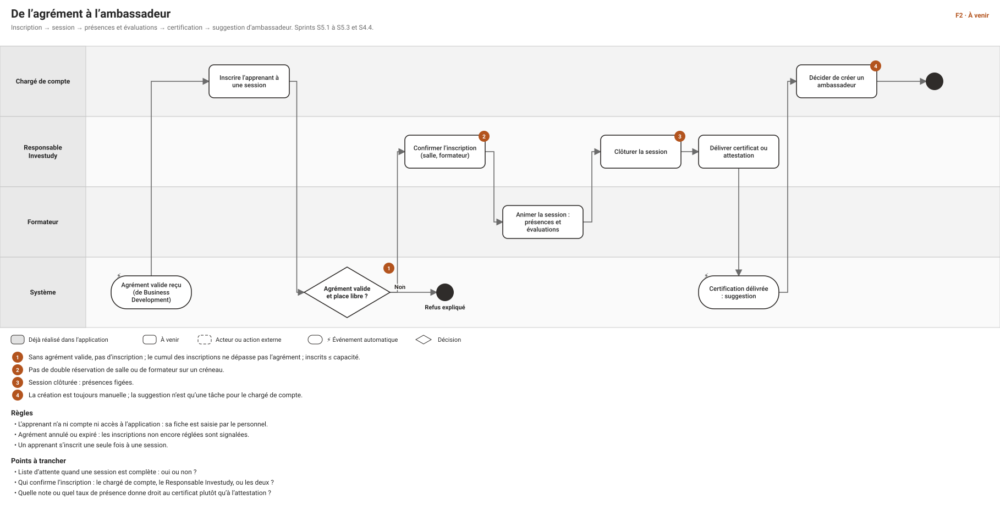
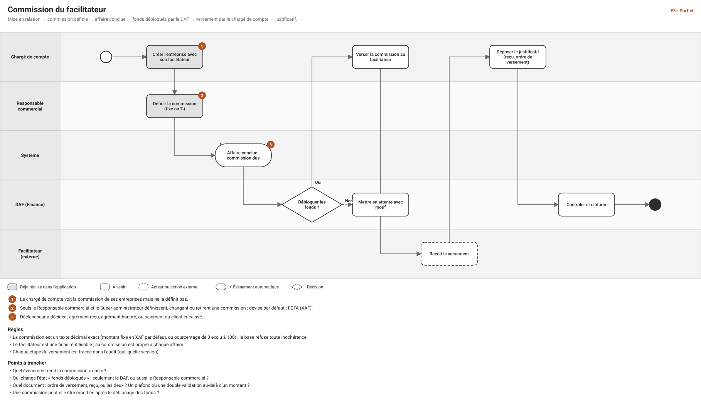
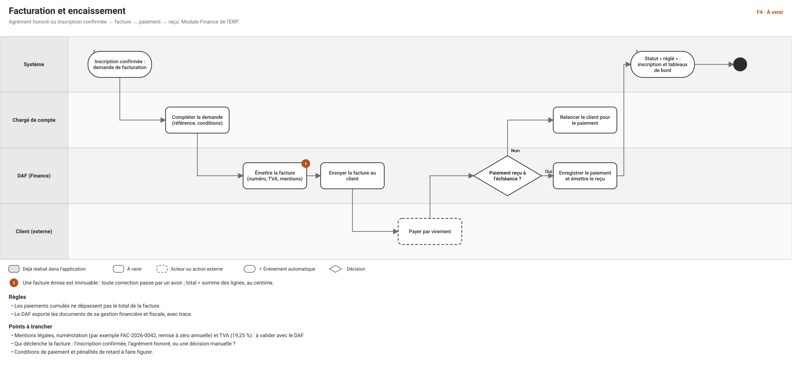
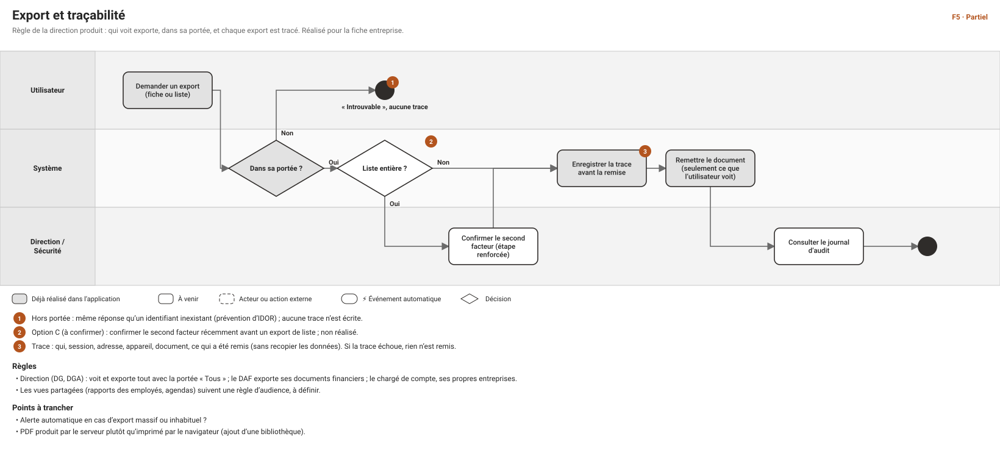
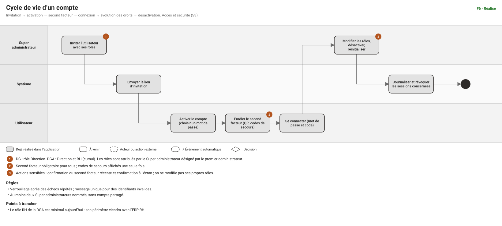
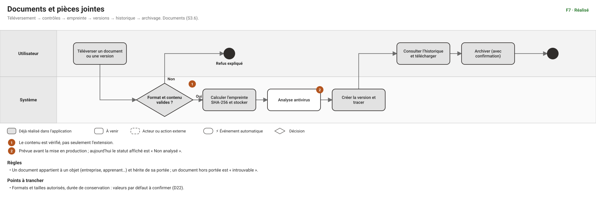

# Cas d'usage et workflows — flux transverses

**Date** : 2026-10-30 · **Statut** : **proposition à valider** · **Méthode** : [METHODE-D-ARBITRAGE.md](METHODE-D-ARBITRAGE.md) · **Diagrammes** : [workflows/index.html](workflows/index.html) · **Écrans** : [wireframes](design/wireframe/index.html)

> Les **flux transverses** traversent plusieurs modules et plusieurs acteurs : c'est là que les malentendus coûtent le plus cher. Ce document en décrit sept, avec pour chacun un schéma par acteur, puis les cas d'usage. **Rien n'est décidé ici** : les points marqués « à trancher » sont ceux de la direction produit. Les étapes déjà réalisées dans l'application sont indiquées.

## 1. Comment lire
- **Schéma** : un couloir par acteur, le temps de gauche à droite ; gris = déjà réalisé, blanc = à venir ; ⚡ = événement automatique ; pastille orange = règle ou point ouvert.
- **Cas d'usage (CU)** : acteur, déclencheur, préconditions, scénario, variantes et erreurs, résultat, règles, droits, écrans (numéro du wireframe), état.
- **Droits** : portée **Propre** (ses objets), **Équipe** (lui et ses subordonnés directs), **Tous**. Le serveur est toujours le seul juge ; l'interface masque ce qui n'est pas accordé.

## 2. Acteurs et rôles
| Acteur | Rôle dans l'application | Remarque |
|---|---|---|
| **DG** | Direction | Décidé le 2026-10-30 (D27) : voit et exporte tout, ne modifie pas les fiches commerciales, n'administre pas les comptes |
| **DGA** | Direction **et** RH | Cumul : la portée la plus large l'emporte ; le rôle RH est minimal en attendant l'ERP |
| **DAF** | Finance | Débloque les fonds ; exporte ses documents financiers et fiscaux, avec trace |
| **Responsable commercial** | Responsable commercial | Pilote l'équipe ; définit la commission ; accorde les dérogations |
| **Chargé de compte** | Chargé de compte | Mène ses entreprises ; voit la commission de ses entreprises et la verse |
| **Responsable Investudy** | Responsable formation | Sessions, inscriptions, certifications |
| **Formateur** | Formateur | Ses sessions : présences, évaluations |
| **Super administrateur** | Super administrateur | Comptes et droits ; désigné par le premier administrateur ; au moins deux, sans compte partagé |
| **Client, facilitateur, apprenant** | *Aucun compte* | Acteurs externes : l'apprenant n'accède jamais à l'application |

---

## F1 — Du besoin à l'agrément
*Statut : à venir (S4.3 et S4.4).*

### CU-F1-01 — Qualifier une opportunité
- **Acteur** : chargé de compte. **Déclencheur** : un contact montre un intérêt.
- **Préconditions** : l'entreprise existe dans la portée du chargé de compte.
- **Scénario** : 1. Il crée une opportunité liée à l'entreprise. 2. Il renseigne le besoin, le montant estimé et la source. 3. Elle apparaît en « Qualification » (écrans 19 et 20).
- **Variantes** : plusieurs opportunités simultanées pour une même entreprise ; entreprise archivée : création refusée.
- **Résultat** : opportunité ouverte, propriétaire = le chargé de compte. **Droits** : `bd.opportunity.create` (Propre). **État** : à venir.

### CU-F1-02 — Tenir un rendez-vous décideur
- **Acteur** : chargé de compte. **Déclencheur** : un rendez-vous avec le décideur est obtenu.
- **Scénario** : 1. Il planifie le rendez-vous (type « décideur » ; écran 18). 2. Après le rendez-vous, il le marque « tenu » avec une note. 3. L'opportunité en garde la trace.
- **Variantes** : rendez-vous annulé ou reporté ; contact non rattaché à l'entreprise : refusé.
- **Règle** : un rendez-vous « décideur » tenu conditionne l'accord de principe (CU-F1-03). **Droits** : `bd.appointment.*` (Propre). **État** : à venir.

### CU-F1-03 — Demander l'accord de principe
- **Acteur** : chargé de compte. **Préconditions** : opportunité en « Négociation ».
- **Scénario** : 1. Il passe l'opportunité à « Accord de principe » (écran 21). 2. Le système vérifie qu'un rendez-vous décideur a été tenu. 3. Le passage est enregistré.
- **Variantes** : **aucun rendez-vous décideur tenu** → le passage est refusé, avec renvoi vers la dérogation (CU-F1-04) ; opportunité clôturée → immuable.
- **Règles** : étapes franchies dans l'ordre ; chaque passage tracé. **Droits** : `bd.opportunity.advance` (Propre). **État** : à venir.

### CU-F1-04 — Accorder une dérogation à la règle du rendez-vous décideur
- **Acteur** : Responsable commercial. **Déclencheur** : le chargé de compte demande une exception.
- **Scénario** : 1. Il ouvre l'opportunité (équipe). 2. Il choisit « Accorder une dérogation » (écran 22). 3. Il saisit une **justification obligatoire** et confirme. 4. L'accord de principe devient possible ; l'action est inscrite dans l'audit.
- **Variantes** : justification vide → bouton désactivé ; sans le rôle → action absente.
- **Droits** : réservé au Responsable commercial (portée Équipe). **À créer** : une permission dédiée (par exemple `bd.opportunity.override`) : le catalogue actuel n'en a pas. **État** : à venir.

### CU-F1-05 — Enregistrer un agrément (promesse de paiement)
- **Acteur** : chargé de compte. **Préconditions** : accord de principe obtenu.
- **Scénario** : 1. Il demande au client l'agrément signé. 2. Il enregistre l'agrément : montant, devise (XAF par défaut), payeur, période de validité, **document signé joint** (écran 23). 3. L'état passe à « reçu ». 4. Le système envoie l'événement « agrément accordé » vers Investudy.
- **Variantes** : document manquant ou format refusé ; payeur tiers (à trancher) ; agrément expiré ou annulé → les inscriptions non réglées sont signalées.
- **Règles** : états demandé → reçu → honoré, ou expiré / annulé ; montant > 0. **Droits** : **à créer** (le catalogue n'a pas de ressource « agrément »). **État** : à venir.

**À trancher pour F1** : places couvertes ou somme globale ; payeur tiers ; expiration et effet sur les inscriptions ; paiement suivi par le CRM ou par la Finance (défaut : la Finance).

---

## F2 — De l'agrément à l'ambassadeur
*Statut : à venir (S5.1 à S5.3, S4.4).*

### CU-F2-01 — Inscrire un apprenant à une session
- **Acteur** : chargé de compte. **Préconditions** : agrément valide pour cette entreprise ; session ouverte.
- **Scénario** : 1. Il choisit la session et l'apprenant (fiche créée au besoin ; écran 30). 2. Il rattache l'inscription à l'agrément. 3. Le système contrôle la validité, le cumul et la capacité. 4. L'inscription est créée « en attente de confirmation ».
- **Variantes** : **sans agrément valide → refus** ; cumul supérieur à l'agrément → refus ; session complète → refus (liste d'attente à trancher) ; apprenant déjà inscrit → refus.
- **Droits** : `training.enrollment.create` (Propre). **État** : à venir.

### CU-F2-02 — Confirmer l'inscription et affecter la session
- **Acteur** : Responsable Investudy. **Scénario** : 1. Il consulte les inscriptions en attente (écran 28). 2. Il confirme, et affecte salle et formateur. 3. Le système refuse tout conflit de salle ou de formateur.
- **Droits** : `training.session.*` (Tous). **À trancher** : le chargé de compte peut-il confirmer lui-même ? **État** : à venir.

### CU-F2-03 — Saisir présences et évaluations
- **Acteur** : formateur (ses sessions). **Scénario** : 1. Il ouvre la feuille de présence du jour (écran 31). 2. Il coche matin et après-midi, note les retards. 3. En fin de formation, il saisit les évaluations.
- **Variantes** : session clôturée → figée, aucune saisie. **Droits** : `training.attendance.record`, `training.evaluation.record` (Propre). **État** : à venir.

### CU-F2-04 — Clôturer une session
- **Acteur** : Responsable Investudy. **Scénario** : 1. Il vérifie présences et évaluations saisies. 2. Il clôture (action confirmée). 3. Les présences sont figées.
- **Résultat** : la session ouvre droit aux certifications. **État** : à venir.

### CU-F2-05 — Délivrer une certification ou une attestation
- **Acteur** : Responsable Investudy. **Scénario** : 1. Pour chaque apprenant, il décide : certificat (réussite) ou attestation (suivi) (écran 32). 2. Le document est généré selon la charte. 3. Le système envoie l'événement « certification délivrée ».
- **Variantes** : révocation avec justification, confirmée. **Droits** : `training.certification.issue / revoke`. **À trancher** : seuils de note et de présence. **État** : à venir.

### CU-F2-06 — Créer un ambassadeur
- **Acteur** : chargé de compte. **Déclencheur** : suggestion après une certification.
- **Scénario** : 1. Il consulte les suggestions (écran 24). 2. Il décide **manuellement** de créer l'ambassadeur. 3. Il l'enregistre avec son origine (client ou apprenant).
- **Règle** : jamais de création automatique. **Droits** : `bd.ambassador.create` (Propre). **État** : à venir.

**À trancher pour F2** : liste d'attente ; qui confirme l'inscription ; seuils de certification.

---

## F3 — Commission du facilitateur
*Statut : partiel (mise en relation et définition de la commission réalisées ; versement à venir).*

### CU-F3-01 — Enregistrer une entreprise avec son facilitateur
- **Acteur** : chargé de compte. **Scénario** : 1. Il crée l'entreprise (écran 6). 2. Il choisit un facilitateur existant ou en crée un (nom, prénom, téléphone, commentaire), la méthode de prise de contact et l'appartenance à l'entreprise.
- **Variantes** : facilitateur d'un collègue → « introuvable » ; doublon de nom d'entreprise → conflit. **Droits** : `bd.company.create`, `bd.facilitator.create`. **État** : **réalisé**.

### CU-F3-02 — Définir ou modifier la commission
- **Acteur** : Responsable commercial (ou Super administrateur). **Scénario** : 1. Il ouvre la fiche, « Modifier » (écran 5). 2. Il choisit montant fixe (devise XAF par défaut) ou pourcentage. 3. Il enregistre ; l'ancienne et la nouvelle valeur sont tracées.
- **Variantes** : le chargé de compte tente de la définir → refus ; sa propre modification conserve la commission. **Droits** : `bd.commission.manage`. **État** : **réalisé**.

### CU-F3-03 — Constater qu'une commission est due
- **Acteur** : système. **Déclencheur** : « affaire conclue ». **Résultat** : la commission passe « à verser » et apparaît dans la liste du chargé de compte (écran 25).
- **À trancher** : l'événement déclencheur (agrément reçu, agrément honoré, paiement du client encaissé). **État** : à venir.

### CU-F3-04 — Débloquer les fonds
- **Acteur** : DAF. **Scénario** : 1. Il consulte les commissions à verser. 2. Il débloque les fonds, ou met en attente avec un motif.
- **Résultat** : état « fonds débloqués » ; le chargé de compte est prévenu. **Droits** : **à créer** (par exemple `bd.commission.release`). **À trancher** : plafond ou double validation. **État** : à venir.

### CU-F3-05 — Verser la commission et déposer le justificatif
- **Acteur** : chargé de compte. **Préconditions** : fonds débloqués.
- **Scénario** : 1. Il verse la commission au facilitateur. 2. Il dépose le justificatif (reçu ou ordre de versement) via les documents. 3. Le DAF contrôle et clôture ; l'état passe « versée » avec la date.
- **Variantes** : justificatif manquant → clôture refusée. **À trancher** : le document attendu. **État** : à venir.

**À trancher pour F3** : événement déclencheur ; qui change chaque état ; document ; commission modifiable après déblocage.

---

## F4 — Facturation et encaissement
*Statut : à venir (module Finance de l'ERP).*

### CU-F4-01 — Préparer une demande de facturation
- **Acteur** : système puis chargé de compte. **Déclencheur** : inscription confirmée (ou agrément honoré, à trancher). **Scénario** : le système prépare la demande ; le chargé de compte complète la référence et les conditions.

### CU-F4-02 — Émettre une facture
- **Acteur** : DAF (Finance). **Scénario** : 1. Il vérifie la demande (écran 41). 2. Il émet : numéro, TVA, mentions légales (écran 42). 3. La facture devient **immuable** ; elle est envoyée au client.
- **Règles** : total = somme des lignes, au centime ; correction uniquement par un avoir. **À trancher** : mentions légales, numérotation (par exemple FAC-2026-0042), TVA 19,25 %. **Droits** : **à créer** (ressource finance). **État** : à venir.

### CU-F4-03 — Enregistrer un paiement
- **Acteur** : DAF. **Scénario** : il rapproche le virement, enregistre le paiement, émet le reçu ; l'inscription passe « réglée » et les tableaux de bord se mettent à jour.
- **Variantes** : paiement partiel (cumul ≤ total) ; échéance dépassée → relance par le chargé de compte. **État** : à venir.

### CU-F4-04 — Corriger par un avoir
- **Acteur** : DAF. **Règle** : une facture émise ne se modifie pas ; l'avoir l'annule en tout ou partie, avec sa propre numérotation. **État** : à venir.

---

## F5 — Export et traçabilité
*Statut : partiel (fiche entreprise réalisée).*

### CU-F5-01 — Exporter une fiche
- **Acteur** : tout utilisateur qui voit l'entreprise. **Scénario** : 1. Il clique « Exporter la fiche » (écran 5). 2. Le système vérifie la portée. 3. Il écrit la **trace** (qui, session, adresse, appareil, ce qui a été remis). 4. Il remet un document qui ne contient que ce que l'utilisateur voit.
- **Variantes** : hors portée → « introuvable », aucune trace ; trace impossible → rien n'est remis. **Droits** : lecture dans sa portée. **État** : **réalisé** (gabarit provisoire).

### CU-F5-02 — Exporter une liste
- **Acteur** : tout utilisateur, dans sa portée. **Particularité** (option C, à confirmer) : confirmation récente du second facteur, et alerte dans l'audit pour un export massif.
- **État** : à venir (D59).

### CU-F5-03 — Consulter le journal d'audit
- **Acteur** : Direction, Super administrateur. **Scénario** : 1. Il ouvre le journal (écran 45). 2. Il filtre par action, utilisateur, période. 3. Il exporte, ce qui est lui-même tracé.
- **Règles** : journal en ajout seul ; conservation 10 ans. **Droits** : `audit.log.read` (Tous). **État** : à venir (écran).

**À trancher pour F5** : alerte sur export inhabituel ; PDF serveur ; règle d'audience des vues partagées.

---

## F6 — Cycle de vie d'un compte
*Statut : réalisé (S3).*

### CU-F6-01 — Inviter un utilisateur
- **Acteur** : Super administrateur. **Scénario** : 1. Il invite par adresse e-mail (écran 7). 2. Il choisit les rôles dans le sélecteur par familles, avec l'aperçu des droits (écran 8). 3. Le système envoie le lien d'invitation.
- **Règles** : **DG = Direction ; DGA = Direction + RH** ; on ne modifie pas ses propres rôles. **Droits** : `iam.user.create`, `iam.user.assign_role`. **État** : **réalisé**.

### CU-F6-02 — Activer le compte et enrôler le second facteur
- **Acteur** : l'utilisateur invité. **Scénario** : 1. Il ouvre le lien, choisit son mot de passe. 2. Il scanne le QR code, saisit le code à six chiffres. 3. Il note les codes de secours, affichés une seule fois.
- **Variantes** : lien expiré ou déjà utilisé → refusé ; code erroné → nouvel essai, verrouillage après échecs répétés. **État** : **réalisé**.

### CU-F6-03 — Modifier les droits, désactiver, réinitialiser
- **Acteur** : Super administrateur. **Scénario** : 1. Il choisit l'action (écran 7). 2. Il confirme le second facteur s'il date de plus de 10 minutes. 3. Il confirme à l'écran. 4. Le système applique, journalise et révoque les sessions concernées.
- **État** : **réalisé**.

---

## F7 — Documents et pièces jointes
*Statut : réalisé (S3.6), antivirus prévu.*

### CU-F7-01 — Téléverser un document ou une version
- **Acteur** : utilisateur ayant accès à l'objet (entreprise, offre…). **Scénario** : 1. Il choisit le fichier et sa catégorie. 2. Le système vérifie format et **contenu**. 3. Il calcule l'empreinte, stocke, crée la version et trace.
- **Variantes** : fichier trompeur (contenu différent de l'extension) → refusé avec message ; antivirus : statut « Non analysé » jusqu'à sa mise en place. **État** : **réalisé**.

### CU-F7-02 — Consulter l'historique et télécharger
- **Acteur** : utilisateur ayant accès. **Scénario** : liste des versions avec empreinte ; téléchargement d'une version ; chaque téléchargement est tracé. **État** : **réalisé**.

### CU-F7-03 — Archiver un document
- **Acteur** : utilisateur autorisé. **Scénario** : archivage avec confirmation ; le document reste consultable dans les archives. **État** : **réalisé**.

---

## 3. Permissions et rôles à créer
| Besoin | Flux | Proposition |
|---|---|---|
| Accorder une dérogation | F1 | `bd.opportunity.override` : Responsable commercial (Équipe), Super administrateur |
| Gérer les agréments | F1, F2 | ressource `bd.approval` : lecture, création, mise à jour (chargé de compte Propre, Responsable commercial Équipe) |
| Débloquer les fonds d'une commission | F3 | `bd.commission.release` : DAF (Finance), Super administrateur |
| Verser et justifier une commission | F3 | `bd.commission.pay` : chargé de compte (Propre) |
| Émettre une facture, enregistrer un paiement | F4 | ressource `finance.invoice` : DAF (Finance) |
| Exporter une liste entière | F5 | lecture + confirmation récente du second facteur (option C) |

## 4. Points à trancher, par ordre d'impact
1. **Événement qui rend une commission « due »** (F3) et **qui change chaque état** : bloque le suivi des versements.
2. **Agrément** : places ou somme globale, payeur tiers, expiration (F1, F2).
3. **Qui déclenche la facture** et mentions légales, numérotation, TVA à valider avec le DAF (F4).
4. **Liste d'attente** et **qui confirme les inscriptions** (F2).
5. **Option C** pour les exports de listes ; **alerte** sur export inhabituel (F5).
6. **Vues partagées** : audience des rapports des employés et des agendas, avec avis juridique et RH (hors de ces sept flux, mais liées à F5).

## 5. Suite proposée
Après validation de ces flux : le **module commercial** (entreprises, contacts, offres, relances, agenda, opportunités) en cas d'usage détaillés, puis **Investudy**, puis **Reporting**, **Stocks** et **RH et fiscalité**.
