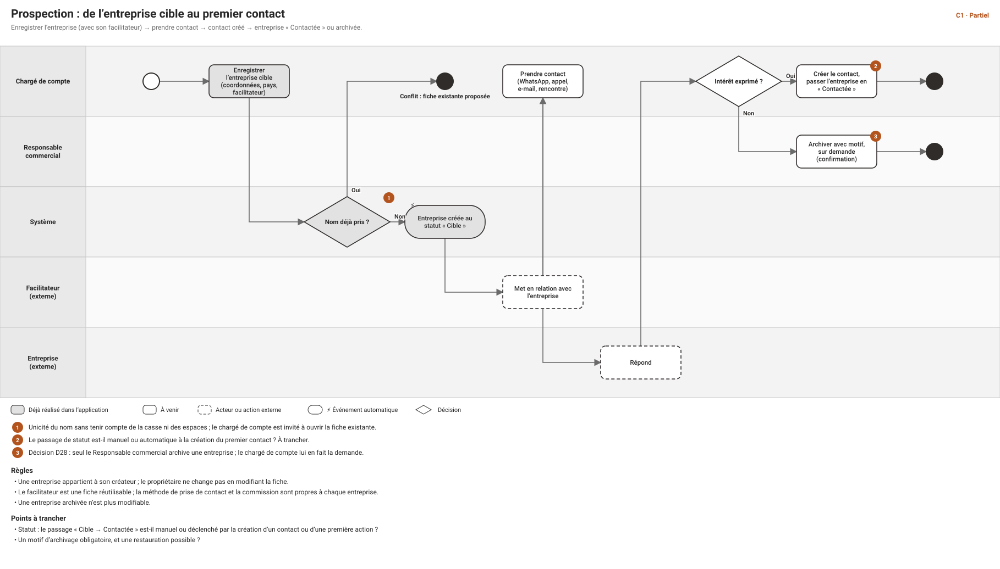
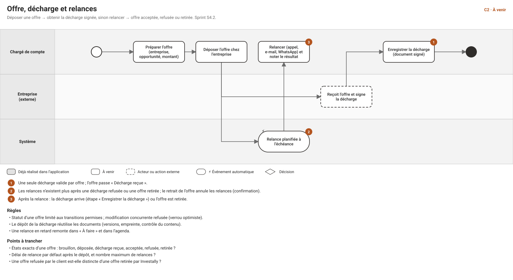
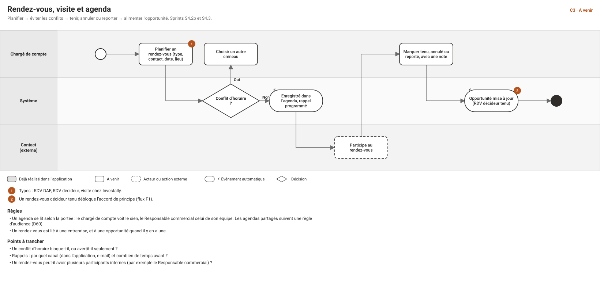
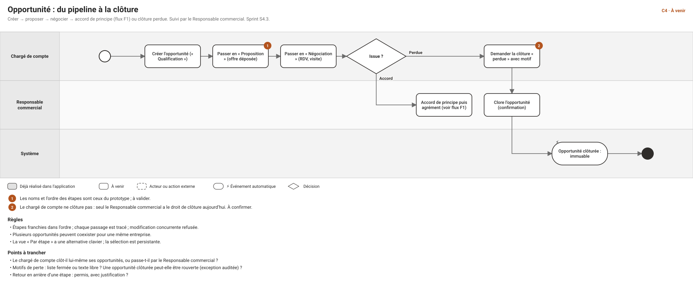
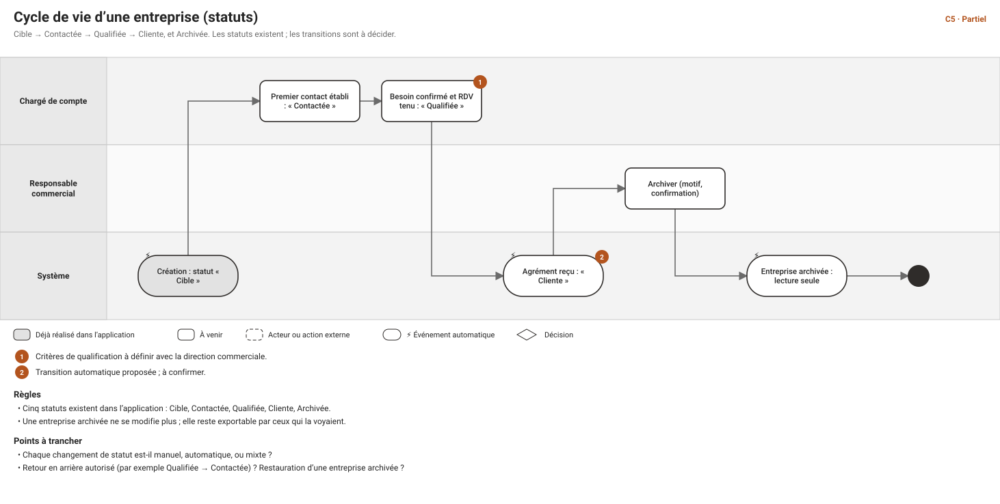

# Cas d'usage et workflows — module commercial (Business Development)

**Date** : 2026-10-30 · **Statut** : **proposition à valider** · **Suite de** : [CAS-D-USAGE-FLUX-TRANSVERSES.md](CAS-D-USAGE-FLUX-TRANSVERSES.md) · **Schémas** : [workflows/index.html](workflows/index.html) (flux C1 à C5) · **Écrans** : [wireframes](design/wireframe/index.html)

> Le module commercial couvre l'entreprise cible jusqu'à l'accord de principe : entreprises, contacts, offres, décharges, relances, rendez-vous, visites, opportunités. Les flux qui le traversent vers Investudy et la Finance sont dans le document des flux transverses (F1 à F7). **Rien n'est décidé ici** : les points « à trancher » sont ceux de la direction produit. Les étapes déjà réalisées sont signalées.

## 1. Droits actuels du module (rappel de la matrice)
| Objet | Chargé de compte | Responsable commercial | Direction, Support, Finance |
|---|---|---|---|
| Entreprise | lire, créer, modifier (Propre) ; **demande l'archivage** | + **archiver**, exporter (Équipe) | lecture (Tous) ; Direction exporte |
| Contact | lire, créer, modifier (Propre) | tout, supprimer compris (Équipe) | Direction et Support : lecture |
| Offre, décharge, relance, rendez-vous, visite | lire, créer, modifier, retirer ou annuler ou terminer (Propre) | tout (Équipe) | — |
| Opportunité | lire, créer, modifier, avancer, **clore « perdue »** (Propre) | lecture Tous ; créer, modifier, avancer, **clore « perdue » ou « gagnée »**, exporter (Équipe) | Direction : lecture, export |
| Ambassadeur | lire, créer (Propre) | lire Tous ; créer, modifier (Équipe) | Direction : lecture |
| Facilitateur, commission | facilitateur : lire, créer ; commission : **lire** (Propre) | facilitateur et commission : lire, créer ou définir (Équipe) | Direction et Finance : lecture (Tous) |

**Décision D28 (option C, 2026-10-30)** : le chargé de compte clôt lui-même ses opportunités « perdues » ; seul le Responsable commercial clôt une opportunité « gagnée » (elle déclenche l'accord de principe, l'agrément et la commission) et archive une entreprise. La matrice actuelle du code **n'est pas encore modifiée** : elle le sera avec S4.3, en remplaçant `bd.opportunity.close` par `bd.opportunity.close_lost` et `bd.opportunity.close_won`. Par ailleurs, le droit d'export existe encore à part (`bd.company.export`) alors que la règle retenue est « qui voit exporte » (à réaligner, D26).

## 2. Les cinq flux du module
Chaque schéma est dans `workflows/svg/`.

---

## 3. Entreprises

### CU-C-01 — Créer une entreprise cible *(réalisé)*
- **Acteur** : chargé de compte, Responsable commercial. **Écran** : 6. **Flux** : C1.
- **Scénario** : 1. « Nouvelle entreprise ». 2. Nom (obligatoire), pays, secteur, e-mail, téléphone. 3. Facilitateur facultatif (existant ou nouveau), méthode de contact, commission si le droit existe. 4. Enregistrer.
- **Variantes** : nom déjà pris (sans tenir compte de la casse) → conflit ; champs non conformes en surbrillance avec message ; facilitateur d'un collègue → « introuvable ».
- **Résultat** : statut « Cible », propriétaire = le créateur, audit. **Droits** : `bd.company.create`. 

### CU-C-02 — Rechercher, filtrer et sélectionner des entreprises *(partiellement réalisé)*
- **Acteur** : tout rôle qui lit les entreprises. **Écran** : 4.
- **Scénario** : recherche par nom ; sélection persistante de plusieurs lignes ; pagination. **Réalisé** : recherche, pagination, sélection. **À venir (lot « tableaux » de S4.1)** : filtres (statut, pays), tri, compteurs, colonnes au choix.
- **Droits** : la liste ne montre que la portée de l'utilisateur.

### CU-C-03 — Consulter la fiche d'une entreprise *(réalisé, 360° à venir)*
- **Écrans** : 5 (actuel), 10 (cible). **Réalisé** : identité, mise en relation, documents. **À venir** : contacts, offres, rendez-vous, opportunités, historique, par onglets visibles selon les droits.
- **Variantes** : entreprise hors portée → « introuvable », même message qu'un identifiant inexistant.

### CU-C-04 — Modifier une entreprise *(réalisé)*
- **Scénario** : « Modifier » ; fenêtre préremplie ; enregistrement avec la version lue (refus si quelqu'un a modifié entre-temps). Le propriétaire et le statut ne se modifient pas ici ; une entreprise archivée est en lecture seule.
- **Droits** : `bd.company.update` ; la commission : `bd.commission.manage` seulement (une modification par un chargé de compte la conserve).

### CU-C-05 — Changer le statut d'une entreprise *(à venir)*
- **Acteur** : chargé de compte (Contactée, Qualifiée), système (Cliente à l'agrément). **Flux** : C5.
- **Statuts** : Cible, Contactée, Qualifiée, Cliente, Archivée. **À trancher** : transitions manuelles ou automatiques, critères de « Qualifiée », retour en arrière.

### CU-C-06 — Archiver une entreprise *(à venir)*
- **Acteur** : Responsable commercial (décision D28). Le chargé de compte lui en **fait la demande** (message ou tâche). **Scénario** : « Archiver », motif, confirmation ; l'entreprise passe en lecture seule.
- **À trancher** : motif obligatoire ? restauration d'une entreprise archivée ? **Droits** : `bd.company.archive` (Équipe).

### CU-C-07 — Exporter la fiche d'une entreprise *(réalisé)*
- Voir le flux F5 : qui voit exporte, chaque export est tracé, le document ne contient que ce que l'utilisateur voit.

---

## 4. Contacts

### CU-C-10 — Créer un contact *(à venir, S4.1)*
- **Acteur** : chargé de compte. **Écran** : 12. **Scénario** : 1. Depuis la fiche entreprise ou la liste, « Nouveau contact ». 2. Entreprise, nom, prénom, fonction (DAF, décideur, autre), téléphone, e-mail. 3. Enregistrer.
- **Variantes** : **doublon probable** (même entreprise et même nom ou e-mail) → la fiche existante est proposée ; e-mail ou téléphone invalide → champ en surbrillance.
- **Règle** : un contact appartient à une entreprise. **À trancher** : champs exacts, fonctions possibles. **Droits** : `bd.contact.create` (Propre).

### CU-C-11 — Modifier un contact *(à venir)*
- Mêmes champs ; version lue contrôlée ; audit avant/après. **Droits** : `bd.contact.update`.

### CU-C-12 — Rattacher ou détacher un contact d'une entreprise *(à venir)*
- **Scénario** : déplacer un contact vers une autre entreprise de sa portée. **Règles** : les rendez-vous liés restent attachés à l'ancienne entreprise (à confirmer). **À trancher** : un contact peut-il appartenir à plusieurs entreprises ?

### CU-C-13 — Rechercher et consulter les contacts *(à venir)*
- **Écran** : 11. Liste filtrable par fonction et entreprise ; fiche du contact avec son historique d'actions. **Droits** : la portée de l'entreprise liée.

### CU-C-14 — Supprimer un contact *(à venir)*
- **Acteur** : Responsable commercial seulement (le chargé de compte n'a pas `bd.contact.delete`). Suppression logique avec confirmation ; refusée si le contact est lié à un rendez-vous ou un apprenant (à trancher).

---

## 5. Offres, décharges et relances *(flux C2, S4.2)*

### CU-C-20 — Préparer puis déposer une offre
- **Acteur** : chargé de compte. **Écrans** : 13, 14. **Scénario** : 1. « Nouvelle offre » liée à l'entreprise (et à une opportunité). 2. Montant, objet, pièces jointes. 3. « Déposer » : l'offre passe à « Déposée » et la date est enregistrée.
- **Variantes** : entreprise archivée → refus ; modification concurrente → refus (version).
- **Droits** : `bd.offer.create / update` (Propre). **À trancher** : états exacts (brouillon, déposée, décharge reçue, acceptée, refusée, retirée).

### CU-C-21 — Enregistrer la décharge signée
- **Scénario** : 1. Depuis l'offre, « Déposer la décharge » (écran 15). 2. Date de réception, reçue par, fichier signé (contrôle du contenu). 3. L'offre passe à « Décharge reçue ».
- **Règles** : **une seule décharge valide par offre** ; pas de décharge sur une offre retirée. **Droits** : `bd.receipt.create`. **État** : à venir.

### CU-C-22 — Planifier et effectuer une relance
- **Écran** : 16. **Scénario** : 1. Planification (automatique après le dépôt, ou manuelle) avec échéance et canal. 2. À l'échéance, la relance apparaît dans « À faire » et l'agenda. 3. Le chargé de compte la réalise (appel, e-mail, WhatsApp) et note le résultat : « Terminer ».
- **Règles** : **plus de relance après une décharge refusée ou une offre retirée** ; une relance en retard est signalée. **Droits** : `bd.followup.create / complete`. **À trancher** : délai par défaut, nombre maximum de relances.

### CU-C-23 — Retirer une offre
- **Scénario** : « Retirer l'offre » avec motif, confirmation ; les relances à venir sont annulées. **Droits** : `bd.offer.withdraw` (Propre). **Variantes** : offre déjà acceptée → refus.

---

## 6. Rendez-vous, visites et agenda *(flux C3, S4.2b et S4.3)*

### CU-C-30 — Planifier un rendez-vous
- **Écran** : 18. **Types** : RDV DAF, RDV décideur, visite chez Investally. **Scénario** : 1. Type, entreprise, contact, date, heure, lieu ou lien, opportunité liée. 2. Contrôle du conflit d'horaire. 3. Enregistrement dans l'agenda, rappel programmé.
- **Variantes** : conflit d'horaire (bloque ou avertit : à trancher) ; contact non rattaché à l'entreprise → refus. **Droits** : `bd.appointment.create`, `bd.visit.create` (Propre).

### CU-C-31 — Tenir, annuler ou reporter un rendez-vous
- **Scénario** : après le rendez-vous, le chargé de compte le marque « tenu » avec une note, ou « annulé » / « reporté » avec motif. **Règle** : un rendez-vous **décideur tenu** débloque l'accord de principe (flux F1). **Droits** : `bd.appointment.update / cancel`.

### CU-C-32 — Consulter l'agenda
- **Écran** : 17. Vues jour, semaine, mois ; filtre par type. **Droits** : le chargé de compte voit le sien ; le Responsable commercial celui de son équipe ; **les agendas partagés suivent une règle d'audience à définir (D60)**.

### CU-C-33 — Créer un événement depuis un objet
- **Scénario** : depuis une entreprise, une offre ou une opportunité, « Planifier » préremplit le lien. **État** : à venir (S4.2b).

---

## 7. Opportunités *(flux C4, S4.3)*

### CU-C-40 — Créer une opportunité
- **Acteur** : chargé de compte. **Écran** : 19. **Scénario** : entreprise, intitulé, montant estimé, source ; l'opportunité apparaît en « Qualification ». **Règle** : plusieurs opportunités simultanées par entreprise. **Droits** : `bd.opportunity.create` (Propre).

### CU-C-41 — Faire avancer une opportunité
- **Écrans** : 19 (cartes), 20 (par étape), 21 (fiche). **Scénario** : « Passer à l'étape suivante » ; en vue par étape, la carte se déplace ; **alternative clavier** par un menu « Déplacer vers… ».
- **Règles** : étapes dans l'ordre ; chaque passage tracé ; version contrôlée. Le passage à « Accord de principe » est soumis à la règle du rendez-vous décideur (F1). **Étapes du prototype** (à valider) : Qualification, Proposition, Négociation, Accord de principe, Agrément. **Droits** : `bd.opportunity.advance` (Propre).

### CU-C-42 — Clore une opportunité (perdue ou gagnée)
- **Acteur** : chargé de compte pour une opportunité **perdue** ; Responsable commercial pour une opportunité **gagnée** (décision D28). **Scénario** : « Clore », issue, motif (obligatoire pour une perte), confirmation. **Règle** : une opportunité clôturée est **immuable** et la clôture est tracée.
- **Droits** : `bd.opportunity.close_lost` (chargé de compte Propre, Responsable commercial Équipe) et `bd.opportunity.close_won` (Responsable commercial Équipe) : à créer avec S4.3.
- **À trancher** : motifs de perte (liste fermée ou texte libre) ; réouverture exceptionnelle.

### CU-C-43 — Suivre le pipeline
- **Acteur** : Responsable commercial, Direction. Vue de toutes les opportunités de l'équipe (écrans 20 et tableaux de bord 33 à 35) ; export tracé. **Droits** : lecture Tous pour le Responsable commercial et la Direction.

---

## 8. Facilitateurs et commissions (rappel)
- **Réutiliser un facilitateur existant** : choisi dans la liste de sa portée à la création ou à la modification d'une entreprise *(réalisé)*. 
- **Définir ou modifier une commission** : Responsable commercial *(réalisé)*. **Voir sa commission** : chargé de compte, sur ses entreprises *(réalisé)*. Le versement et son suivi sont dans le flux F3 *(à venir)*.

## 9. Permissions et données à prévoir
| Besoin | Proposition |
|---|---|
| Statut d'entreprise : changer le statut | utiliser `bd.company.update` ; à confirmer si un droit dédié est nécessaire |
| Doublons de contacts | règle de détection côté serveur (entreprise + nom ou e-mail) |
| Dérogation, agrément | voir le document des flux transverses (§ 3) |
| Export d'une liste d'entreprises ou d'opportunités | lecture + confirmation récente du second facteur (option C, à confirmer) |

## 10. Points à trancher, par ordre d'impact
1. **Statuts d'une entreprise** : transitions manuelles ou automatiques, critères de « Qualifiée » (C5, CU-C-05).
2. **Offre** : états exacts, délai et nombre de relances (C2).
3. **Rendez-vous** : un conflit d'horaire bloque-t-il ? rappels et canal (C3).
4. **Contact** : champs, fonctions possibles, appartenance à plusieurs entreprises (CU-C-10 et CU-C-12).
5. **Étapes d'opportunité** : noms, ordre, retour en arrière (C4).
6. **Agendas partagés** : audience (D60).

*Réglé le 2026-10-30 (D28) : qui archive et qui clôt.*

## 11. Suite proposée
Après validation : le module **Investudy** (catalogue, sessions, inscriptions, présences, certifications) en cas d'usage détaillés, puis **Reporting**, **Stocks**, **Finance**, **RH et fiscalité**.
