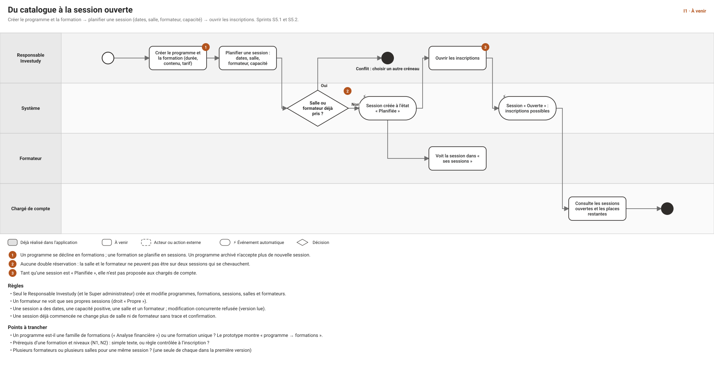
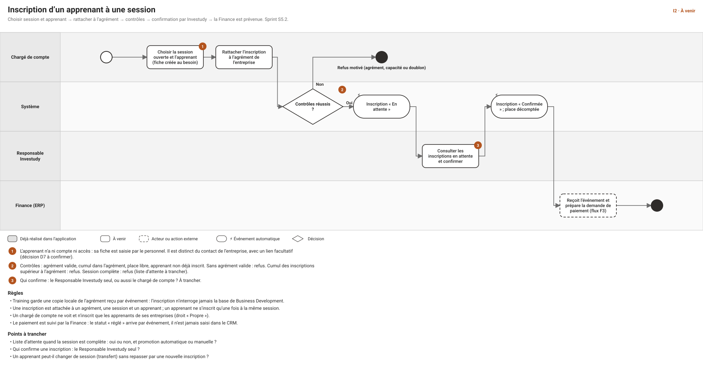
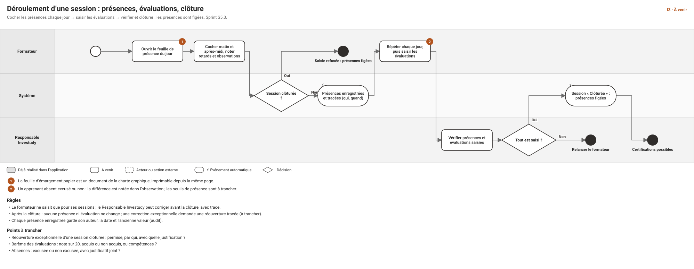
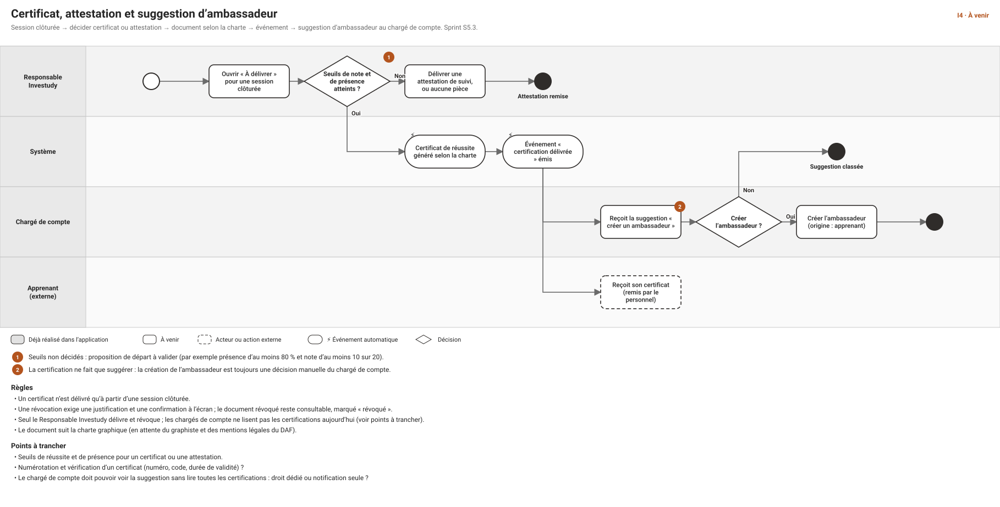
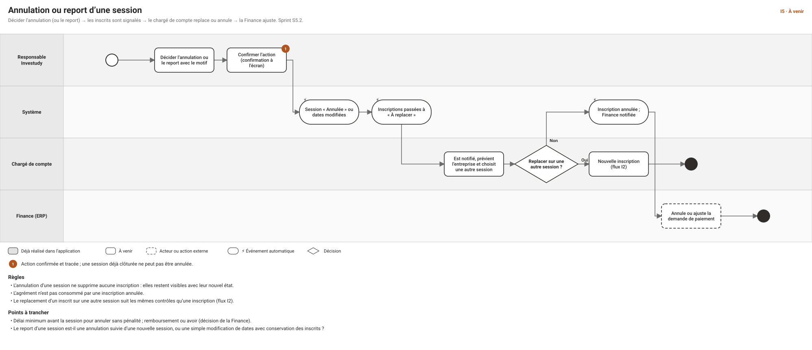

# Cas d'usage et workflows — module Investudy (formation)

**Date** : 2026-10-30 · **Statut** : **proposition à valider** · **Suite de** : [CAS-D-USAGE-MODULE-COMMERCIAL.md](CAS-D-USAGE-MODULE-COMMERCIAL.md) et [CAS-D-USAGE-FLUX-TRANSVERSES.md](CAS-D-USAGE-FLUX-TRANSVERSES.md) (flux F2) · **Schémas** : [workflows/index.html](workflows/index.html) (flux I1 à I5) · **Écrans** : [wireframes 26 à 32 et 36](design/wireframe/index.html)

> Le module Investudy commence là où le module commercial s'arrête : un **agrément** reçu. Il couvre le catalogue, les ressources (salles, formateurs), les sessions, les apprenants, les inscriptions, les présences, les évaluations et les certifications. **Rien n'est décidé ici** : les points « à trancher » sont ceux de la direction produit, et chaque valeur proposée est une hypothèse de travail. **Aucun écran n'est réalisé** : tout le module est à venir (sprints S5.1 à S5.3, tableau de bord en S6.2).

## 0. Vocabulaire
| Terme | Sens retenu |
|---|---|
| **Programme** | Famille de formations (ex. « Analyse financière »). Peut être archivé. |
| **Formation** | Contenu précis d'un programme (durée, objectifs, tarif de référence). |
| **Session** | Occurrence datée d'une formation, avec une salle, un formateur et une capacité. |
| **Apprenant** | Personne qui suit une formation. **N'a ni compte ni accès à l'application** : sa fiche est saisie par le personnel. Entité distincte du contact d'une entreprise, avec un lien facultatif (décision D7 à confirmer). |
| **Inscription** | Lien entre un apprenant, une session et un agrément. |
| **Agrément** | Promesse de paiement donnée par le client (module commercial). Investudy en garde une **copie locale** reçue par événement et refuse toute inscription sans agrément valide. |
| **Certificat / attestation** | Certificat de réussite, ou attestation de suivi. Le document suit la charte graphique. |

## 1. Droits actuels du module (rappel de la matrice RBAC)
| Objet | Chargé de compte | Responsable commercial | Responsable Investudy | Formateur | Direction, Support, Finance |
|---|---|---|---|---|---|
| Programme | lire | lire | **lire, créer, modifier, archiver** | lire | Direction : lire |
| Formation | — | — | **lire, créer, modifier** | — | Direction : lire |
| Session | lire | lire | **tout** (créer, modifier, annuler, clôturer) | lire **ses sessions** | Direction, Support, Finance : lire |
| Salle, formateur (ressources) | — | — | **gérer** | lire les salles | — |
| Apprenant | lire, créer, modifier **(Propre : ses entreprises)** | lire (Équipe) | **tout**, supprimer compris | lire (ses sessions) | Direction, Support : lire |
| Inscription | lire, **créer** (Propre) | lire (Équipe) | **tout** (créer, modifier, annuler) | — | Direction, Support, Finance : lire |
| Présence, évaluation | — | — | **lire, saisir** | **lire, saisir (ses sessions)** | Direction : lire |
| Certification | **— (aucun droit)** | lire (Équipe) | **lire, délivrer, révoquer** | lire (ses sessions) | Direction : lire |

Le Super administrateur détient tous ces droits. Les détails sont dans [RBAC.md](RBAC.md).

## 2. Les cinq flux du module
Chaque schéma est dans `workflows/svg/`.

---

## 3. Catalogue : programmes et formations *(flux I1, S5.1, écran 26)*

### CU-I-01 — Créer un programme
- **Acteur** : Responsable Investudy. **Scénario** : 1. « Nouveau programme ». 2. Nom (obligatoire, unique), description, public visé. 3. Enregistrer : le programme est « Actif ».
- **Variantes** : nom déjà pris → conflit ; champs non conformes en surbrillance avec message. **Droits** : `training.program.create`. **État** : à venir.

### CU-I-02 — Ajouter une formation à un programme
- **Scénario** : dans le programme, « Nouvelle formation » : intitulé, durée en jours, objectifs, prérequis (texte), tarif de référence (FCFA par défaut), documents (support de cours). **Règle** : une formation appartient à un seul programme. **Droits** : `training.training.create / update`.
- **À trancher** : les prérequis sont-ils un simple texte ou une règle contrôlée à l'inscription ?

### CU-I-03 — Modifier ou archiver un programme
- **Scénario** : modification avec version lue contrôlée ; archivage avec confirmation. **Règle** : un programme archivé n'accepte plus de nouvelle session ; les sessions existantes se poursuivent. **Droits** : `training.program.update / archive`.

### CU-I-04 — Consulter le catalogue
- **Acteur** : Responsable Investudy, Formateur, Chargé de compte, Responsable commercial, Direction. **Scénario** : cartes ou liste des programmes, recherche, filtre actif ou archivé ; détail d'une formation avec ses prochaines sessions. **Droits** : `training.program.read`.
- **Note** : l'affichage en **cartes** de l'écran 26 est prévu pour le catalogue ; le choix cartes ou tableau pour les entreprises est traité à part (décision D30).

---

## 4. Ressources : salles et formateurs *(S5.1, écran 26)*

### CU-I-10 — Gérer les salles
- **Acteur** : Responsable Investudy. **Scénario** : liste des salles (nom, capacité, équipements, active ou non) ; création, modification, désactivation. **Règle** : une salle désactivée n'est plus proposée à la planification mais reste visible sur les sessions passées. **Droits** : `training.room.manage` ; lecture : `training.room.read` (le formateur aussi).

### CU-I-11 — Gérer les formateurs
- **Acteur** : Responsable Investudy. **Scénario** : fiche formateur (nom, spécialités, coordonnées, **lien vers son compte utilisateur s'il en a un**). **Règle** : pour qu'un formateur voie « ses sessions » et saisisse ses présences, sa fiche doit être **rattachée à un compte au rôle Formateur**. **Droits** : `training.trainer.manage / read`.
- **À trancher** : un formateur externe sans compte est-il autorisé (la saisie est alors faite par le Responsable Investudy) ?

### CU-I-12 — Vérifier la disponibilité
- **Scénario** : à la planification, le système indique les salles et formateurs libres sur les dates choisies. **Règle** : voir CU-I-20. **État** : à venir.

---

## 5. Sessions *(flux I1 et I5, S5.2, écrans 27 et 28)*

### CU-I-20 — Planifier une session
- **Acteur** : Responsable Investudy. **Écran** : 27. **Scénario** : 1. « Nouvelle session ». 2. Formation, dates de début et de fin, salle, formateur, capacité. 3. Le système contrôle le chevauchement. 4. La session est créée « Planifiée ».
- **Variantes** : salle ou formateur déjà pris sur ces dates → **refus**, avec la session en conflit ; capacité supérieure à celle de la salle → avertissement (à trancher : bloquant ?) ; dates dans le passé → refus. **Droits** : `training.session.create`.

### CU-I-21 — Ouvrir les inscriptions
- **Scénario** : « Ouvrir » : la session passe « Ouverte » et devient visible des chargés de compte, avec les places restantes. **Règle** : ouverte seulement si salle, formateur et capacité sont renseignés. **Droits** : `training.session.update`.

### CU-I-22 — Modifier une session
- **Règles** : version lue contrôlée ; une session **commencée** ne change plus de salle ni de formateur sans confirmation et trace ; une **réduction de capacité** en dessous du nombre d'inscrits confirmés est refusée.

### CU-I-23 — Annuler ou reporter une session *(flux I5)*
- **Acteur** : Responsable Investudy. **Scénario** : 1. « Annuler » ou « Modifier les dates », motif obligatoire. 2. Confirmation à l'écran. 3. Les inscriptions passent à « À replacer » ; les chargés de compte concernés sont notifiés. 4. Chaque chargé de compte replace l'inscrit sur une autre session (nouveau contrôle, flux I2) ou l'annule ; la Finance est prévenue pour ajuster la demande de paiement.
- **Règles** : une session clôturée ne s'annule pas ; l'annulation **ne supprime** aucune inscription ; l'agrément n'est pas consommé par une inscription annulée. **Droits** : `training.session.cancel`.
- **À trancher** : le report est-il une annulation suivie d'une nouvelle session, ou une modification de dates qui conserve les inscrits ? Délai minimal et conséquences financières (décision de la Finance).

### CU-I-24 — Consulter le calendrier et la liste des sessions
- **Écran** : 27. **Scénario** : liste filtrable (état, salle, formateur, période) et vue calendrier ; compteur « inscrits / capacité ». **Droits** : `training.session.read` (le formateur ne voit que les siennes, **Propre**).

### CU-I-25 — Consulter le détail d'une session
- **Écran** : 28. **Scénario** : indicateurs (inscrits, présence moyenne, évaluations saisies, agrément) et onglets Inscrits, Présences, Évaluations, Documents. **Droits** : selon l'onglet (voir § 1).

### CU-I-26 — Clôturer une session *(flux I3)*
- **Acteur** : Responsable Investudy. **Scénario** : vérifier les présences et évaluations saisies, puis « Clôturer » (confirmation). **Résultat** : les présences et évaluations sont **figées** ; la session ouvre droit aux certifications ; événement « session clôturée ». **Droits** : `training.session.close`.
- **À trancher** : réouverture exceptionnelle (qui, motif, trace).

---

## 6. Apprenants *(S5.2, écran 29)*

### CU-I-30 — Créer la fiche d'un apprenant
- **Acteur** : chargé de compte (pour ses entreprises), Responsable Investudy. **Scénario** : nom, prénom, entreprise, e-mail et téléphone (facultatifs, contrôlés), **lien facultatif vers un contact** de l'entreprise. **Variantes** : **doublon probable** (même entreprise et même nom ou e-mail) signalé avec « Créer quand même », comme pour les contacts. **Droits** : `training.learner.create` (Propre pour le chargé de compte).

### CU-I-31 — Modifier un apprenant
- **Règles** : version lue contrôlée, audit avant/après ; l'entreprise ne change pas (ou seulement par le Responsable Investudy, à trancher). **Droits** : `training.learner.update`.

### CU-I-32 — Consulter les apprenants et leur parcours
- **Scénario** : liste filtrable par entreprise ; fiche avec formations suivies, présences, certifications. **Droits** : portée de l'entreprise pour le chargé de compte (Propre), Équipe pour le Responsable commercial, **Tous** pour Investudy, Direction et Support ; le formateur ne voit que les apprenants de ses sessions.

### CU-I-33 — Supprimer un apprenant
- **Acteur** : Responsable Investudy seulement (`training.learner.delete`). Suppression logique avec confirmation ; **refusée** si l'apprenant a une inscription confirmée ou une certification. **Point sensible** : durée de conservation des données personnelles des apprenants (D11, même sujet que D55 et D65).

---

## 7. Inscriptions *(flux I2, S5.2, écrans 28 et 30)*

### CU-I-40 — Inscrire un apprenant à une session
- **Acteur** : chargé de compte. **Écran** : 30. **Préconditions** : session « Ouverte » ; agrément valide pour l'entreprise.
- **Scénario** : 1. Session, apprenant (créé au besoin), agrément, prise en charge, commentaire. 2. Le système vérifie : agrément valide, **cumul des inscriptions dans le montant ou le nombre de places de l'agrément**, place libre, apprenant non déjà inscrit. 3. L'inscription est créée « En attente de confirmation ».
- **Variantes** : sans agrément valide → refus ; cumul supérieur → refus ; session complète → refus (liste d'attente à trancher). **Droits** : `training.enrollment.create` (Propre).

### CU-I-41 — Confirmer une inscription
- **Acteur** : Responsable Investudy. **Scénario** : file des inscriptions en attente (écran 28), « Confirmer » ; la place est décomptée ; événement « inscription confirmée » vers la Finance (demande de paiement, flux F3). **Droits** : `training.enrollment.update`.
- **À trancher** : le chargé de compte peut-il confirmer lui-même ? (proposition : non, pour garder un contrôle de capacité).

### CU-I-42 — Annuler une inscription
- **Scénario** : « Annuler » avec motif et confirmation ; la place est libérée, l'agrément n'est plus consommé, la Finance est prévenue. **Règle** : une inscription d'une session **clôturée** ne s'annule pas. **Droits** : `training.enrollment.cancel`.

### CU-I-43 — Replacer un inscrit sur une autre session
- **Scénario** : depuis une inscription « À replacer » (flux I5) ou à la demande ; mêmes contrôles qu'à CU-I-40 ; l'ancienne inscription est annulée avec le lien vers la nouvelle. **À trancher** : transfert direct sans nouvelle inscription ?

### CU-I-44 — Gérer la liste d'attente *(si retenue)*
- **Scénario** : à session complète, l'inscription est mise « En liste d'attente » avec un rang ; quand une place se libère, le Responsable Investudy (ou le système) promeut le premier rang. **À trancher** : liste d'attente oui ou non, promotion manuelle ou automatique.

### CU-I-45 — Suivre l'état de paiement
- **Scénario** : l'état « réglé » d'une inscription **arrive de la Finance par événement** et s'affiche en lecture seule dans la session et la fiche entreprise. **Règle** : jamais saisi dans le CRM.

---

## 8. Présences et évaluations *(flux I3, S5.3, écran 31)*

### CU-I-50 — Enregistrer les présences du jour
- **Acteur** : formateur (ses sessions), Responsable Investudy. **Scénario** : 1. Feuille du jour (écran 31). 2. Pour chaque inscrit confirmé : matin, après-midi, retard, observation. 3. Enregistrer.
- **Règles** : session clôturée → **saisie refusée** ; seuls les inscrits **confirmés** apparaissent ; chaque saisie garde auteur, date et ancienne valeur. **Droits** : `training.attendance.record` (Propre pour le formateur).

### CU-I-51 — Imprimer la feuille d'émargement
- **Scénario** : « Imprimer » produit un document de la charte, signé à la main par les participants, puis **numérisé et joint à la session** (module Documents). **État** : à venir ; dépend de la charte et du rendu PDF (D61).

### CU-I-52 — Saisir les évaluations
- **Acteur** : formateur, Responsable Investudy. **Scénario** : à la fin de la formation, une évaluation par apprenant (note ou résultat) et un commentaire. **Règle** : figée à la clôture. **Droits** : `training.evaluation.record`. **À trancher** : barème.

### CU-I-53 — Consulter présences et évaluations
- **Droits** : `training.attendance.read`, `training.evaluation.read` (Direction : tous ; formateur : ses sessions).

### CU-I-54 — Corriger une saisie
- **Avant la clôture** : le Responsable Investudy ou le formateur corrige, avec trace. **Après la clôture** : réouverture exceptionnelle tracée (à trancher).

---

## 9. Certifications et attestations *(flux I4, S5.3, écran 32)*

### CU-I-60 — Délivrer un certificat ou une attestation
- **Acteur** : Responsable Investudy. **Préconditions** : session clôturée. **Scénario** : 1. Onglet « À délivrer ». 2. Pour chaque apprenant : **certificat de réussite** (seuils atteints), **attestation de suivi**, ou rien. 3. Le document est généré selon la charte. 4. Événement « certification délivrée ».
- **Règle** : seuils proposés pour démarrer (**à valider**) : présence d'au moins 80 % et note d'au moins 10 sur 20 pour un certificat ; présence d'au moins 80 % seulement pour une attestation. **Droits** : `training.certification.issue`.

### CU-I-61 — Révoquer une certification
- **Scénario** : « Révoquer » avec **justification obligatoire** et confirmation. **Règle** : le document reste consultable, marqué « révoqué » ; événement « certification révoquée ». **Droits** : `training.certification.revoke`.

### CU-I-62 — Recevoir la suggestion d'ambassadeur
- **Acteur** : chargé de compte. **Scénario** : après une certification délivrée, il reçoit une suggestion (écran 24) ; il décide **manuellement** de créer l'ambassadeur (origine : apprenant). **Règle** : jamais automatique.
- **Constat** : le chargé de compte **n'a aucun droit de lecture sur les certifications** dans la matrice actuelle. Il lui faut soit un droit de lecture limité aux apprenants de ses entreprises (`training.certification.read`, Propre), soit une suggestion portée par l'événement seul, sans accès à la certification. À trancher.

### CU-I-63 — Consulter les certifications
- **Droits** : Responsable Investudy, Direction : tous ; Responsable commercial : son équipe ; formateur : ses sessions.

### CU-I-64 — Vérifier un certificat
- **À trancher** : numéro unique, code de vérification et page publique de contrôle (hors périmètre actuel : l'application n'a aucun accès externe).

---

## 10. Pilotage *(S6.2, écran 36)*

### CU-I-70 — Tableau de bord Investudy
- **Acteur** : Responsable Investudy, Direction (`reporting.dashboard.training`). **Contenu proposé** : taux de remplissage des sessions à venir, inscriptions en attente, taux de présence, certificats délivrés par mois, inscriptions par entreprise. **État** : à venir (S6.2) ; les chiffres viennent des mêmes données que les écrans.

### CU-I-71 — Exporter une liste
- **Scénario** : export des inscrits d'une session ou de la liste des apprenants, **tracé** comme tout export, limité à la portée de l'utilisateur ; confirmation récente du second facteur (option C, à confirmer). **Droits** : à créer (`training.*.export`).

---

## 11. Événements échangés
| Sens | Événement | Effet |
|---|---|---|
| **Reçu** du module commercial | Agrément accordé, expiré, annulé | Copie locale de l'agrément ; les inscriptions non réglées d'un agrément expiré ou annulé sont **signalées** |
| **Émis** vers la Finance | Inscription confirmée / annulée | Demande de paiement préparée / ajustée (flux F3) |
| **Émis** vers la Finance | Session annulée | Ajustement des demandes de paiement |
| **Émis** vers le module commercial | Certification délivrée / révoquée | Suggestion d'ambassadeur au chargé de compte |
| **Émis** vers le reporting | Session clôturée | Mise à jour des indicateurs |

## 12. Permissions et données à prévoir
| Besoin | Proposition |
|---|---|
| Lecture des suggestions d'ambassadeur par le chargé de compte | `training.certification.read` limité aux apprenants de ses entreprises, ou notification seule |
| Réouverture d'une session clôturée | permission dédiée `training.session.reopen` (Responsable Investudy), avec justification |
| Liste d'attente | statut d'inscription supplémentaire ; pas de permission nouvelle |
| Rattacher un formateur à un compte | champ « compte utilisateur » sur la fiche formateur |
| Export des listes | permission d'export par ressource, comme pour les entreprises |
| Documents (émargement, certificats) | module Documents existant, rattaché à la session ou à la certification |
| Entités de données | programme, formation, session, salle, formateur, apprenant, inscription, présence, évaluation, certification (à modéliser en S5.1) |

## 13. Points à trancher, par ordre d'impact
1. **Confirmation des inscriptions** : le Responsable Investudy seul ? (I2)
2. **Liste d'attente** quand la session est complète : oui ou non, promotion manuelle ou automatique (I2).
3. **Seuils de certification** : présence, note, et différence certificat ou attestation (I4).
4. **Apprenant et contact** : entité distincte avec lien facultatif ? (D7)
5. **Agrément** : places ou somme globale, expiration et effet sur les inscriptions (D1, F1).
6. **Barème des évaluations** : note sur 20, acquis ou non, compétences (I3).
7. **Annulation et report** : modifier les dates ou annuler puis recréer ; délais et conséquences financières (I5).
8. **Réouverture** d'une session clôturée (I3).
9. **Visibilité des certifications pour le chargé de compte** (I4, CU-I-62).
10. **Conservation des données des apprenants** : durée et base légale (D11, D65).
11. **Numérotation et vérification** des certificats (CU-I-64).

## 14. Découpage proposé
| Sprint | Contenu |
|---|---|
| **S5.1** | Catalogue (programmes, formations), salles, formateurs ; modèle de données Investudy |
| **S5.2** | Sessions, apprenants, inscriptions (avec les contrôles d'agrément et de capacité), annulation et report ; réception des événements d'agrément |
| **S5.3** | Présences, évaluations, clôture, certifications et attestations ; émission des événements |
| **S6.2** | Tableau de bord Investudy |

## 15. Suite proposée
Après validation : retour au **module commercial** pour S4.2 (offres, décharges, relances), puis S4.3 (opportunités) qui produit l'agrément attendu par Investudy ; ensuite Reporting, Stocks, Finance, RH et fiscalité.
