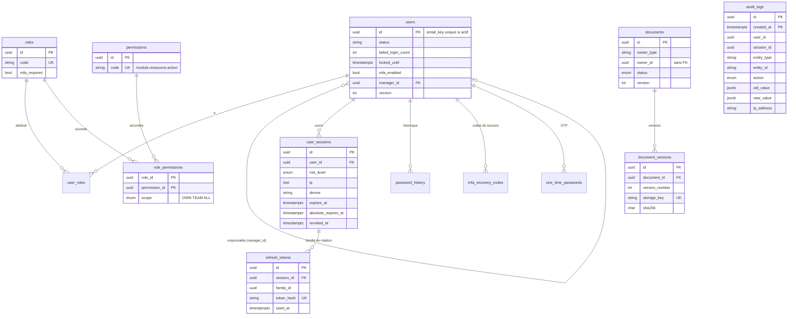
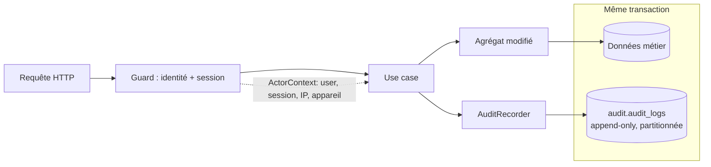
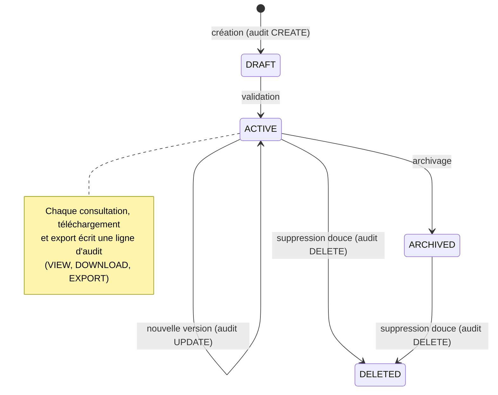

# Modèle de données Core — CRM (Sprint 2)

> Source de vérité : `apps/crm-api/prisma/schema.prisma` + migrations SQL. Ce document l'explique ; en cas de divergence, le schéma prévaut.
> Périmètre : schémas `iam`, `audit`, `docs` + `bd.companies` (tranche S1). Les autres contextes arrivent aux sprints S4 et S5.

## 1. Principes
- **Un schéma PostgreSQL par contexte** ; **aucune clé étrangère entre schémas** (vérifié par un test d'intégration). Les références inter-contextes sont de simples UUID (`user_id`, `owner_id`…).
- Identifiants **UUID v7** générés par l'application ; dates en `timestamptz`, session forcée en UTC ; verrou optimiste (`version`) sur les agrégats modifiables.
- **Soft delete** (`deleted_at`) sur utilisateurs, entreprises, documents ; unicité sur les enregistrements non supprimés par **index partiel**.
- Contraintes d'intégrité **dans la base** (CHECK) en plus des règles du domaine : défense en profondeur.
- Secrets : seuls des **hachages** (mot de passe, jeton de rafraîchissement, codes de secours, OTP) ou des **valeurs chiffrées** (secret TOTP) sont stockés.

### Évolutions de S3.3
- `bd.companies.owner_user_id` (UUID, **sans clé étrangère**, indexé) : propriétaire d'une entreprise, base de la portée Propre / Équipe / Tous. Les entreprises antérieures n'en ont pas (visibles de la portée Tous seulement).
- `iam.user_invitations` : `id`, `user_id` (FK avec cascade), `token_hash` (SHA-256 hexadécimal, unique), `created_by`, `created_at`, `expires_at` (> création), `used_at`, `revoked_at`.
- Évolutions de S3.2 : `iam.users.mfa_last_used_step`, `iam.user_sessions.mfa_verified_at`.

## 2. ERD

```
 iam                                                                   docs
 ┌─────────┐ 1   n ┌───────────┐ n   1 ┌──────┐ 1   n ┌────────────────┐ n   1 ┌────────────┐
 │  users  ├───────┤ user_roles├───────┤ roles├───────┤role_permissions├───────┤ permissions│
 └─┬─┬─┬─┬─┘       └───────────┘       └──────┘       │  scope O/T/A   │       └────────────┘
   │ │ │ │ manager_id ──► users                       └────────────────┘
   │ │ │ └──< password_history
   │ │ └────< mfa_recovery_codes                      ┌───────────┐ 1   n ┌───────────────────┐
   │ └──────< one_time_passwords                      │ documents ├───────┤ document_versions │
   └────────< user_sessions ──< refresh_tokens        └───────────┘       └───────────────────┘
   login_attempts (sans FK : inclut les e-mails inconnus)
                                                       audit
                                                       ┌──────────────────────────────┐
                                                       │ audit_logs  (partitionnée    │
                                                       │ par mois, append-only)       │
                                                       └──────────────────────────────┘
```



**Explication.** Le contexte `iam` porte l'identité, les rôles/permissions et le cycle de vie des sessions. `docs` stocke les métadonnées des fichiers (le contenu est en stockage objet) et se rattache à n'importe quel objet métier par `(owner_type, owner_id)`. `audit` est écrit par tous les contextes et ne dépend d'aucun.
**Risques.** (1) L'absence de FK inter-contextes impose de vérifier l'existence d'un `owner_id` dans le use case. (2) `login_attempts` et `audit_logs` grossissent vite : rétention à définir (SECURITY.md §7). (3) Le modèle de portée Équipe repose sur un seul niveau hiérarchique.

## 3. Diagramme d'audit

```
  Requête HTTP ──► Guard (identité, session) ──► Use case ──► Agrégat ──► Repository ─┐
        │                                            │                                  │ même transaction
        │  ActorContext (userId, sessionId, IP,      ▼                                  ▼
        └─ appareil) ──────────────────────────► AuditRecorder ───────► audit.audit_logs (append-only)
                                                                                   │
                                          lecture : audit.log.read ◄───────────────┘
```



**Explication.** Qui (userId, sessionId), quoi (action), quand (createdAt, UTC), d'où (IP, appareil), sur quelle donnée (entityType, entityId), valeurs avant/après (JSON, champs sensibles masqués). L'écriture d'audit et la modification métier sont **atomiques** (testé : si l'audit échoue, la donnée n'est pas enregistrée).
**Risques.** (1) Un propriétaire de table peut désactiver le déclencheur : le rôle applicatif sans droits `UPDATE/DELETE` est requis en production (S7). (2) Une ligne tombée dans la partition de secours signale des partitions mensuelles non créées : alerte à mettre en place. (3) Les actions refusées (403) doivent aussi être auditées, hors de la transaction métier annulée.

## 4. Diagramme de traçabilité documentaire

```
  Création ─► docs.documents + document_versions (SHA-256, clé de stockage aléatoire) ─► audit CREATE
  Consultation ─► contrôle RBAC (docs.document.read + portée) ─► audit VIEW
  Modification ─► nouvelle version (l'ancienne reste) ─► audit UPDATE (ancien/nouveau n° de version)
  Téléchargement ─► docs.document.download ─► audit DOWNLOAD
  Export ─► docs.document.export (step-up MFA) ─► audit EXPORT
  Suppression ─► soft delete (status DELETED, deleted_by) ─► audit DELETE ; contenu conservé selon la rétention
```



**Explication.** Le cycle de vie du document est dans `docs.documents.status` ; l'**historique d'accès** n'est pas dupliqué : il se lit dans `audit.audit_logs` filtré sur `entity_type = 'Document'`. Une seule source de vérité.
**Risques.** (1) La consultation génère beaucoup de lignes d'audit : volume à surveiller (partitionnement prévu). (2) Un fichier servi dans l'origine de l'application permettrait du XSS : téléchargement forcé (`attachment`) et type MIME contrôlé (SECURITY.md §6). (3) La suppression douce conserve le contenu : politique de purge à valider avec le juridique.
