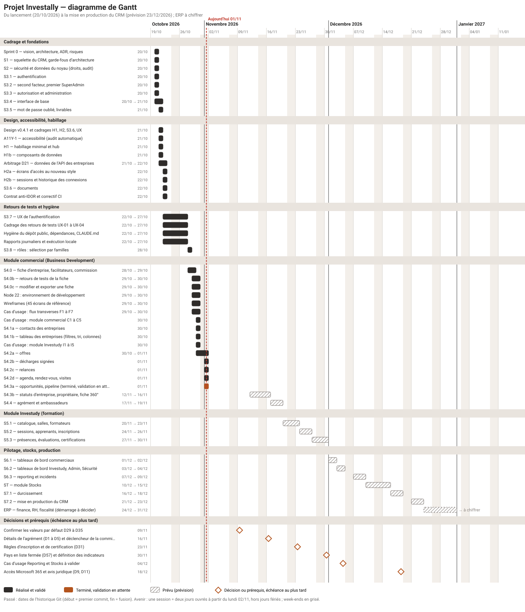

# Diagramme de Gantt du projet

**Date** : 01/11/2026 · **Statut** : **état réel jusqu'à aujourd'hui, prévisions au-delà (à valider)** · **Lié à** : [reste à faire sur le développement](RESTE-A-FAIRE-DEVELOPPEMENT.md) · **Généré par** `docs/gantt/build.mjs`

> Le passé vient de l'historique Git : le début d'un lot est son premier commit, la fin est sa fusion dans la branche principale. L'avenir est une **prévision**, pas un engagement : elle dépend de vos validations, des décisions listées en bas du schéma et des prérequis externes (Microsoft 365, avis juridique).

## Résumé
| Repère | Date |
|---|---|
| **Lancement** (Sprint 0) | 20/10/2026 |
| Premier jalon de code validé (S1 à S3.3) | 20/10/2026 (le même jour) |
| Fin de la fondation et du design | 22/10/2026 |
| Module commercial : dernier lot validé (S4.4c, commissions à verser) | 05/11/2026 |
| Lots réalisés et validés au 01/11/2026 | 45 (dont 36 étiquetés) |
| **Prochaine session** | S5 (Investudy), après vos réponses sur FD-9 et FD-11 |
| Fin du module commercial | **Terminé le 05/11/2026** (S4.4c validé) |
| Fin d'Investudy (prévision) | 30/11/2026 |
| **Mise en production du CRM, prévision prudente** | **23/12/2026** |
| Mise en production du CRM au rythme observé la semaine du 28/10 (un lot par jour ouvré) | vers le 26/11/2026 |
| ERP (finance, RH, fiscalité) | Démarrage à décider, non chiffré |

## Hypothèses de la prévision
1. **Une session = deux jours ouvrés**, soit le double du rythme observé : elle tient compte des validations, des retours de tests (S4.0 en a demandé deux : S4.0b et S4.0c) et des décisions à obtenir.
2. Départ le **lundi 02/11/2026** ; aucun jour férié ni congé n'est retiré (les fêtes de fin d'année pourraient décaler S7.1 et S7.2).
3. Les tailles par lot sont celles de [reste à faire](RESTE-A-FAIRE-DEVELOPPEMENT.md) : ordres de grandeur.
4. Les **échéances de décision** (losanges orange) sont les dates **au plus tard** : une réponse tardive décale le lot qu'elle bloque.
5. S7.2 exige l'accès Microsoft 365, l'avis juridique et l'analyse antivirus des documents ; **sans eux, la mise en production ne peut pas avoir lieu**, quelle que soit l'avancée du code.

## Détail par phase
### Cadrage et fondations
| Lot | Début | Fin | État | Étiquette |
|---|---|---|---|---|
| Sprint 0 — vision, architecture, ADR, risques | 20/10/2026 | 20/10/2026 | Validé | — |
| S1 — squelette du CRM, garde-fous d’architecture | 20/10/2026 | 20/10/2026 | Validé | `s1-validated` |
| S2 — sécurité et données du noyau (droits, audit) | 20/10/2026 | 20/10/2026 | Validé | `s2-validated` |
| S3.1 — authentification | 20/10/2026 | 20/10/2026 | Validé | `s3-1-validated` |
| S3.2 — second facteur, premier SuperAdmin | 20/10/2026 | 20/10/2026 | Validé | `s3-2-validated` |
| S3.3 — autorisation et administration | 20/10/2026 | 20/10/2026 | Validé | `s3-3-validated` |
| S3.4 — interface de base | 20/10/2026 | 21/10/2026 | Validé | `s3-4-validated` |
| S3.5 — mot de passe oublié, livrables | 21/10/2026 | 21/10/2026 | Validé | `s3-5-validated` |

### Design, accessibilité, habillage
| Lot | Début | Fin | État | Étiquette |
|---|---|---|---|---|
| Design v0.4.1 et cadrages H1, H2, S3.6, UX | 21/10/2026 | 21/10/2026 | Validé | `design-v0.4.1, cadrages-validated` |
| A11Y-1 — accessibilité (audit automatique) | 21/10/2026 | 21/10/2026 | Validé | `a11y-1-validated` |
| H1 — habillage minimal et hub | 21/10/2026 | 21/10/2026 | Validé | `h1-validated` |
| H1b — composants de données | 21/10/2026 | 21/10/2026 | Validé | `h1b-validated` |
| Arbitrage D21 — données de l’API des entreprises | 21/10/2026 | 22/10/2026 | Validé | `d21-validated` |
| H2a — écrans d’accès au nouveau style | 22/10/2026 | 22/10/2026 | Validé | `h2a-validated` |
| H2b — sessions et historique des connexions | 22/10/2026 | 22/10/2026 | Validé | `h2b-validated` |
| S3.6 — documents | 22/10/2026 | 22/10/2026 | Validé | `s3-6-validated` |
| Contrat anti-IDOR et correctif CI | 22/10/2026 | 22/10/2026 | Validé | `idor-validated` |

### Retours de tests et hygiène
| Lot | Début | Fin | État | Étiquette |
|---|---|---|---|---|
| S3.7 — UX de l’authentification | 22/10/2026 | 27/10/2026 | Validé | `s3-7-validated` |
| Cadrage des retours de tests UX-01 à UX-04 | 22/10/2026 | 27/10/2026 | Validé | — |
| Hygiène du dépôt public, dépendances, CLAUDE.md | 22/10/2026 | 27/10/2026 | Validé | — |
| Rapports journaliers et exécution locale | 22/10/2026 | 27/10/2026 | Validé | — |
| S3.8 — rôles : sélection par familles | 28/10/2026 | 28/10/2026 | Validé | `s3-8-validated` |

### Module commercial (Business Development)
| Lot | Début | Fin | État | Étiquette |
|---|---|---|---|---|
| S4.0 — fiche d’entreprise, facilitateurs, commission | 28/10/2026 | 29/10/2026 | Validé | `s4-0-validated` |
| S4.0b — retours de tests de la fiche | 29/10/2026 | 30/10/2026 | Validé | `s4-0b-validated` |
| S4.0c — modifier et exporter une fiche | 29/10/2026 | 30/10/2026 | Validé | `s4-0c-validated` |
| Node 22 : environnement de développement | 29/10/2026 | 30/10/2026 | Validé | — |
| Wireframes (45 écrans de référence) | 29/10/2026 | 30/10/2026 | Validé | — |
| Cas d’usage : flux transverses F1 à F7 | 29/10/2026 | 30/10/2026 | Validé | — |
| Cas d’usage : module commercial C1 à C5 | 30/10/2026 | 30/10/2026 | Validé | — |
| S4.1a — contacts des entreprises | 30/10/2026 | 30/10/2026 | Validé | `s4-1a-validated` |
| S4.1b — tableau des entreprises (filtres, tri, colonnes) | 30/10/2026 | 30/10/2026 | Validé | `s4-1b-validated` |
| Cas d’usage : module Investudy I1 à I5 | 30/10/2026 | 30/10/2026 | Validé | — |
| S4.2a — offres | 30/10/2026 | 01/11/2026 | Validé | `s4-2a-validated` |
| S4.2b — décharges signées | 01/11/2026 | 01/11/2026 | Validé | `s4-2b-validated` |
| S4.2c — relances | 01/11/2026 | 01/11/2026 | Validé | `s4-2c-validated` |
| S4.2d — agenda, rendez-vous, visites | 01/11/2026 | 01/11/2026 | Validé | `s4-2d-validated` |
| S4.3a — opportunités, pipeline | 01/11/2026 | 01/11/2026 | Validé | `s4-3a-validated` |
| S4.3b — statuts d’entreprise, responsable, fiche 360° | 01/11/2026 | 01/11/2026 | Validé | `s4-3b-validated` |
| S4.3c — colonne Valeur, lien rendez-vous ↔ opportunité | 02/11/2026 | 02/11/2026 | Validé | `s4-3c-validated` |
| S4.4a — agréments | 02/11/2026 | 02/11/2026 | Validé | `s4-4a-validated` |
| S4.4b — ambassadeurs | 02/11/2026 | 02/11/2026 | Validé | `s4-4b-validated` |
| Correctifs 1 — téléphones, fenêtres, barres de défilement, tableaux | 03/11/2026 | 03/11/2026 | Validé | `correctifs-1-validated` |
| S4.4a-bis — correctifs D41 (agrément demandé, payeur, Finance, second facteur) | 03/11/2026 | 03/11/2026 | Validé | `s4-4a-bis-validated` |
| Jeu de données de démonstration (module commercial) | 03/11/2026 | 04/11/2026 | Validé | `jeu-de-donnees-enrichi-validated` |
| S4.4c — commissions à verser | 04/11/2026 | 04/11/2026 | Validé | `s4-4c-validated` |

### Module Investudy (formation)
| Lot | Début | Fin | État | Étiquette |
|---|---|---|---|---|
| S5.1 — catalogue, salles, formateurs | 20/11/2026 | 23/11/2026 | Prévu | — |
| S5.2 — sessions, apprenants, inscriptions | 24/11/2026 | 26/11/2026 | Prévu | — |
| S5.3 — présences, évaluations, certifications | 27/11/2026 | 30/11/2026 | Prévu | — |

### Pilotage, stocks, production
| Lot | Début | Fin | État | Étiquette |
|---|---|---|---|---|
| S6.1 — tableaux de bord commerciaux | 01/12/2026 | 02/12/2026 | Prévu | — |
| S6.2 — tableaux de bord Investudy, Admin, Sécurité | 03/12/2026 | 04/12/2026 | Prévu | — |
| S6.3 — reporting et incidents | 07/12/2026 | 09/12/2026 | Prévu | — |
| ST — module Stocks | 10/12/2026 | 15/12/2026 | Prévu | — |
| S7.1 — durcissement | 16/12/2026 | 18/12/2026 | Prévu | — |
| S7.2 — mise en production du CRM | 21/12/2026 | 23/12/2026 | Prévu | — |
| ERP — finance, RH, fiscalité (démarrage à décider) | 24/12/2026 | à décider | Prévu | — |

### Décisions et prérequis (échéance au plus tard)
| Lot | Début | Fin | État | Étiquette |
|---|---|---|---|---|
| Confirmer les valeurs par défaut D29 à D35 | 09/11/2026 | 09/11/2026 | Échéance | — |
| Détails de l’agrément (D1 à D5) et déclencheur de la commission | 16/11/2026 | 16/11/2026 | Échéance | — |
| Règles d’inscription et de certification (D31) | 23/11/2026 | 23/11/2026 | Échéance | — |
| Pays en liste fermée (D57) et définition des indicateurs | 30/11/2026 | 30/11/2026 | Échéance | — |
| Cas d’usage Reporting et Stocks à valider | 04/12/2026 | 04/12/2026 | Échéance | — |
| Accès Microsoft 365 et avis juridique (D9, D11) | 18/12/2026 | 18/12/2026 | Échéance | — |
