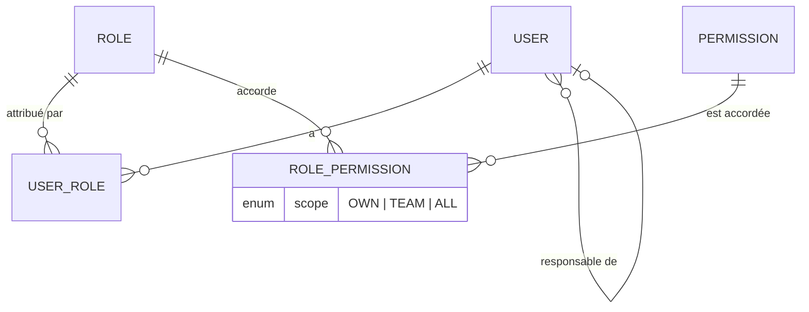
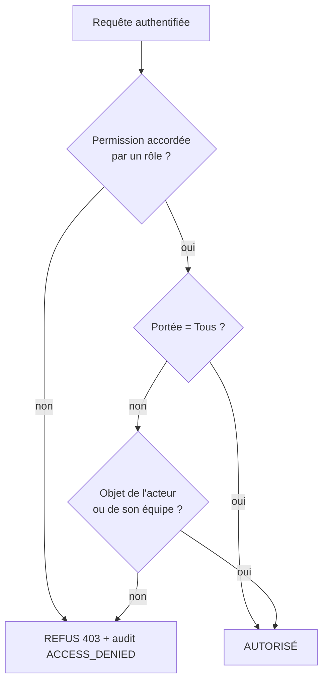

# RBAC — CRM Investally

> **Document généré** par `pnpm crm-api docs:rbac` à partir du code (`apps/crm-api/src/modules/iam/domain`). Ne pas modifier à la main : modifier le code puis régénérer. Les tests `roles.spec.ts` et `core-schema.integration.spec.ts` garantissent que la base contient exactement cette matrice.

## 1. Modèle

Un **utilisateur** a un ou plusieurs **rôles** ; un rôle accorde des **permissions** (`module.ressource.action`), chacune avec une **portée** : **O**wn (ses propres objets), **É**quipe (lui et ses subordonnés directs), **T**ous. Si deux rôles accordent la même permission, la portée la plus large l'emporte. **Refus par défaut** : ce qui n'est pas accordé est interdit.

```
  ┌────────┐ 1..n ┌──────────┐ n..1 ┌────────┐ 1..n ┌────────────────┐ n..1 ┌────────────┐
  │  User  ├──────┤ UserRole ├──────┤  Role  ├──────┤ RolePermission ├──────┤ Permission │
  └───┬────┘      └──────────┘      └────────┘      │  scope: O/E/T  │      └────────────┘
      │ managerId (définit la portée Équipe)         └────────────────┘
      └──► User
```



### Décision d'accès (pour chaque requête, côté serveur)

```
  Requête authentifiée (jeton valide, session non révoquée)
        │
        ▼   permission accordée par un des rôles ?  ── non ──► REFUS (403, audit ACCESS_DENIED)
        │ oui
        ▼   portée = Tous ? ── oui ──► AUTORISÉ
        │ non
        ▼   l'objet appartient à l'acteur (ou à un subordonné si portée Équipe) ? ── non ──► REFUS
        │ oui
        ▼   AUTORISÉ  (+ audit si action sensible)
```



## 2. Rôles

| Code | Libellé | MFA obligatoire | Description |
| --- | --- | --- | --- |
| `SUPER_ADMIN` | Super administrateur | oui | Administration technique : utilisateurs, rôles, sessions, audit. Aucun accès aux données métier (séparation des tâches). |
| `DIRECTION` | Direction | oui | Supervision en lecture de tout le CRM, tableaux de bord stratégiques. |
| `HEAD_OF_SALES` | Responsable commercial | non | Pilote l'équipe commerciale et le pipeline global. |
| `ACCOUNT_MANAGER` | Chargé de compte | non | Mène ses propres entreprises, offres, relances, rendez-vous et inscriptions. |
| `TRAINING_MANAGER` | Responsable Investudy | non | Gère programmes, sessions, salles, formateurs, apprenants, certifications. |
| `TRAINER` | Formateur | non | Anime ses sessions : présences, évaluations. |
| `SUPPORT` | Support | non | Consultation pour assister les utilisateurs et les clients. |
| `FINANCE` | Finance | oui | Accès CRM limité à la préparation de facturation (l'ERP couvrira le reste). |
| `HR` | RH | oui | Aucun accès métier CRM (l'ERP couvrira le périmètre RH). |
| `TAX` | Fiscalité | oui | Aucun accès métier CRM (l'ERP couvrira le périmètre fiscal). |

## 3. Matrice d'accès par module et par rôle

Légende : **L** lecture (consulter, télécharger, exporter, tableaux de bord) · **L+E** lecture et écriture/actions · **/O /É /T** portée la plus large du rôle sur le module · **—** aucun accès.

| Module | SUPER_ADMIN | DIRECTION | HEAD_OF_SALES | ACCOUNT_MANAGER | TRAINING_MANAGER | TRAINER | SUPPORT | FINANCE | HR | TAX |
| --- | --- | --- | --- | --- | --- | --- | --- | --- | --- | --- |
| Identité et accès | L+E/T | L+E/O | L+E/O | L+E/O | L+E/O | L+E/O | L+E/O | L+E/O | L+E/O | L+E/O |
| Audit | L/T | L/T | — | — | — | — | — | — | — | — |
| Documents | — | L/T | L+E/E | L+E/O | L+E/T | L/O | — | — | — | — |
| Business Development | — | L/T | L+E/T | L+E/O | L/T | — | L/T | L/T | — | — |
| Investudy | — | L/T | L/T | L+E/T | L+E/T | L+E/T | L/T | L/T | — | — |
| Reporting | L/T | L/T | L/T | L/O | L/T | L/O | — | L/T | — | — |

## 4. Matrice détaillée rôles × permissions

Cellule : **O**, **É**, **T** = portée accordée ; vide = non accordée.

### Identité et accès (`iam`)

| Permission | SUPER_ADMIN | DIRECTION | HEAD_OF_SALES | ACCOUNT_MANAGER | TRAINING_MANAGER | TRAINER | SUPPORT | FINANCE | HR | TAX |
| --- | --- | --- | --- | --- | --- | --- | --- | --- | --- | --- |
| `iam.user.read` | T |  |  |  |  |  |  |  |  |  |
| `iam.user.create` | T |  |  |  |  |  |  |  |  |  |
| `iam.user.update` | T |  |  |  |  |  |  |  |  |  |
| `iam.user.disable` | T |  |  |  |  |  |  |  |  |  |
| `iam.user.assign_role` | T |  |  |  |  |  |  |  |  |  |
| `iam.user.reset_mfa` | T |  |  |  |  |  |  |  |  |  |
| `iam.role.read` | T |  |  |  |  |  |  |  |  |  |
| `iam.role.manage` | T |  |  |  |  |  |  |  |  |  |
| `iam.session.read` | T | O | O | O | O | O | O | O | O | O |
| `iam.session.revoke` | T | O | O | O | O | O | O | O | O | O |

### Audit (`audit`)

| Permission | SUPER_ADMIN | DIRECTION | HEAD_OF_SALES | ACCOUNT_MANAGER | TRAINING_MANAGER | TRAINER | SUPPORT | FINANCE | HR | TAX |
| --- | --- | --- | --- | --- | --- | --- | --- | --- | --- | --- |
| `audit.log.read` | T | T |  |  |  |  |  |  |  |  |
| `audit.log.export` | T |  |  |  |  |  |  |  |  |  |

### Documents (`docs`)

| Permission | SUPER_ADMIN | DIRECTION | HEAD_OF_SALES | ACCOUNT_MANAGER | TRAINING_MANAGER | TRAINER | SUPPORT | FINANCE | HR | TAX |
| --- | --- | --- | --- | --- | --- | --- | --- | --- | --- | --- |
| `docs.document.read` |  | T | E | O | T | O |  |  |  |  |
| `docs.document.create` |  |  | E | O | T |  |  |  |  |  |
| `docs.document.update` |  |  |  | O | T |  |  |  |  |  |
| `docs.document.delete` |  |  | E |  | T |  |  |  |  |  |
| `docs.document.download` |  | T | E | O | T | O |  |  |  |  |
| `docs.document.export` |  | T |  |  | T |  |  |  |  |  |

### Business Development (`bd`)

| Permission | SUPER_ADMIN | DIRECTION | HEAD_OF_SALES | ACCOUNT_MANAGER | TRAINING_MANAGER | TRAINER | SUPPORT | FINANCE | HR | TAX |
| --- | --- | --- | --- | --- | --- | --- | --- | --- | --- | --- |
| `bd.company.read` |  | T | E | O | T |  | T | T |  |  |
| `bd.company.create` |  |  | E | O |  |  |  |  |  |  |
| `bd.company.update` |  |  | E | O |  |  |  |  |  |  |
| `bd.company.archive` |  |  | E |  |  |  |  |  |  |  |
| `bd.company.export` |  | T | E |  |  |  |  |  |  |  |
| `bd.contact.read` |  | T | E | O | T |  | T |  |  |  |
| `bd.contact.create` |  |  | E | O |  |  |  |  |  |  |
| `bd.contact.update` |  |  | E | O |  |  |  |  |  |  |
| `bd.contact.delete` |  |  | E |  |  |  |  |  |  |  |
| `bd.offer.read` |  | T | E | O |  |  |  |  |  |  |
| `bd.offer.create` |  |  | E | O |  |  |  |  |  |  |
| `bd.offer.update` |  |  | E | O |  |  |  |  |  |  |
| `bd.offer.withdraw` |  |  | E | O |  |  |  |  |  |  |
| `bd.receipt.read` |  | T | E | O |  |  |  |  |  |  |
| `bd.receipt.create` |  |  | E | O |  |  |  |  |  |  |
| `bd.receipt.update` |  |  | E | O |  |  |  |  |  |  |
| `bd.followup.read` |  | T | E | O |  |  |  |  |  |  |
| `bd.followup.create` |  |  | E | O |  |  |  |  |  |  |
| `bd.followup.update` |  |  | E | O |  |  |  |  |  |  |
| `bd.followup.complete` |  |  | E | O |  |  |  |  |  |  |
| `bd.appointment.read` |  | T | E | O |  |  |  |  |  |  |
| `bd.appointment.create` |  |  | E | O |  |  |  |  |  |  |
| `bd.appointment.update` |  |  | E | O |  |  |  |  |  |  |
| `bd.appointment.cancel` |  |  | E | O |  |  |  |  |  |  |
| `bd.visit.read` |  | T | E | O |  |  |  |  |  |  |
| `bd.visit.create` |  |  | E | O |  |  |  |  |  |  |
| `bd.visit.update` |  |  | E | O |  |  |  |  |  |  |
| `bd.opportunity.read` |  | T | T | O | T |  |  |  |  |  |
| `bd.opportunity.create` |  |  | E | O |  |  |  |  |  |  |
| `bd.opportunity.update` |  |  | E | O |  |  |  |  |  |  |
| `bd.opportunity.advance` |  |  | E | O |  |  |  |  |  |  |
| `bd.opportunity.close` |  |  | E |  |  |  |  |  |  |  |
| `bd.opportunity.export` |  | T | E |  |  |  |  |  |  |  |
| `bd.ambassador.read` |  | T | T | O | T |  |  |  |  |  |
| `bd.ambassador.create` |  |  | E | O |  |  |  |  |  |  |
| `bd.ambassador.update` |  |  | E |  |  |  |  |  |  |  |

### Investudy (`training`)

| Permission | SUPER_ADMIN | DIRECTION | HEAD_OF_SALES | ACCOUNT_MANAGER | TRAINING_MANAGER | TRAINER | SUPPORT | FINANCE | HR | TAX |
| --- | --- | --- | --- | --- | --- | --- | --- | --- | --- | --- |
| `training.program.read` |  | T | T | T | T | T |  |  |  |  |
| `training.program.create` |  |  |  |  | T |  |  |  |  |  |
| `training.program.update` |  |  |  |  | T |  |  |  |  |  |
| `training.program.archive` |  |  |  |  | T |  |  |  |  |  |
| `training.training.read` |  | T |  |  | T |  |  |  |  |  |
| `training.training.create` |  |  |  |  | T |  |  |  |  |  |
| `training.training.update` |  |  |  |  | T |  |  |  |  |  |
| `training.session.read` |  | T | T | T | T | O | T | T |  |  |
| `training.session.create` |  |  |  |  | T |  |  |  |  |  |
| `training.session.update` |  |  |  |  | T |  |  |  |  |  |
| `training.session.cancel` |  |  |  |  | T |  |  |  |  |  |
| `training.session.close` |  |  |  |  | T |  |  |  |  |  |
| `training.room.read` |  |  |  |  | T | T |  |  |  |  |
| `training.room.manage` |  |  |  |  | T |  |  |  |  |  |
| `training.trainer.read` |  |  |  |  | T |  |  |  |  |  |
| `training.trainer.manage` |  |  |  |  | T |  |  |  |  |  |
| `training.learner.read` |  | T | E | O | T | O | T |  |  |  |
| `training.learner.create` |  |  |  | O | T |  |  |  |  |  |
| `training.learner.update` |  |  |  | O | T |  |  |  |  |  |
| `training.learner.delete` |  |  |  |  | T |  |  |  |  |  |
| `training.enrollment.read` |  | T | E | O | T |  | T | T |  |  |
| `training.enrollment.create` |  |  |  | O | T |  |  |  |  |  |
| `training.enrollment.update` |  |  |  |  | T |  |  |  |  |  |
| `training.enrollment.cancel` |  |  |  |  | T |  |  |  |  |  |
| `training.attendance.read` |  | T |  |  | T | O |  |  |  |  |
| `training.attendance.record` |  |  |  |  | T | O |  |  |  |  |
| `training.evaluation.read` |  | T |  |  | T | O |  |  |  |  |
| `training.evaluation.record` |  |  |  |  | T | O |  |  |  |  |
| `training.certification.read` |  | T | E |  | T | O |  |  |  |  |
| `training.certification.issue` |  |  |  |  | T |  |  |  |  |  |
| `training.certification.revoke` |  |  |  |  | T |  |  |  |  |  |

### Reporting (`reporting`)

| Permission | SUPER_ADMIN | DIRECTION | HEAD_OF_SALES | ACCOUNT_MANAGER | TRAINING_MANAGER | TRAINER | SUPPORT | FINANCE | HR | TAX |
| --- | --- | --- | --- | --- | --- | --- | --- | --- | --- | --- |
| `reporting.dashboard.account_manager` |  |  | E | O |  |  |  |  |  |  |
| `reporting.dashboard.head_of_sales` |  | T | T |  |  |  |  |  |  |  |
| `reporting.dashboard.training` |  | T |  |  | T | O |  |  |  |  |
| `reporting.dashboard.direction` |  | T |  |  |  |  |  |  |  |  |
| `reporting.dashboard.security` | T |  |  |  |  |  |  |  |  |  |
| `reporting.dashboard.admin` | T |  |  |  |  |  |  |  |  |  |
| `reporting.kpi.read` |  | T | T |  | T |  |  | T |  |  |
| `reporting.report.read` |  | T | T |  | T |  |  |  |  |  |
| `reporting.report.export` |  | T | E |  | T |  |  |  |  |  |

## 5. Règles de gouvernance

1. **Séparation des tâches** : le `SUPER_ADMIN` administre les comptes, rôles, sessions et l'audit mais n'a **aucun** accès aux données métier (bd, investudy, documents). Test automatisé.
2. **Seul le `SUPER_ADMIN`** crée/modifie/désactive des utilisateurs, attribue des rôles, réinitialise le MFA et gère les rôles. Test automatisé.
3. **Nul ne modifie ni ne supprime le journal d'audit** : le catalogue ne contient que `audit.log.read` et `audit.log.export`. Test automatisé + déclencheur SQL.
4. La **Direction** est en lecture seule (consulter, télécharger, exporter) sur le métier. Test automatisé.
5. Un utilisateur **ne peut pas modifier ses propres rôles** (règle à implémenter en S3 dans l'attribution de rôle, avec test).
6. Tout changement de rôle est audité (`ROLE_CHANGE`) et exige un MFA récent (step-up).
7. Aucun export massif pour les rôles chargé de compte, support et formateur. Test automatisé.
8. Droits de base **implicites** pour tout utilisateur authentifié, hors catalogue : consulter son profil, changer son mot de passe, gérer son MFA et voir/révoquer ses propres sessions.

## 6. Points à valider avec le métier

- **Rôle `TRAINING_MANAGER` (Responsable Investudy)** : ajouté, absent du prompt maître. Sans lui, personne ne gère programmes, sessions, salles et certifications dans le CRM.
- **`SUPER_ADMIN` sans accès métier** : choix de sécurité (séparation des tâches). À confirmer : faut-il un accès « bris de glace » journalisé ?
- **`FINANCE`, `HR`, `TAX`** : rôles conservés mais quasi vides dans le CRM (leur périmètre est l'ERP). Finance lit entreprises, inscriptions et sessions pour préparer la facturation.
- **Portée Équipe** : définie par le champ `managerId` (subordonnés directs seulement, pas toute la hiérarchie). À confirmer.
- **Support** : lecture seule. Doit-il pouvoir créer des relances ou corriger des coordonnées ?
- **Direction** et accès aux **journaux d'audit** en lecture : à confirmer avec le RSSI.
