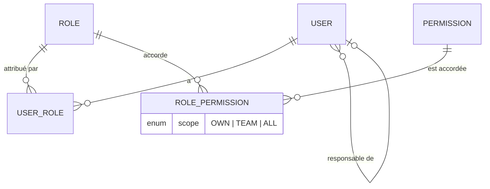
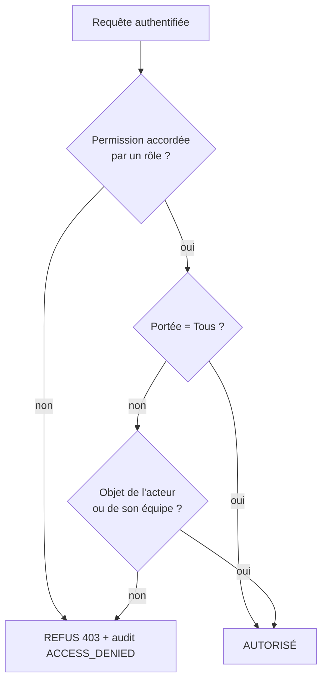

# RBAC — CRM Investally

> **Document généré** par `pnpm crm-api docs:rbac` à partir du code (`apps/crm-api/src/modules/iam/domain`). Ne pas modifier à la main : modifier le code puis régénérer. Les tests `roles.spec.ts` et `core-schema.integration.spec.ts` garantissent que la base contient exactement cette matrice.

## 1. Modèle

Un **utilisateur** a un ou plusieurs **rôles** ; un rôle accorde des **permissions** (`module.ressource.action`), chacune avec une **portée** : **O**wn (ses propres objets), **É**quipe (lui et ses subordonnés directs), **T**ous. Si deux rôles accordent la même permission, la portée la plus large l'emporte. **Refus par défaut** : ce qui n'est pas accordé est interdit.

```
  ┌────────┐ 1..n ┌──────────┐ n..1 ┌────────┐ 1..n ┌────────────────┐ n..1 ┌────────────┐
  │  User  ├──────┤ UserRole ├──────┤  Role  ├──────┤ RolePermission ├──────┤ Permission │
  └───┬────┘      └──────────┘      └────────┘      │  scope: O/E/T  │      └────────────┘
      │ managerId (définit la portée Équipe)         └────────────────┘
      └──► User
```



### Décision d'accès (pour chaque requête, côté serveur)

```
  Requête authentifiée (jeton valide, session non révoquée)
        │
        ▼   permission accordée par un des rôles ?  ── non ──► REFUS (403, audit ACCESS_DENIED)
        │ oui
        ▼   portée = Tous ? ── oui ──► AUTORISÉ
        │ non
        ▼   l'objet appartient à l'acteur (ou à un subordonné si portée Équipe) ? ── non ──► REFUS
        │ oui
        ▼   AUTORISÉ  (+ audit si action sensible)
```



## 2. Rôles

| Code | Libellé | MFA obligatoire | Description |
| --- | --- | --- | --- |
| `SUPER_ADMIN` | Super administrateur | oui | Accès complet au CRM : administration, métier, audit et tableaux de bord. Compte à haut risque : MFA obligatoire, toutes les actions auditées, ne peut pas modifier ses propres rôles. |
| `DIRECTION` | Direction | oui | Supervision en lecture de tout le CRM, tableaux de bord stratégiques. |
| `HEAD_OF_SALES` | Responsable commercial | oui | Pilote l'équipe commerciale et le pipeline global. |
| `ACCOUNT_MANAGER` | Chargé de compte | oui | Mène ses propres entreprises, offres, relances, rendez-vous et inscriptions. |
| `TRAINING_MANAGER` | Responsable Investudy | oui | Gère programmes, sessions, salles, formateurs, apprenants, certifications. |
| `TRAINER` | Formateur | oui | Anime ses sessions : présences, évaluations. |
| `SUPPORT` | Support | oui | Consultation pour assister les utilisateurs et les clients. |
| `FINANCE` | Finance | oui | Accès CRM limité à la préparation de facturation (l'ERP couvrira le reste). |
| `HR` | RH | oui | Aucun accès métier CRM (l'ERP couvrira le périmètre RH). |
| `TAX` | Fiscalité | oui | Aucun accès métier CRM (l'ERP couvrira le périmètre fiscal). |

## 3. Matrice d'accès par module et par rôle

Légende : **L:x** lecture (consulter, télécharger, exporter, tableaux de bord) · **E:x** écriture et actions (créer, modifier, valider, révoquer…) · **x** = portée la plus large du rôle sur le module : **O** ses objets, **E** son équipe, **T** tous · **—** aucun accès. Exemple : `L:T E:O` = lit tout, écrit seulement sur ses propres objets.

| Module | SUPER_ADMIN | DIRECTION | HEAD_OF_SALES | ACCOUNT_MANAGER | TRAINING_MANAGER | TRAINER | SUPPORT | FINANCE | HR | TAX |
| --- | --- | --- | --- | --- | --- | --- | --- | --- | --- | --- |
| Identité et accès | L:T E:T | L:O E:O | L:O E:O | L:O E:O | L:O E:O | L:O E:O | L:O E:O | L:O E:O | L:O E:O | L:O E:O |
| Audit | L:T | L:T | — | — | — | — | — | — | — | — |
| Documents | L:T E:T | L:T | L:E E:E | L:O E:O | L:T E:T | L:O | — | — | — | — |
| Business Development | L:T E:T | L:T | L:T E:E | L:O E:O | L:T | — | L:T | L:T | — | — |
| Investudy | L:T E:T | L:T | L:T | L:T E:O | L:T E:T | L:T E:O | L:T | L:T | — | — |
| Reporting | L:T | L:T | L:T | L:O | L:T | L:O | — | L:T | — | — |

## 4. Matrice détaillée rôles × permissions

Cellule : **O**, **É**, **T** = portée accordée ; vide = non accordée.

### Identité et accès (`iam`)

| Permission | SUPER_ADMIN | DIRECTION | HEAD_OF_SALES | ACCOUNT_MANAGER | TRAINING_MANAGER | TRAINER | SUPPORT | FINANCE | HR | TAX |
| --- | --- | --- | --- | --- | --- | --- | --- | --- | --- | --- |
| `iam.user.read` | T |  |  |  |  |  |  |  |  |  |
| `iam.user.create` | T |  |  |  |  |  |  |  |  |  |
| `iam.user.update` | T |  |  |  |  |  |  |  |  |  |
| `iam.user.disable` | T |  |  |  |  |  |  |  |  |  |
| `iam.user.assign_role` | T |  |  |  |  |  |  |  |  |  |
| `iam.user.reset_mfa` | T |  |  |  |  |  |  |  |  |  |
| `iam.user.reset_password` | T |  |  |  |  |  |  |  |  |  |
| `iam.role.read` | T |  |  |  |  |  |  |  |  |  |
| `iam.role.manage` | T |  |  |  |  |  |  |  |  |  |
| `iam.session.read` | T | O | O | O | O | O | O | O | O | O |
| `iam.session.revoke` | T | O | O | O | O | O | O | O | O | O |

### Audit (`audit`)

| Permission | SUPER_ADMIN | DIRECTION | HEAD_OF_SALES | ACCOUNT_MANAGER | TRAINING_MANAGER | TRAINER | SUPPORT | FINANCE | HR | TAX |
| --- | --- | --- | --- | --- | --- | --- | --- | --- | --- | --- |
| `audit.log.read` | T | T |  |  |  |  |  |  |  |  |
| `audit.log.export` | T |  |  |  |  |  |  |  |  |  |

### Documents (`docs`)

| Permission | SUPER_ADMIN | DIRECTION | HEAD_OF_SALES | ACCOUNT_MANAGER | TRAINING_MANAGER | TRAINER | SUPPORT | FINANCE | HR | TAX |
| --- | --- | --- | --- | --- | --- | --- | --- | --- | --- | --- |
| `docs.document.read` | T | T | E | O | T | O |  |  |  |  |
| `docs.document.create` | T |  | E | O | T |  |  |  |  |  |
| `docs.document.update` | T |  |  | O | T |  |  |  |  |  |
| `docs.document.delete` | T |  | E |  | T |  |  |  |  |  |
| `docs.document.download` | T | T | E | O | T | O |  |  |  |  |
| `docs.document.export` | T | T |  |  | T |  |  |  |  |  |

### Business Development (`bd`)

| Permission | SUPER_ADMIN | DIRECTION | HEAD_OF_SALES | ACCOUNT_MANAGER | TRAINING_MANAGER | TRAINER | SUPPORT | FINANCE | HR | TAX |
| --- | --- | --- | --- | --- | --- | --- | --- | --- | --- | --- |
| `bd.company.read` | T | T | E | O | T |  | T | T |  |  |
| `bd.company.create` | T |  | E | O |  |  |  |  |  |  |
| `bd.company.update` | T |  | E | O |  |  |  |  |  |  |
| `bd.company.archive` | T |  | E |  |  |  |  |  |  |  |
| `bd.company.export` | T | T | E |  |  |  |  |  |  |  |
| `bd.contact.read` | T | T | E | O | T |  | T |  |  |  |
| `bd.contact.create` | T |  | E | O |  |  |  |  |  |  |
| `bd.contact.update` | T |  | E | O |  |  |  |  |  |  |
| `bd.contact.delete` | T |  | E |  |  |  |  |  |  |  |
| `bd.offer.read` | T | T | E | O |  |  |  |  |  |  |
| `bd.offer.create` | T |  | E | O |  |  |  |  |  |  |
| `bd.offer.update` | T |  | E | O |  |  |  |  |  |  |
| `bd.offer.withdraw` | T |  | E | O |  |  |  |  |  |  |
| `bd.receipt.read` | T | T | E | O |  |  |  |  |  |  |
| `bd.receipt.create` | T |  | E | O |  |  |  |  |  |  |
| `bd.receipt.update` | T |  | E | O |  |  |  |  |  |  |
| `bd.followup.read` | T | T | E | O |  |  |  |  |  |  |
| `bd.followup.create` | T |  | E | O |  |  |  |  |  |  |
| `bd.followup.update` | T |  | E | O |  |  |  |  |  |  |
| `bd.followup.complete` | T |  | E | O |  |  |  |  |  |  |
| `bd.appointment.read` | T | T | E | O |  |  |  |  |  |  |
| `bd.appointment.create` | T |  | E | O |  |  |  |  |  |  |
| `bd.appointment.update` | T |  | E | O |  |  |  |  |  |  |
| `bd.appointment.cancel` | T |  | E | O |  |  |  |  |  |  |
| `bd.visit.read` | T | T | E | O |  |  |  |  |  |  |
| `bd.visit.create` | T |  | E | O |  |  |  |  |  |  |
| `bd.visit.update` | T |  | E | O |  |  |  |  |  |  |
| `bd.opportunity.read` | T | T | T | O | T |  |  |  |  |  |
| `bd.opportunity.create` | T |  | E | O |  |  |  |  |  |  |
| `bd.opportunity.update` | T |  | E | O |  |  |  |  |  |  |
| `bd.opportunity.advance` | T |  | E | O |  |  |  |  |  |  |
| `bd.opportunity.close` | T |  | E |  |  |  |  |  |  |  |
| `bd.opportunity.export` | T | T | E |  |  |  |  |  |  |  |
| `bd.ambassador.read` | T | T | T | O | T |  |  |  |  |  |
| `bd.ambassador.create` | T |  | E | O |  |  |  |  |  |  |
| `bd.ambassador.update` | T |  | E |  |  |  |  |  |  |  |
| `bd.facilitator.read` | T | T | E | O |  |  |  | T |  |  |
| `bd.facilitator.create` | T |  | E | O |  |  |  |  |  |  |
| `bd.commission.read` | T | T | E |  |  |  |  | T |  |  |
| `bd.commission.manage` | T |  | E |  |  |  |  |  |  |  |

### Investudy (`training`)

| Permission | SUPER_ADMIN | DIRECTION | HEAD_OF_SALES | ACCOUNT_MANAGER | TRAINING_MANAGER | TRAINER | SUPPORT | FINANCE | HR | TAX |
| --- | --- | --- | --- | --- | --- | --- | --- | --- | --- | --- |
| `training.program.read` | T | T | T | T | T | T |  |  |  |  |
| `training.program.create` | T |  |  |  | T |  |  |  |  |  |
| `training.program.update` | T |  |  |  | T |  |  |  |  |  |
| `training.program.archive` | T |  |  |  | T |  |  |  |  |  |
| `training.training.read` | T | T |  |  | T |  |  |  |  |  |
| `training.training.create` | T |  |  |  | T |  |  |  |  |  |
| `training.training.update` | T |  |  |  | T |  |  |  |  |  |
| `training.session.read` | T | T | T | T | T | O | T | T |  |  |
| `training.session.create` | T |  |  |  | T |  |  |  |  |  |
| `training.session.update` | T |  |  |  | T |  |  |  |  |  |
| `training.session.cancel` | T |  |  |  | T |  |  |  |  |  |
| `training.session.close` | T |  |  |  | T |  |  |  |  |  |
| `training.room.read` | T |  |  |  | T | T |  |  |  |  |
| `training.room.manage` | T |  |  |  | T |  |  |  |  |  |
| `training.trainer.read` | T |  |  |  | T |  |  |  |  |  |
| `training.trainer.manage` | T |  |  |  | T |  |  |  |  |  |
| `training.learner.read` | T | T | E | O | T | O | T |  |  |  |
| `training.learner.create` | T |  |  | O | T |  |  |  |  |  |
| `training.learner.update` | T |  |  | O | T |  |  |  |  |  |
| `training.learner.delete` | T |  |  |  | T |  |  |  |  |  |
| `training.enrollment.read` | T | T | E | O | T |  | T | T |  |  |
| `training.enrollment.create` | T |  |  | O | T |  |  |  |  |  |
| `training.enrollment.update` | T |  |  |  | T |  |  |  |  |  |
| `training.enrollment.cancel` | T |  |  |  | T |  |  |  |  |  |
| `training.attendance.read` | T | T |  |  | T | O |  |  |  |  |
| `training.attendance.record` | T |  |  |  | T | O |  |  |  |  |
| `training.evaluation.read` | T | T |  |  | T | O |  |  |  |  |
| `training.evaluation.record` | T |  |  |  | T | O |  |  |  |  |
| `training.certification.read` | T | T | E |  | T | O |  |  |  |  |
| `training.certification.issue` | T |  |  |  | T |  |  |  |  |  |
| `training.certification.revoke` | T |  |  |  | T |  |  |  |  |  |

### Reporting (`reporting`)

| Permission | SUPER_ADMIN | DIRECTION | HEAD_OF_SALES | ACCOUNT_MANAGER | TRAINING_MANAGER | TRAINER | SUPPORT | FINANCE | HR | TAX |
| --- | --- | --- | --- | --- | --- | --- | --- | --- | --- | --- |
| `reporting.dashboard.account_manager` | T |  | E | O |  |  |  |  |  |  |
| `reporting.dashboard.head_of_sales` | T | T | T |  |  |  |  |  |  |  |
| `reporting.dashboard.training` | T | T |  |  | T | O |  |  |  |  |
| `reporting.dashboard.direction` | T | T |  |  |  |  |  |  |  |  |
| `reporting.dashboard.security` | T |  |  |  |  |  |  |  |  |  |
| `reporting.dashboard.admin` | T |  |  |  |  |  |  |  |  |  |
| `reporting.kpi.read` | T | T | T |  | T |  |  | T |  |  |
| `reporting.report.read` | T | T | T |  | T |  |  |  |  |  |
| `reporting.report.export` | T | T | E |  | T |  |  |  |  |  |

## 5. Règles de gouvernance

1. **Le `SUPER_ADMIN` a un accès complet** (décision produit du 2026-10-20) : toutes les permissions, en portée Tous. C'est un compte à très haut risque ; garde-fous compensatoires : MFA obligatoire, toutes ses actions auditées, interdiction de modifier ses propres rôles, au moins **deux** comptes SuperAdmin pour la continuité, revue périodique de la liste. Test automatisé.
2. **Seul le `SUPER_ADMIN`** crée/modifie/désactive des utilisateurs, attribue des rôles, réinitialise le MFA et gère les rôles. Test automatisé.
3. **Nul ne modifie ni ne supprime le journal d'audit** : le catalogue ne contient que `audit.log.read` et `audit.log.export`. Test automatisé + déclencheur SQL.
4. La **Direction** est en lecture seule (consulter, télécharger, exporter) sur le métier. Test automatisé.
5. Un utilisateur **ne peut pas modifier ses propres rôles**, SuperAdmin compris (règle à implémenter dans l'attribution de rôle en S3, avec test).
6. Tout changement de rôle est audité (`ROLE_CHANGE`) et exige un MFA récent (step-up).
7. Aucun export massif pour les rôles chargé de compte, support et formateur. Test automatisé.
8. Droits de base **implicites** pour tout utilisateur authentifié, hors catalogue : consulter son profil, changer son mot de passe, gérer son MFA et voir/révoquer ses propres sessions.

## 6. Décisions prises et points restants

**Décidé le 2026-10-20 :**

- Rôle `TRAINING_MANAGER` (Responsable Investudy) : **ajouté**.
- `SUPER_ADMIN` : **accès complet** (voir la règle 1 pour les garde-fous).
- Portée Équipe : **subordonnés directs** uniquement (`managerId`, un seul niveau).
- **MFA obligatoire pour tous les rôles.** Interprétation : « MFA obligatoire » sans distinction vaut pour tout le monde ; un rôle peut être assoupli via `mfaRequired` si besoin.
- Support : lecture seule. Direction : lecture du journal d'audit (ces lectures sont elles-mêmes auditées).
- `FINANCE`, `HR`, `TAX` : conservés mais quasi vides dans le CRM (leur périmètre est l'ERP).

**Restant à valider :**

- Droits fins du rôle `FINANCE` dans le CRM (aujourd'hui : lecture des entreprises, inscriptions, sessions et indicateurs).
- Droits sur l'**agrément** (promesse de paiement) : qui le saisit et le valide ? À préciser avant le sprint Business Development.
