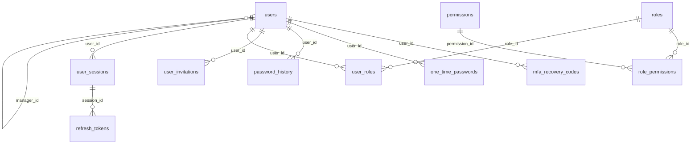
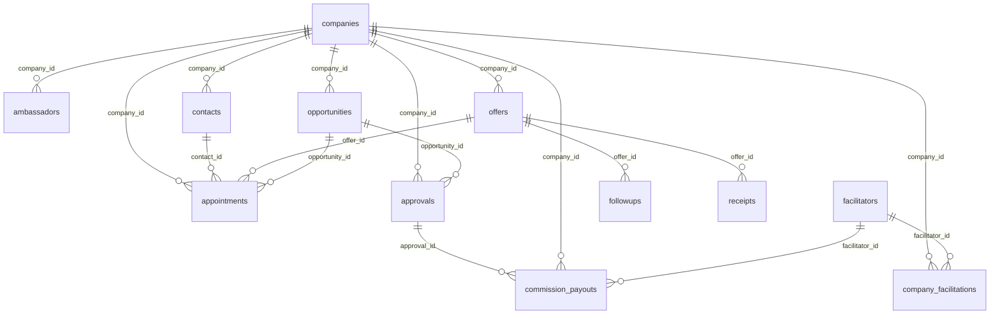
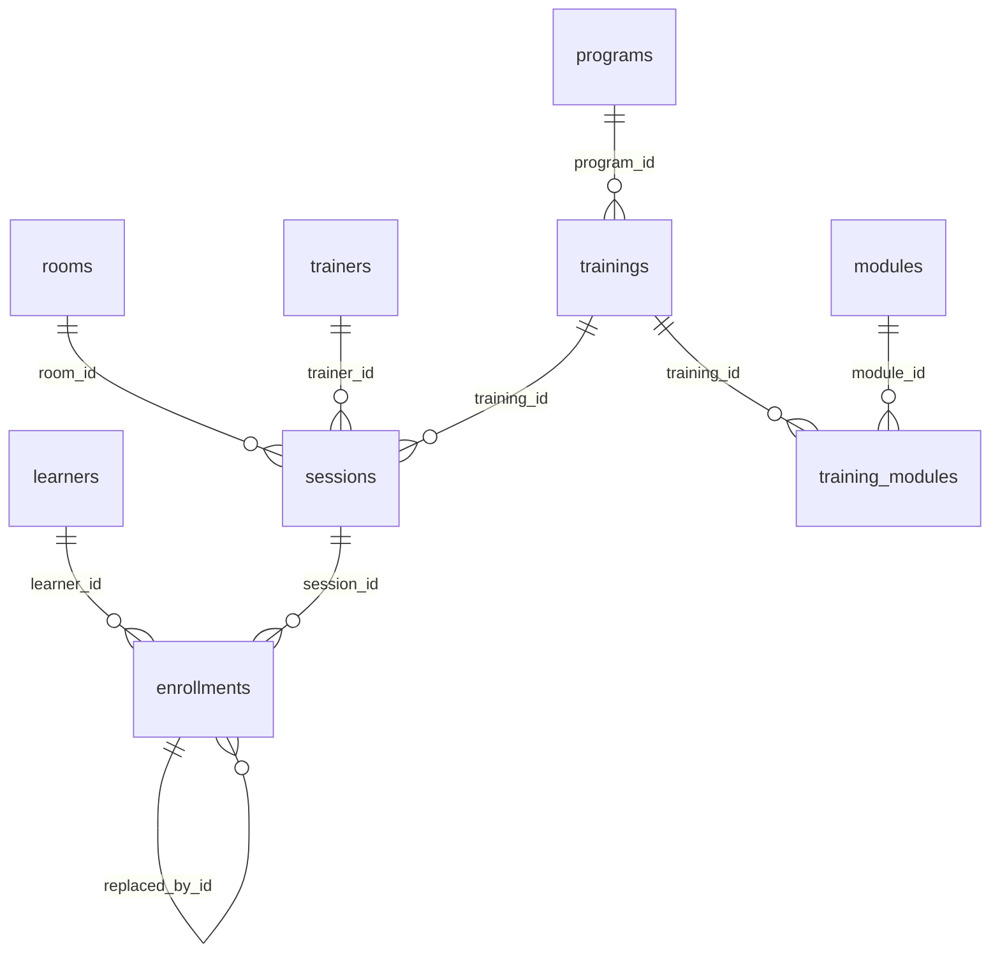
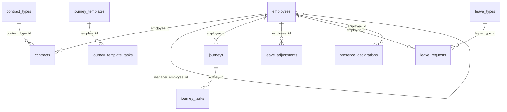
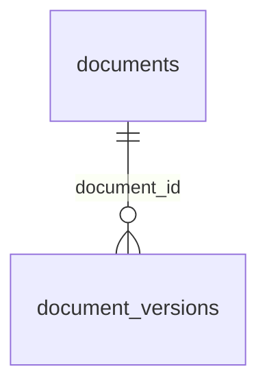

# Dictionnaire de la base de données

*Généré depuis la base réelle (PostgreSQL 17.10, 31 migrations appliquées) et les commentaires du schéma Prisma, par `scripts/db-docs/build-dictionary.mjs`. Ne pas modifier à la main : régénérer.*

## Vue d’ensemble

- **Moteur** : PostgreSQL ; accès par Prisma (client généré) ; migrations versionnées dans `apps/api/prisma/migrations`.
- **Un schéma PostgreSQL par contexte métier** (monolithe modulaire) : `iam`, `bd`, `training`, `hr`, `docs`, `audit`.
- **Aucune clé étrangère entre deux schémas** : un contexte référence un autre **par identifiant** (colonne `*_id` sans contrainte) ; l’existence et l’appartenance sont contrôlées par les cas d’usage (test `core-schema`).
- **Rien n’est supprimé physiquement** sur les données métier : archivage, annulation ou suppression logique (`deleted_at`) ; les clés étrangères sont en `RESTRICT`.
- **Verrou optimiste** : chaque agrégat a une colonne `version` ; une écriture avec une version périmée est refusée.
- **Règles garanties par la base** (CHECK, index uniques) en plus de celles de l’application : une règle violée est refusée même en contournant l’API.
- **Identifiants** : UUID (v7) générés par l’application ; dates en `timestamptz` (UTC) ; jours civils en `date`.

| Schéma | Rôle | Tables |
|---|---|---|
| `iam` | Identité et accès : comptes, rôles, sessions, MFA, invitations | 12 |
| `bd` | Business Development : entreprises, contacts, offres, relances, rendez-vous, opportunités, agréments, ambassadeurs, commissions | 13 |
| `training` | Investudy : catalogue, sessions, salles, formateurs, apprenants, inscriptions | 9 |
| `hr` | Ressources humaines : personnel, absences et congés | 13 |
| `docs` | Documents (métadonnées ; les fichiers sont stockés à part) | 2 |
| `audit` | Journal d’audit (partitionné par mois) | 1 |

## Schéma `iam`

Identité et accès : comptes, rôles, sessions, MFA, invitations

### `iam.login_attempts`

Tentatives de connexion (y compris pour des e-mails inconnus : pas de clé étrangère).

| Colonne | Type | Null | Défaut | Description |
|---|---|---|---|---|
| `id` | uuid | non |  |  |
| `email_key` | character varying(254) | non |  |  |
| `user_id` | uuid | oui |  |  |
| `ip_address` | character varying(64) | non |  |  |
| `outcome` | iam."LoginOutcome" | non |  |  |
| `created_at` | timestamp(6) with time zone | non | `CURRENT_TIMESTAMP` |  |

**Clé primaire** : `(id)`

**Index**

- `login_attempts_email_key_created_at_idx` : `USING btree (email_key, created_at)`
- `login_attempts_ip_address_created_at_idx` : `USING btree (ip_address, created_at)`

### `iam.mfa_recovery_codes`

| Colonne | Type | Null | Défaut | Description |
|---|---|---|---|---|
| `id` | uuid | non |  |  |
| `user_id` | uuid | non |  |  |
| `code_hash` | character varying(255) | non |  |  |
| `used_at` | timestamp(6) with time zone | oui |  |  |
| `created_at` | timestamp(6) with time zone | non | `CURRENT_TIMESTAMP` |  |

**Clé primaire** : `(id)`

**Clés étrangères**

- `mfa_recovery_codes_user_id_fkey` : FOREIGN KEY (user_id) REFERENCES iam.users(id) ON UPDATE CASCADE ON DELETE CASCADE

**Index**

- `mfa_recovery_codes_user_id_idx` : `USING btree (user_id)`

### `iam.one_time_passwords`

| Colonne | Type | Null | Défaut | Description |
|---|---|---|---|---|
| `id` | uuid | non |  |  |
| `user_id` | uuid | non |  |  |
| `purpose` | iam."OtpPurpose" | non |  |  |
| `code_hash` | character varying(255) | non |  |  |
| `attempts` | integer | non | `0` |  |
| `expires_at` | timestamp(6) with time zone | non |  |  |
| `consumed_at` | timestamp(6) with time zone | oui |  |  |
| `created_at` | timestamp(6) with time zone | non | `CURRENT_TIMESTAMP` |  |

**Clé primaire** : `(id)`

**Clés étrangères**

- `one_time_passwords_user_id_fkey` : FOREIGN KEY (user_id) REFERENCES iam.users(id) ON UPDATE CASCADE ON DELETE CASCADE

**Règles garanties par la base (CHECK)**

- `otp_attempts_nonneg` : `((attempts >= 0))`

**Index**

- `one_time_passwords_expires_at_idx` : `USING btree (expires_at)`
- `one_time_passwords_user_id_purpose_idx` : `USING btree (user_id, purpose)`

### `iam.password_history`

| Colonne | Type | Null | Défaut | Description |
|---|---|---|---|---|
| `id` | uuid | non |  |  |
| `user_id` | uuid | non |  |  |
| `password_hash` | character varying(255) | non |  |  |
| `created_at` | timestamp(6) with time zone | non | `CURRENT_TIMESTAMP` |  |

**Clé primaire** : `(id)`

**Clés étrangères**

- `password_history_user_id_fkey` : FOREIGN KEY (user_id) REFERENCES iam.users(id) ON UPDATE CASCADE ON DELETE CASCADE

**Index**

- `password_history_user_id_created_at_idx` : `USING btree (user_id, created_at DESC)`

### `iam.permissions`

| Colonne | Type | Null | Défaut | Description |
|---|---|---|---|---|
| `id` | uuid | non |  |  |
| `code` | character varying(100) | non |  | `module.ressource.action` |
| `module` | character varying(50) | non |  |  |
| `resource` | character varying(50) | non |  |  |
| `action` | character varying(50) | non |  |  |
| `description` | character varying(300) | non |  |  |
| `created_at` | timestamp(6) with time zone | non | `CURRENT_TIMESTAMP` |  |

**Clé primaire** : `(id)`

**Index**

- `permissions_code_key` : `UNIQUE USING btree (code)`
- `permissions_module_idx` : `USING btree (module)`

### `iam.refresh_tokens`

| Colonne | Type | Null | Défaut | Description |
|---|---|---|---|---|
| `id` | uuid | non |  |  |
| `session_id` | uuid | non |  |  |
| `family_id` | uuid | non |  | Famille de rotation : la réutilisation d'un jeton déjà consommé révoque toute la famille. |
| `token_hash` | character varying(64) | non |  | SHA-256 du jeton opaque ; le jeton lui-même n'est jamais stocké. |
| `issued_at` | timestamp(6) with time zone | non | `CURRENT_TIMESTAMP` |  |
| `expires_at` | timestamp(6) with time zone | non |  |  |
| `used_at` | timestamp(6) with time zone | oui |  |  |
| `revoked_at` | timestamp(6) with time zone | oui |  |  |
| `replaced_by_id` | uuid | oui |  |  |

**Clé primaire** : `(id)`

**Clés étrangères**

- `refresh_tokens_session_id_fkey` : FOREIGN KEY (session_id) REFERENCES iam.user_sessions(id) ON UPDATE CASCADE ON DELETE CASCADE

**Index**

- `refresh_tokens_expires_at_idx` : `USING btree (expires_at)`
- `refresh_tokens_family_id_idx` : `USING btree (family_id)`
- `refresh_tokens_session_id_idx` : `USING btree (session_id)`
- `refresh_tokens_token_hash_key` : `UNIQUE USING btree (token_hash)`

### `iam.role_permissions`

| Colonne | Type | Null | Défaut | Description |
|---|---|---|---|---|
| `role_id` | uuid | non |  |  |
| `permission_id` | uuid | non |  |  |
| `scope` | iam."RoleScope" | non |  |  |

**Clé primaire** : `(role_id, permission_id)`

**Clés étrangères**

- `role_permissions_permission_id_fkey` : FOREIGN KEY (permission_id) REFERENCES iam.permissions(id) ON UPDATE CASCADE ON DELETE CASCADE
- `role_permissions_role_id_fkey` : FOREIGN KEY (role_id) REFERENCES iam.roles(id) ON UPDATE CASCADE ON DELETE CASCADE

**Index**

- `role_permissions_permission_id_idx` : `USING btree (permission_id)`

### `iam.roles`

| Colonne | Type | Null | Défaut | Description |
|---|---|---|---|---|
| `id` | uuid | non |  |  |
| `code` | character varying(50) | non |  |  |
| `label` | character varying(100) | non |  |  |
| `description` | character varying(500) | non |  |  |
| `mfa_required` | boolean | non | `false` |  |
| `is_system` | boolean | non | `true` | Rôle livré par le système : non supprimable. |
| `created_at` | timestamp(6) with time zone | non | `CURRENT_TIMESTAMP` |  |
| `updated_at` | timestamp(6) with time zone | non |  |  |

**Clé primaire** : `(id)`

**Index**

- `roles_code_key` : `UNIQUE USING btree (code)`

### `iam.user_invitations`

Invitation à activer un compte : le mot de passe est choisi par l'utilisateur via un lien à usage unique.

| Colonne | Type | Null | Défaut | Description |
|---|---|---|---|---|
| `id` | uuid | non |  |  |
| `user_id` | uuid | non |  |  |
| `token_hash` | character varying(64) | non |  | SHA-256 du jeton ; le jeton lui-même n'est jamais stocké. |
| `created_by` | uuid | oui |  |  |
| `created_at` | timestamp(6) with time zone | non | `CURRENT_TIMESTAMP` |  |
| `expires_at` | timestamp(6) with time zone | non |  |  |
| `used_at` | timestamp(6) with time zone | oui |  |  |
| `revoked_at` | timestamp(6) with time zone | oui |  |  |
| `purpose` | character varying(20) | non | `'INVITATION'::character varying` | INVITATION (activation d'un compte en attente) ou PASSWORD_RESET (réinitialisation par un administrateur). |

**Clé primaire** : `(id)`

**Clés étrangères**

- `user_invitations_user_id_fkey` : FOREIGN KEY (user_id) REFERENCES iam.users(id) ON UPDATE CASCADE ON DELETE CASCADE

**Règles garanties par la base (CHECK)**

- `user_invitations_expiry_after_creation` : `((expires_at > created_at))`
- `user_invitations_purpose_known` : `(((purpose)::text = ANY ((ARRAY['INVITATION'::character varying, 'PASSWORD_RESET'::character varying])::text[])))`
- `user_invitations_token_hash_hex` : `(((token_hash)::text ~ '^[0-9a-f]{64}$'::text))`

**Index**

- `user_invitations_expires_at_idx` : `USING btree (expires_at)`
- `user_invitations_token_hash_key` : `UNIQUE USING btree (token_hash)`
- `user_invitations_user_id_idx` : `USING btree (user_id)`

### `iam.user_roles`

| Colonne | Type | Null | Défaut | Description |
|---|---|---|---|---|
| `user_id` | uuid | non |  |  |
| `role_id` | uuid | non |  |  |
| `assigned_by` | uuid | oui |  |  |
| `assigned_at` | timestamp(6) with time zone | non | `CURRENT_TIMESTAMP` |  |

**Clé primaire** : `(user_id, role_id)`

**Clés étrangères**

- `user_roles_role_id_fkey` : FOREIGN KEY (role_id) REFERENCES iam.roles(id) ON UPDATE CASCADE ON DELETE RESTRICT
- `user_roles_user_id_fkey` : FOREIGN KEY (user_id) REFERENCES iam.users(id) ON UPDATE CASCADE ON DELETE CASCADE

**Index**

- `user_roles_role_id_idx` : `USING btree (role_id)`

### `iam.user_sessions`

| Colonne | Type | Null | Défaut | Description |
|---|---|---|---|---|
| `id` | uuid | non |  |  |
| `user_id` | uuid | non |  |  |
| `ip_address` | character varying(64) | non |  |  |
| `device` | character varying(300) | non |  |  |
| `browser` | character varying(100) | oui |  |  |
| `os` | character varying(100) | oui |  |  |
| `risk_level` | iam."RiskLevel" | non | `'LOW'::iam."RiskLevel"` |  |
| `mfa_verified` | boolean | non | `false` |  |
| `logged_in_at` | timestamp(6) with time zone | non | `CURRENT_TIMESTAMP` |  |
| `last_seen_at` | timestamp(6) with time zone | non | `CURRENT_TIMESTAMP` |  |
| `expires_at` | timestamp(6) with time zone | non |  | Expiration sur inactivité. |
| `absolute_expires_at` | timestamp(6) with time zone | non |  | Expiration absolue, quelle que soit l'activité. |
| `logged_out_at` | timestamp(6) with time zone | oui |  |  |
| `revoked_at` | timestamp(6) with time zone | oui |  |  |
| `revoked_reason` | character varying(200) | oui |  |  |
| `mfa_verified_at` | timestamp(6) with time zone | oui |  | Dernière vérification MFA de la session : sert au step-up. |

**Clé primaire** : `(id)`

**Clés étrangères**

- `user_sessions_user_id_fkey` : FOREIGN KEY (user_id) REFERENCES iam.users(id) ON UPDATE CASCADE ON DELETE CASCADE

**Règles garanties par la base (CHECK)**

- `user_sessions_expiry_order` : `((expires_at <= absolute_expires_at))`

**Index**

- `user_sessions_expires_at_idx` : `USING btree (expires_at)`
- `user_sessions_user_id_logged_in_at_idx` : `USING btree (user_id, logged_in_at)`

### `iam.users`

| Colonne | Type | Null | Défaut | Description |
|---|---|---|---|---|
| `id` | uuid | non |  |  |
| `email` | character varying(254) | non |  |  |
| `email_key` | character varying(254) | non |  | E-mail normalisé (minuscules) : unicité parmi les comptes non supprimés (index partiel en SQL). |
| `display_name` | character varying(200) | non |  |  |
| `status` | iam."UserStatus" | non | `'PENDING'::iam."UserStatus"` |  |
| `password_hash` | character varying(255) | oui |  | Hash argon2id. Jamais journalisé (masqué dans l'audit). |
| `password_changed_at` | timestamp(6) with time zone | oui |  |  |
| `failed_login_count` | integer | non | `0` |  |
| `locked_until` | timestamp(6) with time zone | oui |  |  |
| `mfa_enabled` | boolean | non | `false` |  |
| `mfa_secret_enc` | text | oui |  | Secret TOTP chiffré (AES-256-GCM) ; la clé est hors base. |
| `manager_id` | uuid | oui |  | Responsable hiérarchique : définit la portée TEAM. |
| `last_login_at` | timestamp(6) with time zone | oui |  |  |
| `version` | integer | non | `1` |  |
| `created_at` | timestamp(6) with time zone | non | `CURRENT_TIMESTAMP` |  |
| `updated_at` | timestamp(6) with time zone | non |  |  |
| `deleted_at` | timestamp(6) with time zone | oui |  |  |
| `mfa_last_used_step` | bigint | oui |  | Dernier pas TOTP accepté : un code ne sert qu'une fois (anti-rejeu). |

**Clé primaire** : `(id)`

**Clés étrangères**

- `users_manager_id_fkey` : FOREIGN KEY (manager_id) REFERENCES iam.users(id) ON UPDATE CASCADE ON DELETE SET NULL

**Règles garanties par la base (CHECK)**

- `users_email_key_lowercase` : `(((email_key)::text = lower((email_key)::text)))`
- `users_failed_login_count_nonneg` : `((failed_login_count >= 0))`
- `users_mfa_enabled_has_secret` : `(((NOT mfa_enabled) OR (mfa_secret_enc IS NOT NULL)))`
- `users_mfa_step_nonneg` : `(((mfa_last_used_step IS NULL) OR (mfa_last_used_step >= 0)))`
- `users_not_own_manager` : `(((manager_id IS NULL) OR (manager_id <> id)))`
- `users_version_positive` : `((version >= 1))`

**Index**

- `users_email_key_active_uq` : `UNIQUE USING btree (email_key) WHERE (deleted_at IS NULL)`
- `users_manager_id_idx` : `USING btree (manager_id)`
- `users_status_idx` : `USING btree (status)`

### Types énumérés de `iam`

| Type | Valeurs |
|---|---|
| `LoginOutcome` | `SUCCESS`, `BAD_CREDENTIALS`, `LOCKED`, `MFA_FAILED`, `RATE_LIMITED` |
| `OtpPurpose` | `RECOVERY`, `STEP_UP`, `EMAIL_VERIFICATION` |
| `RiskLevel` | `LOW`, `MEDIUM`, `HIGH`, `CRITICAL` |
| `RoleScope` | `OWN`, `TEAM`, `ALL` |
| `UserStatus` | `PENDING`, `ACTIVE`, `LOCKED`, `DISABLED` |

## Schéma `bd`

Business Development : entreprises, contacts, offres, relances, rendez-vous, opportunités, agréments, ambassadeurs, commissions

### `bd.ambassadors`

| Colonne | Type | Null | Défaut | Description |
|---|---|---|---|---|
| `id` | uuid | non |  |  |
| `owner_user_id` | uuid | non |  | Le chargé de compte qui l'a créé (référence inter-contextes vers iam.users, SANS clé étrangère) : détermine la portée des droits. |
| `last_name` | character varying(100) | non |  |  |
| `first_name` | character varying(100) | non |  |  |
| `origin` | bd."AmbassadorOrigin" | non |  |  |
| `company_id` | uuid | oui |  | Entreprise d'origine : obligatoire pour un client, facultative pour un apprenant. |
| `email` | character varying(200) | oui |  |  |
| `phone` | character varying(40) | oui |  |  |
| `appointed_on` | date | non |  |  |
| `note` | character varying(500) | oui |  |  |
| `version` | integer | non | `1` |  |
| `created_at` | timestamp(6) with time zone | non | `CURRENT_TIMESTAMP` |  |
| `updated_at` | timestamp(6) with time zone | non |  |  |
| `status` | bd."AmbassadorStatus" | non | `'ACTIVE'::bd."AmbassadorStatus"` | Archivage réversible (jamais de suppression) : archivé = gelé, retiré des listes courantes, réactivable. |
| `archived_at` | timestamp(6) with time zone | oui |  |  |
| `archive_reason` | character varying(500) | oui |  |  |

**Clé primaire** : `(id)`

**Clés étrangères**

- `ambassadors_company_id_fkey` : FOREIGN KEY (company_id) REFERENCES bd.companies(id) ON UPDATE CASCADE ON DELETE RESTRICT

**Règles garanties par la base (CHECK)**

- `ambassadors_client_has_company` : `(COALESCE(((origin <> 'CLIENT'::bd."AmbassadorOrigin") OR (company_id IS NOT NULL)), false))`
- `ambassadors_names_not_blank` : `(COALESCE(((length(btrim((last_name)::text)) > 0) AND (length(btrim((first_name)::text)) > 0)), false))`
- `ambassadors_phone_format` : `(COALESCE(((phone IS NULL) OR ((phone)::text ~ '^\+?[1-9][0-9]{7,14}$'::text)), false)) NOT VALID`
- `ambassadors_status_consistent` : `(COALESCE((((status = 'ARCHIVED'::bd."AmbassadorStatus") AND (archived_at IS NOT NULL)) OR ((status = 'ACTIVE'::bd."AmbassadorStatus") AND (archived_at IS NULL) AND (archive_reason IS NULL))), false))`
- `ambassadors_version_positive` : `((version >= 1))`

**Index**

- `ambassadors_company_id_idx` : `USING btree (company_id)`
- `ambassadors_email_unique` : `UNIQUE USING btree (email) WHERE (email IS NOT NULL)`
- `ambassadors_owner_user_id_idx` : `USING btree (owner_user_id)`
- `ambassadors_status_idx` : `USING btree (status)`

### `bd.appointments`

Rendez-vous ou visite d'une entreprise, dans l'agenda de son organisateur (référence inter-contextes vers iam.users, SANS clé étrangère).

| Colonne | Type | Null | Défaut | Description |
|---|---|---|---|---|
| `id` | uuid | non |  |  |
| `type` | bd."AppointmentType" | non |  |  |
| `company_id` | uuid | non |  |  |
| `contact_id` | uuid | oui |  |  |
| `offer_id` | uuid | oui |  |  |
| `organizer_user_id` | uuid | non |  |  |
| `starts_at` | timestamp(6) with time zone | non |  |  |
| `duration_minutes` | integer | non |  |  |
| `location` | character varying(200) | oui |  |  |
| `note` | character varying(500) | oui |  |  |
| `status` | bd."AppointmentStatus" | non | `'PLANNED'::bd."AppointmentStatus"` |  |
| `outcome_note` | character varying(1000) | oui |  | Compte rendu (tenu) ou motif d'annulation (annulé) ; absent tant que le rendez-vous est à venir. |
| `closed_at` | timestamp(6) with time zone | oui |  |  |
| `postponements` | integer | non | `0` |  |
| `last_postpone_reason` | character varying(500) | oui |  |  |
| `version` | integer | non | `1` |  |
| `created_at` | timestamp(6) with time zone | non | `CURRENT_TIMESTAMP` |  |
| `updated_at` | timestamp(6) with time zone | non |  |  |
| `opportunity_id` | uuid | oui |  | Opportunité que le rendez-vous sert (facultatif) : un rendez-vous décideur lié ne compte que pour elle (D93). |

**Clé primaire** : `(id)`

**Clés étrangères**

- `appointments_company_id_fkey` : FOREIGN KEY (company_id) REFERENCES bd.companies(id) ON UPDATE CASCADE ON DELETE RESTRICT
- `appointments_contact_id_fkey` : FOREIGN KEY (contact_id) REFERENCES bd.contacts(id) ON UPDATE CASCADE ON DELETE RESTRICT
- `appointments_offer_id_fkey` : FOREIGN KEY (offer_id) REFERENCES bd.offers(id) ON UPDATE CASCADE ON DELETE RESTRICT
- `appointments_opportunity_id_fkey` : FOREIGN KEY (opportunity_id) REFERENCES bd.opportunities(id) ON UPDATE CASCADE ON DELETE RESTRICT

**Règles garanties par la base (CHECK)**

- `appointments_closure_coherent` : `(COALESCE((((status = 'PLANNED'::bd."AppointmentStatus") = (closed_at IS NULL)) AND ((status = 'PLANNED'::bd."AppointmentStatus") = (outcome_note IS NULL))), false))`
- `appointments_duration_range` : `(COALESCE(((duration_minutes >= 15) AND (duration_minutes <= 480)), false))`
- `appointments_postponements_positive` : `((postponements >= 0))`
- `appointments_version_positive` : `((version >= 1))`

**Index**

- `appointments_company_id_idx` : `USING btree (company_id)`
- `appointments_opportunity_id_idx` : `USING btree (opportunity_id)`
- `appointments_planned_organizer_idx` : `USING btree (organizer_user_id, starts_at) WHERE (status = 'PLANNED'::bd."AppointmentStatus")`
- `appointments_starts_at_idx` : `USING btree (starts_at)`

### `bd.approvals`

| Colonne | Type | Null | Défaut | Description |
|---|---|---|---|---|
| `id` | uuid | non |  |  |
| `company_id` | uuid | non |  |  |
| `opportunity_id` | uuid | non |  |  |
| `amount` | numeric(14,2) | oui |  | Somme globale couverte ; absente si l'agrément ne couvre qu'un nombre de places (au moins l'un des deux, D1). |
| `currency` | character varying(3) | non | `'XAF'::character varying` |  |
| `places` | integer | oui |  |  |
| `received_on` | date | oui |  | Absente tant que l'agrément est seulement demandé (ou annulé avant réception). |
| `valid_until` | date | oui |  |  |
| `status` | bd."ApprovalStatus" | non | `'RECEIVED'::bd."ApprovalStatus"` |  |
| `closed_reason` | character varying(500) | oui |  | Motif de l'expiration ou de l'annulation ; absent pour un agrément reçu ou honoré. |
| `closed_at` | timestamp(6) with time zone | oui |  |  |
| `version` | integer | non | `1` |  |
| `created_at` | timestamp(6) with time zone | non | `CURRENT_TIMESTAMP` |  |
| `updated_at` | timestamp(6) with time zone | non |  |  |
| `payer_name` | character varying(200) | oui |  | Payeur tiers (nom et type vont ensemble) ; absent : le client paie lui-même. |
| `payer_type` | bd."ApprovalPayerType" | oui |  |  |

**Clé primaire** : `(id)`

**Clés étrangères**

- `approvals_company_id_fkey` : FOREIGN KEY (company_id) REFERENCES bd.companies(id) ON UPDATE CASCADE ON DELETE RESTRICT
- `approvals_opportunity_id_fkey` : FOREIGN KEY (opportunity_id) REFERENCES bd.opportunities(id) ON UPDATE CASCADE ON DELETE RESTRICT

**Règles garanties par la base (CHECK)**

- `approvals_amount_or_places` : `(COALESCE(((amount IS NOT NULL) OR (places IS NOT NULL)), false))`
- `approvals_amount_positive` : `(COALESCE(((amount IS NULL) OR (amount > (0)::numeric)), false))`
- `approvals_closure_coherent` : `(COALESCE((((status = ANY (ARRAY['REQUESTED'::bd."ApprovalStatus", 'RECEIVED'::bd."ApprovalStatus"])) = (closed_at IS NULL)) AND ((status = ANY (ARRAY['EXPIRED'::bd."ApprovalStatus", 'CANCELLED'::bd."ApprovalStatus"])) = (closed_reason IS NOT NULL))), false))`
- `approvals_payer_complete` : `(COALESCE(((payer_name IS NULL) = (payer_type IS NULL)), false))`
- `approvals_payer_name_not_blank` : `(COALESCE(((payer_name IS NULL) OR (length(btrim((payer_name)::text)) > 0)), false))`
- `approvals_places_positive` : `(COALESCE(((places IS NULL) OR (places > 0)), false))`
- `approvals_received_on_required` : `(COALESCE(((received_on IS NOT NULL) OR (status = ANY (ARRAY['REQUESTED'::bd."ApprovalStatus", 'CANCELLED'::bd."ApprovalStatus"]))), false))`
- `approvals_validity_after_receipt` : `(COALESCE(((valid_until IS NULL) OR (received_on IS NULL) OR (valid_until >= received_on)), false))`
- `approvals_version_positive` : `((version >= 1))`

**Index**

- `approvals_company_id_idx` : `USING btree (company_id)`
- `approvals_one_active_per_opportunity` : `UNIQUE USING btree (opportunity_id) WHERE (status = ANY (ARRAY['REQUESTED'::bd."ApprovalStatus", 'RECEIVED'::bd."ApprovalStatus", 'HONORED'::bd."ApprovalStatus"]))`
- `approvals_opportunity_id_idx` : `USING btree (opportunity_id)`

### `bd.commission_payouts`

Versement de la commission d'un facilitateur (flux F3) : naît à l'honneur d'un agrément ; montant figé ; déblocage par la Finance, versement avec justificatif.

| Colonne | Type | Null | Défaut | Description |
|---|---|---|---|---|
| `id` | uuid | non |  |  |
| `company_id` | uuid | non |  |  |
| `facilitator_id` | uuid | non |  |  |
| `approval_id` | uuid | non |  | Un seul versement par agrément. |
| `commission_type` | bd."CommissionType" | non |  | Définition de la commission au moment où elle est devenue due (figée). |
| `commission_value` | numeric(12,2) | non |  |  |
| `commission_currency` | character(3) | oui |  |  |
| `amount` | numeric(14,2) | oui |  | Montant à verser ; absent tant qu'un pourcentage n'a pas de montant d'agrément à s'appliquer. |
| `currency` | character varying(3) | non |  |  |
| `status` | bd."CommissionPayoutStatus" | non | `'DUE'::bd."CommissionPayoutStatus"` |  |
| `hold_reason` | character varying(500) | oui |  |  |
| `cancelled_reason` | character varying(500) | oui |  |  |
| `paid_on` | date | oui |  |  |
| `version` | integer | non | `1` |  |
| `created_at` | timestamp(6) with time zone | non | `CURRENT_TIMESTAMP` |  |
| `updated_at` | timestamp(6) with time zone | non |  |  |

**Clé primaire** : `(id)`

**Clés étrangères**

- `commission_payouts_approval_id_fkey` : FOREIGN KEY (approval_id) REFERENCES bd.approvals(id) ON UPDATE CASCADE ON DELETE RESTRICT
- `commission_payouts_company_id_fkey` : FOREIGN KEY (company_id) REFERENCES bd.companies(id) ON UPDATE CASCADE ON DELETE RESTRICT
- `commission_payouts_facilitator_id_fkey` : FOREIGN KEY (facilitator_id) REFERENCES bd.facilitators(id) ON UPDATE CASCADE ON DELETE RESTRICT

**Règles garanties par la base (CHECK)**

- `commission_payouts_amount_before_release` : `(COALESCE(((status <> ALL (ARRAY['RELEASED'::bd."CommissionPayoutStatus", 'PAID'::bd."CommissionPayoutStatus"])) OR (amount IS NOT NULL)), false))`
- `commission_payouts_amount_positive` : `(COALESCE(((amount IS NULL) OR (amount > (0)::numeric)), false))`
- `commission_payouts_cancel_coherent` : `(COALESCE(((status = 'CANCELLED'::bd."CommissionPayoutStatus") = (cancelled_reason IS NOT NULL)), false))`
- `commission_payouts_commission_valid` : `(COALESCE(((commission_value > (0)::numeric) AND ((commission_type = 'PERCENT'::bd."CommissionType") = (commission_currency IS NULL)) AND ((commission_type <> 'PERCENT'::bd."CommissionType") OR (commission_value <= (100)::numeric))), false))`
- `commission_payouts_hold_coherent` : `(COALESCE(((status = 'ON_HOLD'::bd."CommissionPayoutStatus") = (hold_reason IS NOT NULL)), false))`
- `commission_payouts_paid_coherent` : `(COALESCE(((status = 'PAID'::bd."CommissionPayoutStatus") = (paid_on IS NOT NULL)), false))`
- `commission_payouts_version_positive` : `((version >= 1))`

**Index**

- `commission_payouts_approval_id_key` : `UNIQUE USING btree (approval_id)`
- `commission_payouts_company_id_idx` : `USING btree (company_id)`
- `commission_payouts_facilitator_id_idx` : `USING btree (facilitator_id)`
- `commission_payouts_status_idx` : `USING btree (status)`

### `bd.companies`

| Colonne | Type | Null | Défaut | Description |
|---|---|---|---|---|
| `id` | uuid | non |  |  |
| `name` | character varying(200) | non |  |  |
| `name_key` | character varying(200) | non |  | Nom normalisé (minuscules) : unicité parmi les entreprises non supprimées (index partiel en SQL). |
| `status` | bd."CompanyStatus" | non | `'TARGET'::bd."CompanyStatus"` |  |
| `sector` | character varying(100) | oui |  |  |
| `country` | character varying(100) | oui |  |  |
| `version` | integer | non | `1` | Verrou optimiste. |
| `created_at` | timestamp(6) with time zone | non | `CURRENT_TIMESTAMP` |  |
| `updated_at` | timestamp(6) with time zone | non |  |  |
| `deleted_at` | timestamp(6) with time zone | oui |  |  |
| `owner_user_id` | uuid | oui |  | Propriétaire (référence inter-contextes vers iam.users, SANS clé étrangère) : détermine la portée des droits. |
| `email` | character varying(200) | oui |  |  |
| `phone` | character varying(40) | oui |  |  |

**Clé primaire** : `(id)`

**Règles garanties par la base (CHECK)**

- `companies_phone_format` : `(COALESCE(((phone IS NULL) OR ((phone)::text ~ '^\+?[1-9][0-9]{7,14}$'::text)), false)) NOT VALID`
- `companies_version_positive` : `((version >= 1))`

**Index**

- `companies_name_key_active_uq` : `UNIQUE USING btree (name_key) WHERE (deleted_at IS NULL)`
- `companies_owner_user_id_idx` : `USING btree (owner_user_id)`
- `companies_status_idx` : `USING btree (status)`

### `bd.company_facilitations`

Lien entreprise ↔ facilitateur : méthode de contact, appartenance à l'entreprise, commission (cohérence en SQL).

| Colonne | Type | Null | Défaut | Description |
|---|---|---|---|---|
| `company_id` | uuid | non |  |  |
| `facilitator_id` | uuid | non |  |  |
| `contact_method` | bd."ContactMethod" | non |  |  |
| `is_company_employee` | boolean | non | `false` |  |
| `commission_type` | bd."CommissionType" | oui |  |  |
| `commission_value` | numeric(12,2) | oui |  |  |
| `commission_currency` | character(3) | oui |  |  |
| `created_at` | timestamp(6) with time zone | non | `CURRENT_TIMESTAMP` |  |

**Clé primaire** : `(company_id)`

**Clés étrangères**

- `company_facilitations_company_id_fkey` : FOREIGN KEY (company_id) REFERENCES bd.companies(id) ON UPDATE CASCADE ON DELETE RESTRICT
- `company_facilitations_facilitator_id_fkey` : FOREIGN KEY (facilitator_id) REFERENCES bd.facilitators(id) ON UPDATE CASCADE ON DELETE RESTRICT

**Règles garanties par la base (CHECK)**

- `company_facilitations_commission_coherent` : `(COALESCE((((commission_type IS NULL) AND (commission_value IS NULL) AND (commission_currency IS NULL)) OR ((commission_type = 'PERCENT'::bd."CommissionType") AND (commission_value > (0)::numeric) AND (commission_value <= (100)::numeric) AND (commission_currency IS NULL)) OR ((commission_type = 'FIXED'::bd."CommissionType") AND (commission_value > (0)::numeric) AND (commission_currency ~ '^[A-Z]{3}$'::text))), false))`

**Index**

- `company_facilitations_facilitator_id_idx` : `USING btree (facilitator_id)`

### `bd.contacts`

Contact : interlocuteur d'une entreprise (DAF, décideur…). Sa visibilité suit celle de son entreprise.

| Colonne | Type | Null | Défaut | Description |
|---|---|---|---|---|
| `id` | uuid | non |  |  |
| `company_id` | uuid | non |  |  |
| `last_name` | character varying(100) | non |  |  |
| `first_name` | character varying(100) | non |  |  |
| `name_key` | character varying(210) | non |  | Nom normalisé (minuscules) pour la détection de doublons. |
| `role` | bd."ContactRole" | non | `'OTHER'::bd."ContactRole"` |  |
| `email` | character varying(200) | oui |  |  |
| `email_key` | character varying(200) | oui |  |  |
| `phone` | character varying(40) | oui |  |  |
| `version` | integer | non | `1` |  |
| `created_at` | timestamp(6) with time zone | non | `CURRENT_TIMESTAMP` |  |
| `updated_at` | timestamp(6) with time zone | non |  |  |
| `deleted_at` | timestamp(6) with time zone | oui |  |  |

**Clé primaire** : `(id)`

**Clés étrangères**

- `contacts_company_id_fkey` : FOREIGN KEY (company_id) REFERENCES bd.companies(id) ON UPDATE CASCADE ON DELETE RESTRICT

**Règles garanties par la base (CHECK)**

- `contacts_phone_format` : `(COALESCE(((phone IS NULL) OR ((phone)::text ~ '^\+?[1-9][0-9]{7,14}$'::text)), false)) NOT VALID`
- `contacts_version_positive` : `((version >= 1))`

**Index**

- `contacts_company_id_email_key_idx` : `USING btree (company_id, email_key)`
- `contacts_company_id_idx` : `USING btree (company_id)`
- `contacts_company_id_name_key_idx` : `USING btree (company_id, name_key)`

### `bd.facilitators`

Facilitateur : personne qui met en relation avec une entreprise (peut en être un employé). Réutilisable.

| Colonne | Type | Null | Défaut | Description |
|---|---|---|---|---|
| `id` | uuid | non |  |  |
| `last_name` | character varying(100) | non |  |  |
| `first_name` | character varying(100) | non |  |  |
| `phone` | character varying(40) | non |  |  |
| `comment` | character varying(2000) | oui |  |  |
| `owner_user_id` | uuid | non |  | Créateur (référence inter-contextes, SANS clé étrangère) : détermine la portée des droits. |
| `version` | integer | non | `1` |  |
| `created_at` | timestamp(6) with time zone | non | `CURRENT_TIMESTAMP` |  |
| `updated_at` | timestamp(6) with time zone | non |  |  |
| `deleted_at` | timestamp(6) with time zone | oui |  |  |

**Clé primaire** : `(id)`

**Règles garanties par la base (CHECK)**

- `facilitators_phone_format` : `(COALESCE(((phone)::text ~ '^\+?[1-9][0-9]{7,14}$'::text), false)) NOT VALID`
- `facilitators_version_positive` : `((version >= 1))`

**Index**

- `facilitators_owner_user_id_idx` : `USING btree (owner_user_id)`

### `bd.followups`

Relance d'une offre en cours : à faire à une échéance, par un canal ; terminée (avec son résultat) ou annulée (avec son motif).

| Colonne | Type | Null | Défaut | Description |
|---|---|---|---|---|
| `id` | uuid | non |  |  |
| `offer_id` | uuid | non |  |  |
| `due_on` | date | non |  |  |
| `channel` | bd."FollowupChannel" | non |  |  |
| `note` | character varying(500) | oui |  |  |
| `status` | bd."FollowupStatus" | non | `'PLANNED'::bd."FollowupStatus"` |  |
| `result_note` | character varying(1000) | oui |  | Résultat de la relance (terminée) ou motif d'annulation (annulée) ; absent tant qu'elle est à faire. |
| `closed_at` | timestamp(6) with time zone | oui |  |  |
| `version` | integer | non | `1` |  |
| `created_at` | timestamp(6) with time zone | non | `CURRENT_TIMESTAMP` |  |
| `updated_at` | timestamp(6) with time zone | non |  |  |

**Clé primaire** : `(id)`

**Clés étrangères**

- `followups_offer_id_fkey` : FOREIGN KEY (offer_id) REFERENCES bd.offers(id) ON UPDATE CASCADE ON DELETE RESTRICT

**Règles garanties par la base (CHECK)**

- `followups_closure_coherent` : `(COALESCE((((status = 'PLANNED'::bd."FollowupStatus") = (closed_at IS NULL)) AND ((status = 'PLANNED'::bd."FollowupStatus") = (result_note IS NULL))), false))`
- `followups_version_positive` : `((version >= 1))`

**Index**

- `followups_offer_id_idx` : `USING btree (offer_id)`
- `followups_planned_due_idx` : `USING btree (due_on) WHERE (status = 'PLANNED'::bd."FollowupStatus")`

### `bd.offer_counters`

Compteur des références d'offres, une ligne par année (incrémenté dans la transaction de création).

| Colonne | Type | Null | Défaut | Description |
|---|---|---|---|---|
| `year` | integer | non |  |  |
| `last` | integer | non |  |  |

**Clé primaire** : `(year)`

### `bd.offers`

Offre faite à une entreprise. Sa visibilité suit celle de l'entreprise ; jamais supprimée (on la retire, avec un motif).

| Colonne | Type | Null | Défaut | Description |
|---|---|---|---|---|
| `id` | uuid | non |  |  |
| `reference` | character varying(20) | non |  | Référence lisible « OFF-2026-0001 » (compteur par année). |
| `company_id` | uuid | non |  |  |
| `subject` | character varying(200) | non |  |  |
| `amount` | numeric(14,2) | non |  |  |
| `currency` | character(3) | non |  |  |
| `status` | bd."OfferStatus" | non | `'DRAFT'::bd."OfferStatus"` |  |
| `note` | character varying(1000) | oui |  |  |
| `submitted_at` | timestamp(6) with time zone | oui |  |  |
| `decided_at` | timestamp(6) with time zone | oui |  |  |
| `withdrawn_reason` | character varying(500) | oui |  |  |
| `version` | integer | non | `1` |  |
| `created_at` | timestamp(6) with time zone | non | `CURRENT_TIMESTAMP` |  |
| `updated_at` | timestamp(6) with time zone | non |  |  |

**Clé primaire** : `(id)`

**Clés étrangères**

- `offers_company_id_fkey` : FOREIGN KEY (company_id) REFERENCES bd.companies(id) ON UPDATE CASCADE ON DELETE RESTRICT

**Règles garanties par la base (CHECK)**

- `offers_amount_positive` : `((amount > (0)::numeric))`
- `offers_submitted_at_coherent` : `((COALESCE(((status = 'DRAFT'::bd."OfferStatus") = (submitted_at IS NULL)), false) OR (status = 'WITHDRAWN'::bd."OfferStatus")))`
- `offers_version_positive` : `((version >= 1))`
- `offers_withdrawn_reason_required` : `(COALESCE(((status = 'WITHDRAWN'::bd."OfferStatus") = (withdrawn_reason IS NOT NULL)), false))`

**Index**

- `offers_company_id_idx` : `USING btree (company_id)`
- `offers_reference_key` : `UNIQUE USING btree (reference)`
- `offers_status_idx` : `USING btree (status)`

### `bd.opportunities`

Opportunité commerciale d'une entreprise. Sa visibilité suit celle de l'entreprise ; jamais supprimée (on la clôt, gagnée ou perdue).

| Colonne | Type | Null | Défaut | Description |
|---|---|---|---|---|
| `id` | uuid | non |  |  |
| `company_id` | uuid | non |  |  |
| `title` | character varying(200) | non |  |  |
| `amount` | numeric(14,2) | non |  |  |
| `currency` | character(3) | non |  |  |
| `source` | bd."OpportunitySource" | non |  |  |
| `stage` | bd."OpportunityStage" | non | `'QUALIFICATION'::bd."OpportunityStage"` |  |
| `status` | bd."OpportunityStatus" | non | `'OPEN'::bd."OpportunityStatus"` |  |
| `loss_reason` | bd."LossReason" | oui |  |  |
| `closing_note` | character varying(500) | oui |  |  |
| `closed_at` | timestamp(6) with time zone | oui |  |  |
| `waiver_reason` | character varying(500) | oui |  | Dérogation à la règle du rendez-vous décideur : justification et date vont ensemble. |
| `waived_at` | timestamp(6) with time zone | oui |  |  |
| `stage_changed_at` | timestamp(6) with time zone | non | `CURRENT_TIMESTAMP` |  |
| `version` | integer | non | `1` |  |
| `created_at` | timestamp(6) with time zone | non | `CURRENT_TIMESTAMP` |  |
| `updated_at` | timestamp(6) with time zone | non |  |  |

**Clé primaire** : `(id)`

**Clés étrangères**

- `opportunities_company_id_fkey` : FOREIGN KEY (company_id) REFERENCES bd.companies(id) ON UPDATE CASCADE ON DELETE RESTRICT

**Règles garanties par la base (CHECK)**

- `opportunities_amount_positive` : `(COALESCE((amount > (0)::numeric), false))`
- `opportunities_closure_coherent` : `(COALESCE( CASE status     WHEN 'OPEN'::bd."OpportunityStatus" THEN ((closed_at IS NULL) AND (loss_reason IS NULL) AND (closing_note IS NULL))     WHEN 'LOST'::bd."OpportunityStatus" THEN ((closed_at IS NOT NULL) AND (loss_reason IS NOT NULL))     WHEN 'WON'::bd."OpportunityStatus" THEN ((closed_at IS NOT NULL) AND (loss_reason IS NULL) AND (closing_note IS NULL))     ELSE NULL::boolean END, false))`
- `opportunities_version_positive` : `((version >= 1))`
- `opportunities_waiver_coherent` : `(COALESCE(((waiver_reason IS NULL) = (waived_at IS NULL)), false))`
- `opportunities_won_after_agreement` : `(COALESCE(((status <> 'WON'::bd."OpportunityStatus") OR (stage = ANY (ARRAY['AGREEMENT_IN_PRINCIPLE'::bd."OpportunityStage", 'ACCREDITATION'::bd."OpportunityStage"]))), false))`

**Index**

- `opportunities_company_id_idx` : `USING btree (company_id)`
- `opportunities_status_stage_idx` : `USING btree (status, stage)`

### `bd.receipts`

Décharge signée d'une offre déposée. Une offre n'a qu'UNE décharge valide (index unique partiel posé en SQL, que Prisma ne sait pas décrire).

| Colonne | Type | Null | Défaut | Description |
|---|---|---|---|---|
| `id` | uuid | non |  |  |
| `offer_id` | uuid | non |  |  |
| `received_on` | date | non |  |  |
| `received_by` | character varying(150) | non |  |  |
| `status` | bd."ReceiptStatus" | non | `'VALID'::bd."ReceiptStatus"` |  |
| `cancelled_reason` | character varying(500) | oui |  |  |
| `cancelled_at` | timestamp(6) with time zone | oui |  |  |
| `version` | integer | non | `1` |  |
| `created_at` | timestamp(6) with time zone | non | `CURRENT_TIMESTAMP` |  |
| `updated_at` | timestamp(6) with time zone | non |  |  |

**Clé primaire** : `(id)`

**Clés étrangères**

- `receipts_offer_id_fkey` : FOREIGN KEY (offer_id) REFERENCES bd.offers(id) ON UPDATE CASCADE ON DELETE RESTRICT

**Règles garanties par la base (CHECK)**

- `receipts_cancellation_coherent` : `(COALESCE((((status = 'CANCELLED'::bd."ReceiptStatus") = (cancelled_reason IS NOT NULL)) AND ((status = 'CANCELLED'::bd."ReceiptStatus") = (cancelled_at IS NOT NULL))), false))`
- `receipts_version_positive` : `((version >= 1))`

**Index**

- `receipts_offer_id_idx` : `USING btree (offer_id)`
- `receipts_one_valid_per_offer` : `UNIQUE USING btree (offer_id) WHERE (status = 'VALID'::bd."ReceiptStatus")`

### Types énumérés de `bd`

| Type | Valeurs |
|---|---|
| `AmbassadorOrigin` | `CLIENT`, `LEARNER` |
| `AmbassadorStatus` | `ACTIVE`, `ARCHIVED` |
| `AppointmentStatus` | `PLANNED`, `HELD`, `CANCELLED` |
| `AppointmentType` | `FINANCE_DIRECTOR`, `DECISION_MAKER`, `VISIT` |
| `ApprovalPayerType` | `EMPLOYER`, `ORGANISM`, `LANDLORD` |
| `ApprovalStatus` | `REQUESTED`, `RECEIVED`, `HONORED`, `EXPIRED`, `CANCELLED` |
| `CommissionPayoutStatus` | `DUE`, `ON_HOLD`, `RELEASED`, `PAID`, `CANCELLED` |
| `CommissionType` | `FIXED`, `PERCENT` |
| `CompanyStatus` | `TARGET`, `CONTACTED`, `QUALIFIED`, `CLIENT`, `ARCHIVED` |
| `ContactMethod` | `WHATSAPP_MESSAGE`, `PHONE_CALL`, `EMAIL`, `MEETING`, `OTHER` |
| `ContactRole` | `FINANCE_DIRECTOR`, `DECISION_MAKER`, `OTHER` |
| `FollowupChannel` | `CALL`, `EMAIL`, `WHATSAPP`, `MEETING`, `OTHER` |
| `FollowupStatus` | `PLANNED`, `DONE`, `CANCELLED` |
| `LossReason` | `PRICE`, `COMPETITOR`, `NO_BUDGET`, `NO_RESPONSE`, `NOT_INTERESTED`, `OTHER` |
| `OfferStatus` | `DRAFT`, `SUBMITTED`, `RECEIPT_RECEIVED`, `ACCEPTED`, `REFUSED`, `WITHDRAWN` |
| `OpportunitySource` | `PROSPECTING`, `REFERRAL`, `EVENT`, `INBOUND`, `OTHER` |
| `OpportunityStage` | `QUALIFICATION`, `PROPOSAL`, `NEGOTIATION`, `AGREEMENT_IN_PRINCIPLE`, `ACCREDITATION` |
| `OpportunityStatus` | `OPEN`, `WON`, `LOST` |
| `ReceiptStatus` | `VALID`, `CANCELLED` |

## Schéma `training`

Investudy : catalogue, sessions, salles, formateurs, apprenants, inscriptions

### `training.enrollments`

Inscription d'un apprenant à une session, sous un agrément de son entreprise ou, pour un étudiant ou un particulier (sans entreprise), avec un payeur désigné. Une inscription en attente ou confirmée occupe une place et consomme l'agrément ; annulée ou « à replacer », elle les libère. Jamais supprimée.

| Colonne | Type | Null | Défaut | Description |
|---|---|---|---|---|
| `id` | uuid | non |  |  |
| `session_id` | uuid | non |  |  |
| `learner_id` | uuid | non |  |  |
| `company_id` | uuid | oui |  | Entreprise de l'apprenant, recopiée : la portée d'une inscription est celle de son entreprise. Absente pour un étudiant ou un particulier. |
| `approval_id` | uuid | oui |  | Agrément qui couvre l'inscription (apprenant d'une entreprise). Absent pour un étudiant ou un particulier : le payeur est alors désigné ci-dessous. |
| `charged_amount` | numeric(14,2) | oui |  | Prix complet du certificat au moment de l'inscription, quand l'agrément couvre une somme ; recopié pour que le cumul ne bouge pas si le prix change. |
| `status` | training."EnrollmentStatus" | non | `'PENDING'::training."EnrollmentStatus"` |  |
| `comment` | character varying(500) | oui |  |  |
| `cancel_reason` | character varying(500) | oui |  |  |
| `confirmed_at` | timestamp(6) with time zone | oui |  |  |
| `replaced_by_id` | uuid | oui |  | Inscription qui a remplacé celle-ci (replacement sur une autre session). |
| `version` | integer | non | `1` |  |
| `created_at` | timestamp(6) with time zone | non | `CURRENT_TIMESTAMP` |  |
| `updated_at` | timestamp(6) with time zone | non |  |  |
| `payer_kind` | training."EnrollmentPayerKind" | oui |  | Apprenant sans entreprise : lui-même ou un tiers règle les frais (la base garantit qu'un seul des deux modes existe : agrément ou payeur). |
| `payer_name` | character varying(200) | oui |  |  |
| `payer_type` | training."EnrollmentPayerType" | oui |  |  |

**Clé primaire** : `(id)`

**Clés étrangères**

- `enrollments_learner_id_fkey` : FOREIGN KEY (learner_id) REFERENCES training.learners(id) ON UPDATE CASCADE ON DELETE RESTRICT
- `enrollments_replaced_by_id_fkey` : FOREIGN KEY (replaced_by_id) REFERENCES training.enrollments(id) ON UPDATE CASCADE ON DELETE SET NULL
- `enrollments_session_id_fkey` : FOREIGN KEY (session_id) REFERENCES training.sessions(id) ON UPDATE CASCADE ON DELETE RESTRICT

**Règles garanties par la base (CHECK)**

- `enrollments_cancel_reason_coherent` : `(COALESCE(((status = 'CANCELLED'::training."EnrollmentStatus") = (cancel_reason IS NOT NULL)), false))`
- `enrollments_charged_amount_positive` : `(COALESCE(((charged_amount IS NULL) OR (charged_amount > (0)::numeric)), false))`
- `enrollments_confirmed_at_coherent` : `(COALESCE(((status <> 'CONFIRMED'::training."EnrollmentStatus") OR (confirmed_at IS NOT NULL)), false))`
- `enrollments_payer_coherent` : `(COALESCE((((company_id IS NOT NULL) AND (approval_id IS NOT NULL) AND (payer_kind IS NULL) AND (payer_name IS NULL) AND (payer_type IS NULL)) OR ((company_id IS NULL) AND (approval_id IS NULL) AND (charged_amount IS NOT NULL) AND (payer_kind = 'SELF'::training."EnrollmentPayerKind") AND (payer_name IS NULL) AND (payer_type IS NULL)) OR ((company_id IS NULL) AND (approval_id IS NULL) AND (charged_amount IS NOT NULL) AND (payer_kind = 'THIRD_PARTY'::training."EnrollmentPayerKind") AND (payer_name IS NOT NULL) AND (length(btrim((payer_name)::text)) > 0) AND (payer_type IS NOT NULL))), false))`
- `enrollments_version_positive` : `((version >= 1))`

**Index**

- `enrollments_approval_id_status_idx` : `USING btree (approval_id, status)`
- `enrollments_company_id_idx` : `USING btree (company_id)`
- `enrollments_learner_id_status_idx` : `USING btree (learner_id, status)`
- `enrollments_one_live_per_learner_session` : `UNIQUE USING btree (session_id, learner_id) WHERE (status <> 'CANCELLED'::training."EnrollmentStatus")`
- `enrollments_session_id_status_idx` : `USING btree (session_id, status)`

### `training.learners`

| Colonne | Type | Null | Défaut | Description |
|---|---|---|---|---|
| `id` | uuid | non |  |  |
| `company_id` | uuid | oui |  | Absent pour un étudiant ou un particulier (`kind` ≠ COMPANY) : la base garantit la cohérence des deux. |
| `contact_id` | uuid | oui |  |  |
| `last_name` | character varying(100) | non |  |  |
| `first_name` | character varying(100) | non |  |  |
| `name_key` | character varying(210) | non |  | Nom normalisé (minuscules) pour la détection de doublons. |
| `email` | character varying(200) | oui |  |  |
| `email_key` | character varying(200) | oui |  |  |
| `phone` | character varying(40) | oui |  |  |
| `version` | integer | non | `1` |  |
| `created_at` | timestamp(6) with time zone | non | `CURRENT_TIMESTAMP` |  |
| `updated_at` | timestamp(6) with time zone | non |  |  |
| `deleted_at` | timestamp(6) with time zone | oui |  |  |
| `kind` | training."LearnerKind" | non | `'COMPANY'::training."LearnerKind"` |  |

**Clé primaire** : `(id)`

**Règles garanties par la base (CHECK)**

- `learners_email_key_coherent` : `(COALESCE(((email IS NULL) = (email_key IS NULL)), false))`
- `learners_kind_company_coherent` : `(COALESCE((((kind = 'COMPANY'::training."LearnerKind") AND (company_id IS NOT NULL)) OR ((kind <> 'COMPANY'::training."LearnerKind") AND (company_id IS NULL) AND (contact_id IS NULL))), false))`
- `learners_phone_format` : `(COALESCE(((phone IS NULL) OR ((phone)::text ~ '^\+?[1-9][0-9]{7,14}$'::text)), false))`
- `learners_version_positive` : `((version >= 1))`

**Index**

- `learners_company_id_email_key_idx` : `USING btree (company_id, email_key)`
- `learners_company_id_idx` : `USING btree (company_id)`
- `learners_company_id_name_key_idx` : `USING btree (company_id, name_key)`
- `learners_kind_name_key_idx` : `USING btree (kind, name_key)`

### `training.modules`

Module : chapitre partagé entre plusieurs certificats (un titre ; ni durée ni prix, portés par le certificat et le rythme de session).

| Colonne | Type | Null | Défaut | Description |
|---|---|---|---|---|
| `id` | uuid | non |  |  |
| `title` | character varying(150) | non |  |  |
| `title_key` | character varying(150) | non |  |  |
| `description` | character varying(1000) | oui |  |  |
| `requires_workstations` | boolean | non | `false` | Pratique sur poste de travail (ne se donne pas dans une salle de cours) ou cours magistral. |
| `status` | training."CatalogueStatus" | non | `'ACTIVE'::training."CatalogueStatus"` |  |
| `version` | integer | non | `1` |  |
| `created_at` | timestamp(6) with time zone | non | `CURRENT_TIMESTAMP` |  |
| `updated_at` | timestamp(6) with time zone | non |  |  |

**Clé primaire** : `(id)`

**Règles garanties par la base (CHECK)**

- `modules_version_positive` : `((version >= 1))`

**Index**

- `modules_title_key_key` : `UNIQUE USING btree (title_key)`

### `training.programs`

Programme : regroupement de formations. Référentiel partagé (sans propriétaire) ; archivé, jamais supprimé.

| Colonne | Type | Null | Défaut | Description |
|---|---|---|---|---|
| `id` | uuid | non |  |  |
| `name` | character varying(150) | non |  |  |
| `name_key` | character varying(150) | non |  |  |
| `description` | character varying(2000) | oui |  |  |
| `audience` | character varying(500) | oui |  |  |
| `status` | training."CatalogueStatus" | non | `'ACTIVE'::training."CatalogueStatus"` |  |
| `version` | integer | non | `1` |  |
| `created_at` | timestamp(6) with time zone | non | `CURRENT_TIMESTAMP` |  |
| `updated_at` | timestamp(6) with time zone | non |  |  |

**Clé primaire** : `(id)`

**Règles garanties par la base (CHECK)**

- `programs_version_positive` : `((version >= 1))`

**Index**

- `programs_name_key_key` : `UNIQUE USING btree (name_key)`

### `training.rooms`

Salle de formation : capacité et équipements ; désactivée (jamais supprimée) pour rester visible sur les sessions passées.

| Colonne | Type | Null | Défaut | Description |
|---|---|---|---|---|
| `id` | uuid | non |  |  |
| `name` | character varying(100) | non |  |  |
| `name_key` | character varying(100) | non |  |  |
| `kind` | training."RoomKind" | non | `'WORKSTATIONS'::training."RoomKind"` |  |
| `learner_seats` | integer | non |  |  |
| `unavailable_seats` | integer | non | `0` |  |
| `trainer_seats` | integer | non | `1` |  |
| `equipment` | character varying(1000) | oui |  |  |
| `status` | training."CatalogueStatus" | non | `'ACTIVE'::training."CatalogueStatus"` |  |
| `version` | integer | non | `1` |  |
| `created_at` | timestamp(6) with time zone | non | `CURRENT_TIMESTAMP` |  |
| `updated_at` | timestamp(6) with time zone | non |  |  |

**Clé primaire** : `(id)`

**Règles garanties par la base (CHECK)**

- `rooms_seats_range` : `(COALESCE((((learner_seats >= 1) AND (learner_seats <= 1000)) AND ((unavailable_seats >= 0) AND (unavailable_seats <= learner_seats)) AND ((trainer_seats >= 0) AND (trainer_seats <= 10))), false))`
- `rooms_version_positive` : `((version >= 1))`

**Index**

- `rooms_name_key_key` : `UNIQUE USING btree (name_key)`

### `training.sessions`

Session de formation : un certificat, un rythme, une salle, un formateur, des dates (début saisi, fin calculée), une capacité. Jamais supprimée : annulée avec un motif. Pas de propriétaire (référentiel), mais le formateur lié ne voit que les siennes.

| Colonne | Type | Null | Défaut | Description |
|---|---|---|---|---|
| `id` | uuid | non |  |  |
| `training_id` | uuid | non |  |  |
| `room_id` | uuid | non |  |  |
| `trainer_id` | uuid | non |  |  |
| `rhythm` | training."SessionRhythm" | non |  |  |
| `start_date` | date | non |  |  |
| `end_date` | date | non |  |  |
| `capacity` | integer | non |  |  |
| `status` | training."SessionStatus" | non | `'PLANNED'::training."SessionStatus"` |  |
| `cancel_reason` | character varying(500) | oui |  |  |
| `version` | integer | non | `1` |  |
| `created_at` | timestamp(6) with time zone | non | `CURRENT_TIMESTAMP` |  |
| `updated_at` | timestamp(6) with time zone | non |  |  |

**Clé primaire** : `(id)`

**Clés étrangères**

- `sessions_room_id_fkey` : FOREIGN KEY (room_id) REFERENCES training.rooms(id) ON UPDATE CASCADE ON DELETE RESTRICT
- `sessions_trainer_id_fkey` : FOREIGN KEY (trainer_id) REFERENCES training.trainers(id) ON UPDATE CASCADE ON DELETE RESTRICT
- `sessions_training_id_fkey` : FOREIGN KEY (training_id) REFERENCES training.trainings(id) ON UPDATE CASCADE ON DELETE RESTRICT

**Règles garanties par la base (CHECK)**

- `sessions_cancel_reason_coherent` : `(COALESCE(((status = 'CANCELLED'::training."SessionStatus") = (cancel_reason IS NOT NULL)), false))`
- `sessions_capacity_range` : `(COALESCE(((capacity >= 1) AND (capacity <= 1000)), false))`
- `sessions_dates_ordered` : `(COALESCE((end_date >= start_date), false))`
- `sessions_version_positive` : `((version >= 1))`

**Index**

- `sessions_room_id_start_date_end_date_idx` : `USING btree (room_id, start_date, end_date)`
- `sessions_status_start_date_idx` : `USING btree (status, start_date)`
- `sessions_trainer_id_start_date_end_date_idx` : `USING btree (trainer_id, start_date, end_date)`
- `sessions_training_id_idx` : `USING btree (training_id)`

### `training.trainers`

Formateur : interne (compte utilisateur lié, référence SANS clé étrangère) ou externe (sans compte).

| Colonne | Type | Null | Défaut | Description |
|---|---|---|---|---|
| `id` | uuid | non |  |  |
| `last_name` | character varying(100) | non |  |  |
| `first_name` | character varying(100) | non |  |  |
| `specialties` | character varying(500) | oui |  |  |
| `email` | character varying(200) | oui |  |  |
| `email_key` | character varying(200) | oui |  |  |
| `phone` | character varying(40) | oui |  |  |
| `user_id` | uuid | oui |  |  |
| `status` | training."CatalogueStatus" | non | `'ACTIVE'::training."CatalogueStatus"` |  |
| `version` | integer | non | `1` |  |
| `created_at` | timestamp(6) with time zone | non | `CURRENT_TIMESTAMP` |  |
| `updated_at` | timestamp(6) with time zone | non |  |  |

**Clé primaire** : `(id)`

**Règles garanties par la base (CHECK)**

- `trainers_email_key_coherent` : `(COALESCE(((email IS NULL) = (email_key IS NULL)), false))`
- `trainers_phone_format` : `(COALESCE(((phone IS NULL) OR ((phone)::text ~ '^\+?[1-9][0-9]{7,14}$'::text)), false))`
- `trainers_version_positive` : `((version >= 1))`

**Index**

- `trainers_email_key_key` : `UNIQUE USING btree (email_key)`
- `trainers_user_id_key` : `UNIQUE USING btree (user_id)`

### `training.training_modules`

Place d'un module dans un certificat (ordre 1, 2, 3…).

| Colonne | Type | Null | Défaut | Description |
|---|---|---|---|---|
| `training_id` | uuid | non |  |  |
| `module_id` | uuid | non |  |  |
| `position` | integer | non |  |  |

**Clé primaire** : `(training_id, module_id)`

**Clés étrangères**

- `training_modules_module_id_fkey` : FOREIGN KEY (module_id) REFERENCES training.modules(id) ON UPDATE CASCADE ON DELETE RESTRICT
- `training_modules_training_id_fkey` : FOREIGN KEY (training_id) REFERENCES training.trainings(id) ON UPDATE CASCADE ON DELETE CASCADE

**Règles garanties par la base (CHECK)**

- `training_modules_position_positive` : `(COALESCE(("position" >= 1), false))`

**Index**

- `training_modules_module_id_idx` : `USING btree (module_id)`
- `training_modules_training_id_position_key` : `UNIQUE USING btree (training_id, "position")`

### `training.trainings`

Certificat (formation vendable et planifiable) : appartient à un seul programme ; objectifs, prérequis (texte libre), prix complet et prix par module (même devise), modules ordonnés.

| Colonne | Type | Null | Défaut | Description |
|---|---|---|---|---|
| `id` | uuid | non |  |  |
| `program_id` | uuid | non |  |  |
| `title` | character varying(150) | non |  |  |
| `title_key` | character varying(150) | non |  |  |
| `objectives` | character varying(2000) | oui |  |  |
| `prerequisites` | character varying(1000) | oui |  |  |
| `price_amount` | numeric(12,2) | oui |  |  |
| `module_price_amount` | numeric(12,2) | oui |  |  |
| `price_currency` | character(3) | oui |  |  |
| `status` | training."CatalogueStatus" | non | `'ACTIVE'::training."CatalogueStatus"` |  |
| `version` | integer | non | `1` |  |
| `created_at` | timestamp(6) with time zone | non | `CURRENT_TIMESTAMP` |  |
| `updated_at` | timestamp(6) with time zone | non |  |  |

**Clé primaire** : `(id)`

**Clés étrangères**

- `trainings_program_id_fkey` : FOREIGN KEY (program_id) REFERENCES training.programs(id) ON UPDATE CASCADE ON DELETE RESTRICT

**Règles garanties par la base (CHECK)**

- `trainings_price_coherent` : `(COALESCE(((((price_amount IS NULL) AND (module_price_amount IS NULL)) = (price_currency IS NULL)) AND ((price_amount IS NULL) OR (price_amount > (0)::numeric)) AND ((module_price_amount IS NULL) OR (module_price_amount > (0)::numeric))), false))`
- `trainings_version_positive` : `((version >= 1))`

**Index**

- `trainings_program_id_title_key_key` : `UNIQUE USING btree (program_id, title_key)`

### Types énumérés de `training`

| Type | Valeurs |
|---|---|
| `CatalogueStatus` | `ACTIVE`, `ARCHIVED` |
| `EnrollmentPayerKind` | `SELF`, `THIRD_PARTY` |
| `EnrollmentPayerType` | `EMPLOYER`, `ORGANISM`, `LANDLORD`, `FAMILY` |
| `EnrollmentStatus` | `PENDING`, `CONFIRMED`, `CANCELLED`, `TO_REPLACE` |
| `LearnerKind` | `COMPANY`, `STUDENT`, `INDIVIDUAL` |
| `RoomKind` | `WORKSTATIONS`, `CLASSROOM` |
| `SessionRhythm` | `DAY`, `EVENING` |
| `SessionStatus` | `PLANNED`, `OPEN`, `CLOSED`, `CANCELLED` |

## Schéma `hr`

Ressources humaines : personnel, absences et congés

### `hr.contract_types`

Type de contrat PARAMÉTRABLE par la RH (RH-3, D67) : `fixedTerm` = date de fin obligatoire. Jamais supprimé : il se désactive.

| Colonne | Type | Null | Défaut | Description |
|---|---|---|---|---|
| `id` | uuid | non |  |  |
| `code` | character varying(30) | non |  |  |
| `label` | character varying(100) | non |  |  |
| `fixed_term` | boolean | non | `false` |  |
| `active` | boolean | non | `true` |  |
| `sort_order` | integer | non | `0` |  |
| `version` | integer | non | `1` |  |
| `created_at` | timestamp(6) with time zone | non | `CURRENT_TIMESTAMP` |  |
| `updated_at` | timestamp(6) with time zone | non |  |  |

**Clé primaire** : `(id)`

**Règles garanties par la base (CHECK)**

- `contract_types_code_format` : `(COALESCE(((code)::text ~ '^[A-Z][A-Z0-9_]{1,29}$'::text), false))`
- `contract_types_label_not_blank` : `(COALESCE((length(btrim((label)::text)) > 0), false))`
- `contract_types_sort_order_range` : `(COALESCE(((sort_order >= 0) AND (sort_order <= 10000)), false))`
- `contract_types_version_positive` : `((version >= 1))`

**Index**

- `contract_types_code_key` : `UNIQUE USING btree (code)`

### `hr.contracts`

Contrat d'un employé : AUCUN salaire, document ni donnée sensible. Plusieurs au fil du temps, un seul en cours.

| Colonne | Type | Null | Défaut | Description |
|---|---|---|---|---|
| `id` | uuid | non |  |  |
| `employee_id` | uuid | non |  |  |
| `contract_type_id` | uuid | non |  |  |
| `start_date` | date | non |  |  |
| `end_date` | date | oui |  |  |
| `probation_end_date` | date | oui |  |  |
| `status` | hr."ContractStatus" | non | `'ACTIVE'::hr."ContractStatus"` |  |
| `ended_on` | date | oui |  |  |
| `end_reason` | hr."ContractEndReason" | oui |  |  |
| `version` | integer | non | `1` |  |
| `created_at` | timestamp(6) with time zone | non | `CURRENT_TIMESTAMP` |  |
| `updated_at` | timestamp(6) with time zone | non |  |  |

**Clé primaire** : `(id)`

**Clés étrangères**

- `contracts_contract_type_id_fkey` : FOREIGN KEY (contract_type_id) REFERENCES hr.contract_types(id) ON UPDATE CASCADE ON DELETE RESTRICT
- `contracts_employee_id_fkey` : FOREIGN KEY (employee_id) REFERENCES hr.employees(id) ON UPDATE CASCADE ON DELETE RESTRICT

**Règles garanties par la base (CHECK)**

- `contracts_end_after_start` : `(COALESCE(((end_date IS NULL) OR (end_date >= start_date)), false))`
- `contracts_probation_within` : `(COALESCE(((probation_end_date IS NULL) OR ((probation_end_date >= start_date) AND ((end_date IS NULL) OR (probation_end_date <= end_date)))), false))`
- `contracts_status_consistent` : `(COALESCE((((status = 'ACTIVE'::hr."ContractStatus") AND (ended_on IS NULL) AND (end_reason IS NULL)) OR ((status = 'ENDED'::hr."ContractStatus") AND (ended_on IS NOT NULL) AND (end_reason IS NOT NULL) AND (ended_on >= start_date) AND ((end_date IS NULL) OR (ended_on <= end_date)))), false))`
- `contracts_version_positive` : `((version >= 1))`

**Index**

- `contracts_employee_id_start_date_idx` : `USING btree (employee_id, start_date)`
- `contracts_one_active_per_employee` : `UNIQUE USING btree (employee_id) WHERE (status = 'ACTIVE'::hr."ContractStatus")`
- `contracts_status_idx` : `USING btree (status)`

### `hr.employees`

Employé : identité PROFESSIONNELLE seulement (jamais de salaire, pièce d'identité, adresse personnelle, date de naissance : D57). Distinct du compte (`userId` facultatif, sans clé étrangère).

| Colonne | Type | Null | Défaut | Description |
|---|---|---|---|---|
| `id` | uuid | non |  |  |
| `matricule` | character varying(30) | oui |  | Matricule de saisie libre, normalisé en majuscules ; unique s'il est renseigné. |
| `last_name` | character varying(100) | non |  |  |
| `first_name` | character varying(100) | non |  |  |
| `job_title` | character varying(150) | non |  |  |
| `department` | character varying(100) | non |  |  |
| `manager_employee_id` | uuid | oui |  | Responsable hiérarchique (donnée RH) ; ne modifie jamais `iam.users.manager_id`. |
| `user_id` | uuid | oui |  | Compte de la personne (0 ou 1), référence inter-contextes vers iam.users SANS clé étrangère. |
| `work_email` | character varying(200) | oui |  |  |
| `work_phone` | character varying(40) | oui |  |  |
| `hired_on` | date | non |  |  |
| `left_on` | date | oui |  |  |
| `status` | hr."EmployeeStatus" | non | `'ACTIVE'::hr."EmployeeStatus"` |  |
| `archived_at` | timestamp(6) with time zone | oui |  |  |
| `archive_reason` | character varying(500) | oui |  |  |
| `version` | integer | non | `1` |  |
| `created_at` | timestamp(6) with time zone | non | `CURRENT_TIMESTAMP` |  |
| `updated_at` | timestamp(6) with time zone | non |  |  |

**Clé primaire** : `(id)`

**Clés étrangères**

- `employees_manager_employee_id_fkey` : FOREIGN KEY (manager_employee_id) REFERENCES hr.employees(id) ON UPDATE CASCADE ON DELETE RESTRICT

**Règles garanties par la base (CHECK)**

- `employees_left_after_hired` : `(COALESCE(((left_on IS NULL) OR (left_on >= hired_on)), false))`
- `employees_names_not_blank` : `(COALESCE(((length(btrim((last_name)::text)) > 0) AND (length(btrim((first_name)::text)) > 0) AND (length(btrim((job_title)::text)) > 0) AND (length(btrim((department)::text)) > 0)), false))`
- `employees_not_own_manager` : `(COALESCE(((manager_employee_id IS NULL) OR (manager_employee_id <> id)), false))`
- `employees_status_consistent` : `(COALESCE((((status = 'ARCHIVED'::hr."EmployeeStatus") AND (archived_at IS NOT NULL)) OR ((status = 'ACTIVE'::hr."EmployeeStatus") AND (archived_at IS NULL) AND (archive_reason IS NULL) AND (left_on IS NULL))), false))`
- `employees_version_positive` : `((version >= 1))`

**Index**

- `employees_department_idx` : `USING btree (department)`
- `employees_manager_employee_id_idx` : `USING btree (manager_employee_id)`
- `employees_matricule_unique` : `UNIQUE USING btree (upper((matricule)::text)) WHERE (matricule IS NOT NULL)`
- `employees_status_idx` : `USING btree (status)`
- `employees_user_id_unique` : `UNIQUE USING btree (user_id) WHERE (user_id IS NOT NULL)`
- `employees_work_email_unique` : `UNIQUE USING btree (lower((work_email)::text)) WHERE (work_email IS NOT NULL)`

### `hr.journey_tasks`

| Colonne | Type | Null | Défaut | Description |
|---|---|---|---|---|
| `id` | uuid | non |  |  |
| `journey_id` | uuid | non |  |  |
| `title` | character varying(150) | non |  |  |
| `owner` | hr."JourneyTaskOwner" | non |  |  |
| `due_on` | date | non |  |  |
| `sort_order` | integer | non |  |  |
| `done_at` | timestamp(6) with time zone | oui |  |  |
| `done_by_user_id` | uuid | oui |  |  |

**Clé primaire** : `(id)`

**Clés étrangères**

- `journey_tasks_journey_id_fkey` : FOREIGN KEY (journey_id) REFERENCES hr.journeys(id) ON UPDATE CASCADE ON DELETE RESTRICT

**Règles garanties par la base (CHECK)**

- `journey_tasks_done_consistent` : `(((done_at IS NULL) = (done_by_user_id IS NULL)))`
- `journey_tasks_title_not_blank` : `(COALESCE((length(btrim((title)::text)) > 0), false))`

**Index**

- `journey_tasks_journey_id_sort_order_idx` : `USING btree (journey_id, sort_order)`

### `hr.journey_template_tasks`

| Colonne | Type | Null | Défaut | Description |
|---|---|---|---|---|
| `id` | uuid | non |  |  |
| `template_id` | uuid | non |  |  |
| `title` | character varying(150) | non |  |  |
| `owner` | hr."JourneyTaskOwner" | non |  |  |
| `due_offset_days` | integer | non |  | Jours par rapport à la date de référence (entrée ou départ) ; négatif = avant. |
| `sort_order` | integer | non |  |  |

**Clé primaire** : `(id)`

**Clés étrangères**

- `journey_template_tasks_template_id_fkey` : FOREIGN KEY (template_id) REFERENCES hr.journey_templates(id) ON UPDATE CASCADE ON DELETE CASCADE

**Règles garanties par la base (CHECK)**

- `journey_template_tasks_offset_range` : `(COALESCE(((due_offset_days >= '-365'::integer) AND (due_offset_days <= 365)), false))`
- `journey_template_tasks_title_not_blank` : `(COALESCE((length(btrim((title)::text)) > 0), false))`

**Index**

- `journey_template_tasks_template_id_sort_order_idx` : `USING btree (template_id, sort_order)`

### `hr.journey_templates`

Modèle de parcours (RH-3b, D67) : UN par nature, modifiable par la RH. Les tâches lancées sont des copies : modifier le modèle ne change pas les parcours en cours.

| Colonne | Type | Null | Défaut | Description |
|---|---|---|---|---|
| `id` | uuid | non |  |  |
| `kind` | hr."JourneyKind" | non |  |  |
| `version` | integer | non | `1` |  |
| `updated_at` | timestamp(6) with time zone | non |  |  |

**Clé primaire** : `(id)`

**Règles garanties par la base (CHECK)**

- `journey_templates_version_positive` : `((version >= 1))`

**Index**

- `journey_templates_kind_key` : `UNIQUE USING btree (kind)`

### `hr.journeys`

Parcours lancé à la main pour un employé. Aucune donnée sensible.

| Colonne | Type | Null | Défaut | Description |
|---|---|---|---|---|
| `id` | uuid | non |  |  |
| `employee_id` | uuid | non |  |  |
| `kind` | hr."JourneyKind" | non |  |  |
| `reference_date` | date | non |  |  |
| `status` | hr."JourneyStatus" | non | `'ACTIVE'::hr."JourneyStatus"` |  |
| `launched_by_user_id` | uuid | non |  |  |
| `completed_at` | timestamp(6) with time zone | oui |  |  |
| `cancelled_at` | timestamp(6) with time zone | oui |  |  |
| `version` | integer | non | `1` |  |
| `created_at` | timestamp(6) with time zone | non | `CURRENT_TIMESTAMP` |  |
| `updated_at` | timestamp(6) with time zone | non |  |  |

**Clé primaire** : `(id)`

**Clés étrangères**

- `journeys_employee_id_fkey` : FOREIGN KEY (employee_id) REFERENCES hr.employees(id) ON UPDATE CASCADE ON DELETE RESTRICT

**Règles garanties par la base (CHECK)**

- `journeys_status_consistent` : `(COALESCE((((status = 'ACTIVE'::hr."JourneyStatus") AND (completed_at IS NULL) AND (cancelled_at IS NULL)) OR ((status = 'COMPLETED'::hr."JourneyStatus") AND (completed_at IS NOT NULL) AND (cancelled_at IS NULL)) OR ((status = 'CANCELLED'::hr."JourneyStatus") AND (cancelled_at IS NOT NULL) AND (completed_at IS NULL))), false))`
- `journeys_version_positive` : `((version >= 1))`

**Index**

- `journeys_employee_id_kind_idx` : `USING btree (employee_id, kind)`
- `journeys_one_active_per_employee_kind` : `UNIQUE USING btree (employee_id, kind) WHERE (status = 'ACTIVE'::hr."JourneyStatus")`
- `journeys_status_idx` : `USING btree (status)`

### `hr.leave_adjustments`

Ajustement de solde (report, correction) : AJOUT SEUL, motif obligatoire, jamais modifié ni supprimé.

| Colonne | Type | Null | Défaut | Description |
|---|---|---|---|---|
| `id` | uuid | non |  |  |
| `employee_id` | uuid | non |  |  |
| `year` | integer | non |  |  |
| `days` | numeric(5,2) | non |  |  |
| `reason` | character varying(500) | non |  |  |
| `created_by_user_id` | uuid | non |  |  |
| `created_at` | timestamp(6) with time zone | non | `CURRENT_TIMESTAMP` |  |

**Clé primaire** : `(id)`

**Clés étrangères**

- `leave_adjustments_employee_id_fkey` : FOREIGN KEY (employee_id) REFERENCES hr.employees(id) ON UPDATE CASCADE ON DELETE RESTRICT

**Règles garanties par la base (CHECK)**

- `leave_adjustments_days_valid` : `(COALESCE(((days <> (0)::numeric) AND (abs(days) <= (60)::numeric) AND ((days * (2)::numeric) = round((days * (2)::numeric)))), false))`
- `leave_adjustments_reason_not_blank` : `(COALESCE((length(btrim((reason)::text)) > 0), false))`
- `leave_adjustments_year_range` : `(((year >= 2000) AND (year <= 2100)))`

**Index**

- `leave_adjustments_employee_id_year_idx` : `USING btree (employee_id, year)`

### `hr.leave_requests`

Demande d'absence. Dates incluses ; `startHalf` : la première journée commence l'après-midi ; `endHalf` : la dernière journée s'arrête à midi. `days` est figé à la demande (jours fériés et week-ends déjà déduits). Les jours comptent pour l'année de la date de début. Aucune donnée de santé : un motif libre est facultatif.

| Colonne | Type | Null | Défaut | Description |
|---|---|---|---|---|
| `id` | uuid | non |  |  |
| `employee_id` | uuid | non |  |  |
| `leave_type_id` | uuid | non |  |  |
| `start_date` | date | non |  |  |
| `end_date` | date | non |  |  |
| `start_half` | boolean | non | `false` |  |
| `end_half` | boolean | non | `false` |  |
| `days` | numeric(5,2) | non |  |  |
| `leave_year` | integer | non |  |  |
| `status` | hr."LeaveStatus" | non | `'PENDING'::hr."LeaveStatus"` |  |
| `note` | character varying(500) | oui |  |  |
| `requested_by_user_id` | uuid | non |  | Compte qui a saisi la demande (l'employé, ou la RH pour lui) : référence inter-contextes SANS clé étrangère. |
| `decided_by_user_id` | uuid | oui |  |  |
| `decided_at` | timestamp(6) with time zone | oui |  |  |
| `decision_note` | character varying(500) | oui |  |  |
| `cancelled_at` | timestamp(6) with time zone | oui |  |  |
| `cancel_reason` | character varying(500) | oui |  |  |
| `version` | integer | non | `1` |  |
| `created_at` | timestamp(6) with time zone | non | `CURRENT_TIMESTAMP` |  |
| `updated_at` | timestamp(6) with time zone | non |  |  |

**Clé primaire** : `(id)`

**Clés étrangères**

- `leave_requests_employee_id_fkey` : FOREIGN KEY (employee_id) REFERENCES hr.employees(id) ON UPDATE CASCADE ON DELETE RESTRICT
- `leave_requests_leave_type_id_fkey` : FOREIGN KEY (leave_type_id) REFERENCES hr.leave_types(id) ON UPDATE CASCADE ON DELETE RESTRICT

**Règles garanties par la base (CHECK)**

- `leave_requests_dates_ordered` : `(COALESCE((end_date >= start_date), false))`
- `leave_requests_days_valid` : `(COALESCE(((days > (0)::numeric) AND ((days * (2)::numeric) = round((days * (2)::numeric))) AND (days <= (((end_date - start_date) + 1))::numeric)), false))`
- `leave_requests_single_day_halves` : `(COALESCE((NOT ((start_date = end_date) AND start_half AND end_half)), false))`
- `leave_requests_status_consistent` : `(COALESCE((((status = 'PENDING'::hr."LeaveStatus") AND (decided_at IS NULL) AND (decided_by_user_id IS NULL) AND (decision_note IS NULL) AND (cancelled_at IS NULL) AND (cancel_reason IS NULL)) OR ((status = 'APPROVED'::hr."LeaveStatus") AND (decided_at IS NOT NULL) AND (cancelled_at IS NULL) AND (cancel_reason IS NULL)) OR ((status = 'REJECTED'::hr."LeaveStatus") AND (decided_at IS NOT NULL) AND (decision_note IS NOT NULL) AND (length(btrim((decision_note)::text)) > 0) AND (cancelled_at IS NULL)) OR ((status = 'CANCELLED'::hr."LeaveStatus") AND (cancelled_at IS NOT NULL))), false))`
- `leave_requests_version_positive` : `((version >= 1))`
- `leave_requests_year_matches_start` : `(COALESCE((leave_year = (EXTRACT(year FROM start_date))::integer), false))`

**Index**

- `leave_requests_employee_id_start_date_idx` : `USING btree (employee_id, start_date)`
- `leave_requests_leave_year_idx` : `USING btree (leave_year)`
- `leave_requests_status_idx` : `USING btree (status)`

### `hr.leave_settings`

Règles de congés (UNE seule ligne, `id = 1`) : valeurs de départ « à confirmer » (D64), modifiables par la RH avec trace.

| Colonne | Type | Null | Défaut | Description |
|---|---|---|---|---|
| `id` | integer | non | `1` |  |
| `accrual_days_per_month` | numeric(4,2) | non | `1.5` | Jours acquis par mois de service. |
| `counts_saturday` | boolean | non | `false` | Faux : jours ouvrés du lundi au vendredi ; vrai : le samedi compte aussi (jours ouvrables). |
| `allow_half_days` | boolean | non | `true` |  |
| `allow_negative_balance` | boolean | non | `false` |  |
| `version` | integer | non | `1` |  |
| `updated_at` | timestamp(6) with time zone | non | `CURRENT_TIMESTAMP` |  |

**Clé primaire** : `(id)`

**Règles garanties par la base (CHECK)**

- `leave_settings_accrual_range` : `(COALESCE(((accrual_days_per_month >= (0)::numeric) AND (accrual_days_per_month <= (5)::numeric)), false))`
- `leave_settings_single_row` : `((id = 1))`
- `leave_settings_version_positive` : `((version >= 1))`

### `hr.leave_types`

Type d'absence PARAMÉTRABLE par la RH (RH-2, D64) : seul un type qui « décompte le solde » consomme les jours de congé annuel. Jamais supprimé : il se désactive.

| Colonne | Type | Null | Défaut | Description |
|---|---|---|---|---|
| `id` | uuid | non |  |  |
| `code` | character varying(30) | non |  |  |
| `label` | character varying(100) | non |  |  |
| `deducts_balance` | boolean | non | `false` |  |
| `requires_approval` | boolean | non | `true` |  |
| `max_days_per_request` | numeric(5,2) | oui |  | Durée maximale d'une demande, en jours (permission exceptionnelle) ; absent = pas de plafond. |
| `active` | boolean | non | `true` |  |
| `sort_order` | integer | non | `0` |  |
| `version` | integer | non | `1` |  |
| `created_at` | timestamp(6) with time zone | non | `CURRENT_TIMESTAMP` |  |
| `updated_at` | timestamp(6) with time zone | non |  |  |

**Clé primaire** : `(id)`

**Règles garanties par la base (CHECK)**

- `leave_types_code_format` : `(COALESCE(((code)::text ~ '^[A-Z][A-Z0-9_]{1,29}$'::text), false))`
- `leave_types_label_not_blank` : `(COALESCE((length(btrim((label)::text)) > 0), false))`
- `leave_types_max_days_positive` : `(COALESCE(((max_days_per_request IS NULL) OR ((max_days_per_request > (0)::numeric) AND ((max_days_per_request * (2)::numeric) = round((max_days_per_request * (2)::numeric))))), false))`
- `leave_types_version_positive` : `((version >= 1))`

**Index**

- `leave_types_code_key` : `UNIQUE USING btree (code)`

### `hr.presence_declarations`

Présence DÉCLARATIVE d'un employé pour un jour (RH-4a, D69) : une valeur parmi trois, au plus une par employé et par jour. Aucune donnée sensible.

| Colonne | Type | Null | Défaut | Description |
|---|---|---|---|---|
| `id` | uuid | non |  |  |
| `employee_id` | uuid | non |  |  |
| `day` | date | non |  |  |
| `mode` | hr."PresenceMode" | non |  |  |
| `declared_by_user_id` | uuid | non |  |  |
| `version` | integer | non | `1` |  |
| `created_at` | timestamp(6) with time zone | non | `CURRENT_TIMESTAMP` |  |
| `updated_at` | timestamp(6) with time zone | non |  |  |

**Clé primaire** : `(id)`

**Clés étrangères**

- `presence_declarations_employee_id_fkey` : FOREIGN KEY (employee_id) REFERENCES hr.employees(id) ON UPDATE CASCADE ON DELETE RESTRICT

**Règles garanties par la base (CHECK)**

- `presence_declarations_version_positive` : `((version >= 1))`

**Index**

- `presence_declarations_day_idx` : `USING btree (day)`
- `presence_declarations_employee_id_day_key` : `UNIQUE USING btree (employee_id, day)`

### `hr.public_holidays`

Jour férié saisi par la RH (la liste est VIDE au départ : aucune liste légale n'est présumée). Ne compte pas comme jour d'absence.

| Colonne | Type | Null | Défaut | Description |
|---|---|---|---|---|
| `id` | uuid | non |  |  |
| `day` | date | non |  |  |
| `label` | character varying(100) | non |  |  |
| `created_at` | timestamp(6) with time zone | non | `CURRENT_TIMESTAMP` |  |

**Clé primaire** : `(id)`

**Règles garanties par la base (CHECK)**

- `public_holidays_label_not_blank` : `(COALESCE((length(btrim((label)::text)) > 0), false))`

**Index**

- `public_holidays_day_key` : `UNIQUE USING btree (day)`

### Types énumérés de `hr`

| Type | Valeurs |
|---|---|
| `ContractEndReason` | `FIXED_TERM_END`, `PROBATION_END`, `RESIGNATION`, `MISSION_END`, `OTHER` |
| `ContractStatus` | `ACTIVE`, `ENDED` |
| `EmployeeStatus` | `ACTIVE`, `ARCHIVED` |
| `JourneyKind` | `ONBOARDING`, `OFFBOARDING` |
| `JourneyStatus` | `ACTIVE`, `COMPLETED`, `CANCELLED` |
| `JourneyTaskOwner` | `HR`, `MANAGER`, `EMPLOYEE`, `IT` |
| `LeaveStatus` | `PENDING`, `APPROVED`, `REJECTED`, `CANCELLED` |
| `PresenceMode` | `ON_SITE`, `REMOTE`, `TRAVEL` |

## Schéma `docs`

Documents (métadonnées ; les fichiers sont stockés à part)

### `docs.document_versions`

| Colonne | Type | Null | Défaut | Description |
|---|---|---|---|---|
| `id` | uuid | non |  |  |
| `document_id` | uuid | non |  |  |
| `version_number` | integer | non |  |  |
| `storage_key` | character varying(300) | non |  | Clé d'objet aléatoire côté stockage (jamais le nom fourni par l'utilisateur). |
| `file_name` | character varying(255) | non |  |  |
| `mime_type` | character varying(150) | non |  |  |
| `size_bytes` | bigint | non |  |  |
| `sha256` | character(64) | non |  | Empreinte SHA-256 hexadécimale du contenu. |
| `uploaded_by` | uuid | non |  |  |
| `created_at` | timestamp(6) with time zone | non | `CURRENT_TIMESTAMP` |  |
| `scan_status` | docs."ScanStatus" | non | `'PENDING'::docs."ScanStatus"` | Analyse antivirus : PENDING tant que le service d'analyse n'existe pas (S7) ; le téléchargement le signale. |

**Clé primaire** : `(id)`

**Clés étrangères**

- `document_versions_document_id_fkey` : FOREIGN KEY (document_id) REFERENCES docs.documents(id) ON UPDATE CASCADE ON DELETE RESTRICT

**Règles garanties par la base (CHECK)**

- `document_versions_number_positive` : `((version_number >= 1))`
- `document_versions_sha256_hex` : `((sha256 ~ '^[0-9a-f]{64}$'::text))`
- `document_versions_size_nonneg` : `((size_bytes >= 0))`

**Index**

- `document_versions_document_id_version_number_key` : `UNIQUE USING btree (document_id, version_number)`
- `document_versions_storage_key_key` : `UNIQUE USING btree (storage_key)`

### `docs.documents`

Un document appartient à un objet d'un autre contexte, référencé par type + identifiant (sans FK). L'historique d'accès (consultation, téléchargement, export…) est lu dans audit.audit_logs.

| Colonne | Type | Null | Défaut | Description |
|---|---|---|---|---|
| `id` | uuid | non |  |  |
| `owner_type` | character varying(50) | non |  |  |
| `owner_id` | uuid | non |  |  |
| `title` | character varying(300) | non |  |  |
| `category` | character varying(100) | oui |  |  |
| `status` | docs."DocumentStatus" | non | `'DRAFT'::docs."DocumentStatus"` |  |
| `current_version_number` | integer | non | `0` |  |
| `created_by` | uuid | non |  |  |
| `version` | integer | non | `1` | Verrou optimiste. |
| `created_at` | timestamp(6) with time zone | non | `CURRENT_TIMESTAMP` |  |
| `updated_at` | timestamp(6) with time zone | non |  |  |
| `deleted_at` | timestamp(6) with time zone | oui |  |  |
| `deleted_by` | uuid | oui |  |  |

**Clé primaire** : `(id)`

**Règles garanties par la base (CHECK)**

- `documents_version_positive` : `((version >= 1))`

**Index**

- `documents_owner_type_owner_id_idx` : `USING btree (owner_type, owner_id)`
- `documents_status_idx` : `USING btree (status)`

### Types énumérés de `docs`

| Type | Valeurs |
|---|---|
| `DocumentStatus` | `DRAFT`, `ACTIVE`, `ARCHIVED`, `DELETED` |
| `ScanStatus` | `PENDING`, `CLEAN`, `INFECTED` |

## Schéma `audit`

Journal d’audit (partitionné par mois)

### `audit.audit_logs`

Journal append-only, partitionné par mois (SQL). Jamais de UPDATE ni DELETE (déclencheur SQL). La clé primaire inclut createdAt : exigence du partitionnement PostgreSQL.

| Colonne | Type | Null | Défaut | Description |
|---|---|---|---|---|
| `id` | uuid | non |  |  |
| `user_id` | uuid | oui |  |  |
| `session_id` | uuid | oui |  |  |
| `module` | character varying(100) | non |  |  |
| `entity_type` | character varying(100) | non |  |  |
| `entity_id` | character varying(100) | non |  |  |
| `action` | audit."AuditAction" | non |  |  |
| `old_value` | jsonb | oui |  |  |
| `new_value` | jsonb | oui |  |  |
| `ip_address` | character varying(64) | non |  |  |
| `device` | character varying(300) | non |  |  |
| `created_at` | timestamp(6) with time zone | non | `CURRENT_TIMESTAMP` |  |

**Clé primaire** : `(id, created_at)`

**Index**

- `audit_logs_created_at_idx` : `audit.audit_logs USING btree (created_at)`
- `audit_logs_entity_type_entity_id_idx` : `audit.audit_logs USING btree (entity_type, entity_id)`
- `audit_logs_user_id_created_at_idx` : `audit.audit_logs USING btree (user_id, created_at)`

### Types énumérés de `audit`

| Type | Valeurs |
|---|---|
| `AuditAction` | `CREATE`, `UPDATE`, `DELETE`, `VIEW`, `DOWNLOAD`, `EXPORT`, `LOGIN`, `LOGOUT`, `LOGIN_FAILED`, `ACCESS_DENIED`, `PASSWORD_CHANGE`, `MFA_CHANGE`, `ROLE_CHANGE`, `SESSION_REVOKE`, `PASSWORD_RESET` |

## Références par identifiant (sans clé étrangère)

*Colonnes `*_id` qui désignent un objet d’un autre contexte (ou une personne désignée sans contrainte) : l’existence est contrôlée par l’application, jamais par la base.*

| Table | Colonne | Null |
|---|---|---|
| `audit.audit_logs` | `user_id` | oui |
| `audit.audit_logs` | `session_id` | oui |
| `audit.audit_logs` | `entity_id` | non |
| `bd.ambassadors` | `owner_user_id` | non |
| `bd.appointments` | `organizer_user_id` | non |
| `bd.companies` | `owner_user_id` | oui |
| `bd.facilitators` | `owner_user_id` | non |
| `docs.documents` | `owner_id` | non |
| `hr.employees` | `user_id` | oui |
| `hr.journey_tasks` | `done_by_user_id` | oui |
| `hr.journeys` | `launched_by_user_id` | non |
| `hr.leave_adjustments` | `created_by_user_id` | non |
| `hr.leave_requests` | `requested_by_user_id` | non |
| `hr.leave_requests` | `decided_by_user_id` | oui |
| `hr.presence_declarations` | `declared_by_user_id` | non |
| `iam.login_attempts` | `user_id` | oui |
| `iam.refresh_tokens` | `family_id` | non |
| `iam.refresh_tokens` | `replaced_by_id` | oui |
| `training.enrollments` | `company_id` | oui |
| `training.enrollments` | `approval_id` | oui |
| `training.learners` | `company_id` | oui |
| `training.learners` | `contact_id` | oui |
| `training.trainers` | `user_id` | oui |

## Migrations appliquées

- `20261020000000_s1_company_audit`
- `20261021000000_s2_core_iam_docs_audit_partition`
- `20261022000000_s3_2_mfa`
- `20261023000000_s3_3_ownership_invitations`
- `20261024000000_s3_5_password_reset`
- `20261025000000_s3_6_documents`
- `20261029000000_s4_0_facilitators`
- `20261030000000_s4_1_contacts`
- `20261031000000_s4_2a_offers`
- `20261102000000_s4_2b_receipts`
- `20261103000000_s4_2c_followups`
- `20261104000000_s4_2d_appointments`
- `20261105000000_s4_3_opportunities`
- `20261106000000_s4_3c_appointment_opportunity`
- `20261107000000_s4_4a_approvals`
- `20261108000000_s4_4b_ambassadors`
- `20261109000000_s4_4a_bis_requested_status`
- `20261109000100_s4_4a_bis_payer_and_request`
- `20261110000000_phone_format`
- `20261111000000_s4_4c_commission_payouts`
- `20261112000000_s5_1_catalogue`
- `20261113000000_s5_2a_sessions`
- `20261114000000_s5_2b_inscriptions`
- `20261114000001_s5_2b_no_cross_schema_fk`
- `20261115000000_n5_ambassadors_archive`
- `20261116000000_rh_1a_employees`
- `20261117000000_rh_2a_leave`
- `20261118000000_lot_b_apprenant_particulier`
- `20261119000000_rh_3a_contracts`
- `20261120000000_rh_3b_journeys`
- `20261121000000_rh_4a_presences`
