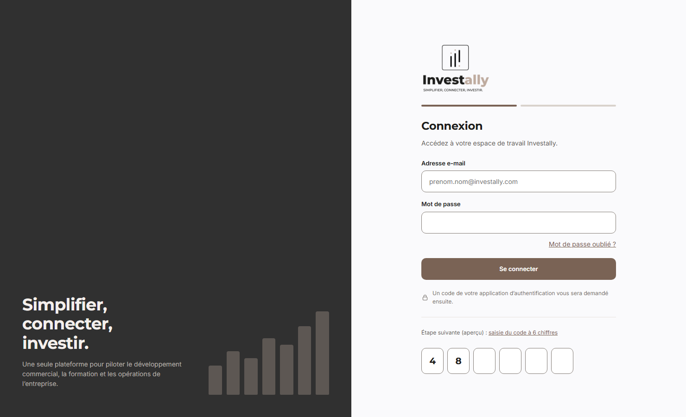
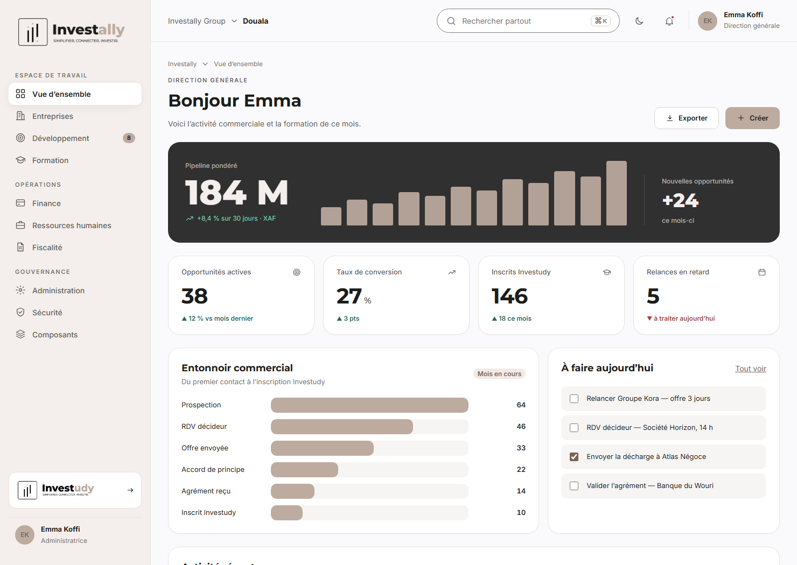
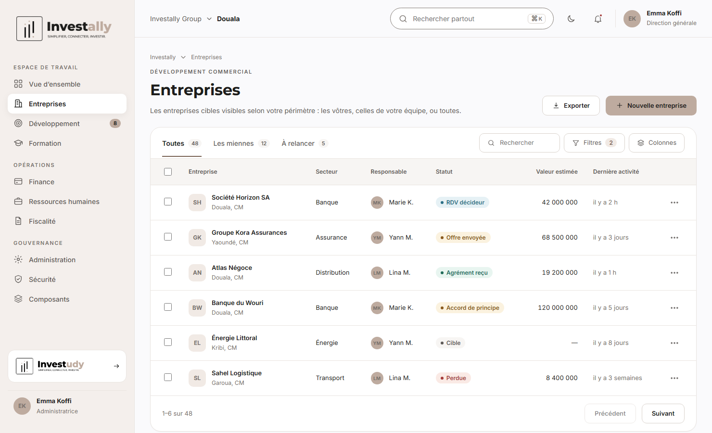
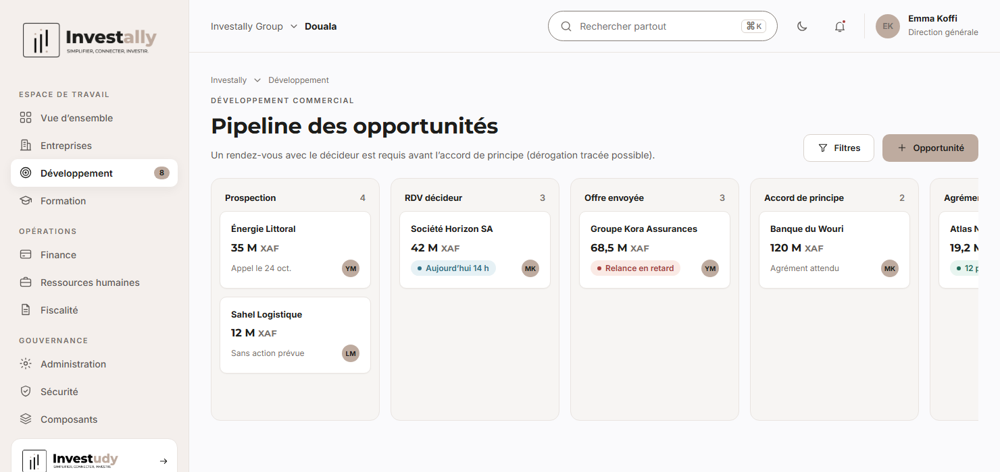
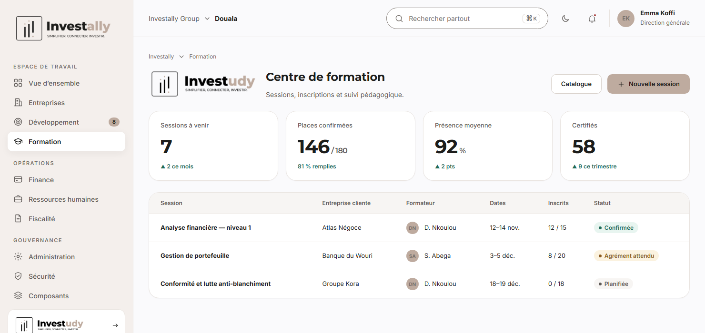
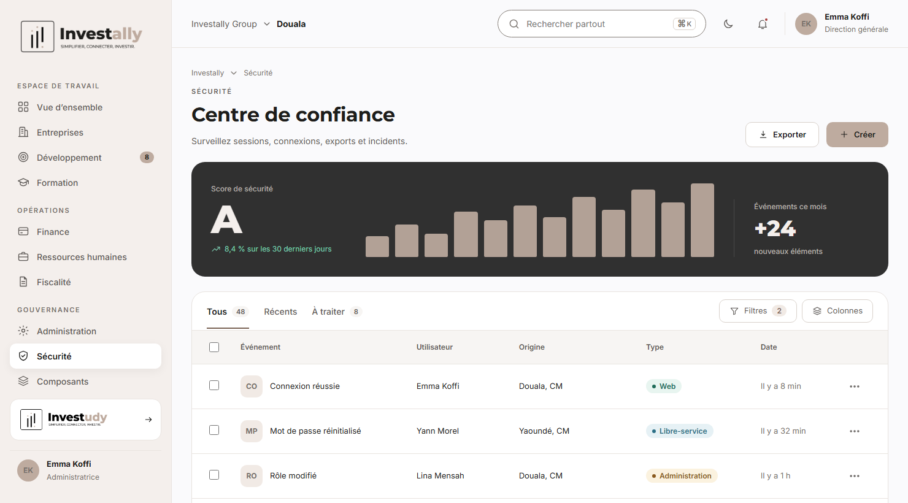
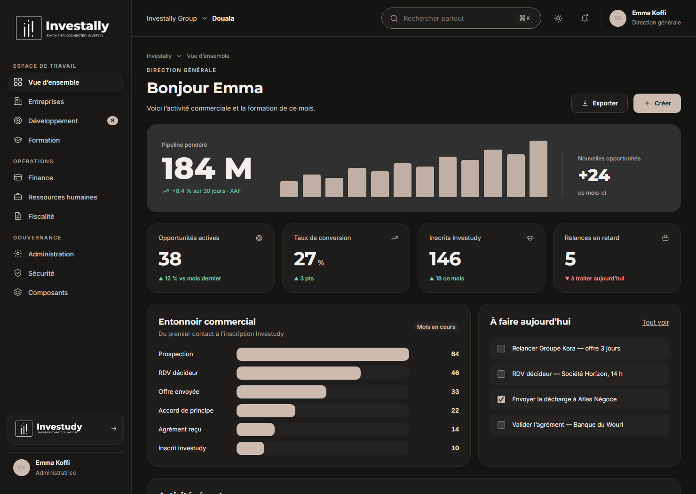

# Investally Business Platform — Direction artistique et Design System

**Version** : 0.1 (proposition à valider) · **Date** : 2026-10-21
**Références fournies** : une capture d'écran « Centre de confiance » (style visuel), le logo Investally (versions rectangle et carrée), le logo Investudy.
**Prototype interactif** : [prototype/index.html](prototype/index.html) (à ouvrir via un petit serveur local, voir §9) · **Captures** : dossier [screens/](screens/)

> **Ce document ne remplace pas la validation du prototype.** Rien n'est encore appliqué à l'application : vous validez d'abord le style ici, puis je l'applique aux écrans existants (voir §10).

---

## 1. Direction artistique

### 1.1 Ce que j'ai lu dans votre capture et dans vos logos
| Observation | Conséquence pour le design |
|---|---|
| Palette **chaude et sobre** : fond rosé très clair, taupe (`#BEAB9F`, la couleur « ally » du logo), noir profond (`#1D1D1B`), une seule grande carte sombre | Une couleur de marque **unique** (le taupe) + des neutres chauds ; pas d'arc-en-ciel |
| **Grande carte sombre** en tête de page avec un indicateur géant et un histogramme taupe | Composant signature, **« carte héros »** : un chiffre qui compte, un graphique, un repère |
| **Barre latérale** claire avec sections (Espace de travail, Opérations, Gouvernance), entrée active en carte blanche | Navigation par domaines métier ; états actifs par **surface** plutôt que par couleur vive |
| Tableaux aérés : avatar à initiales, **badges pastel**, onglets à compteurs, boutons Filtres / Colonnes | Densité « bureau » confortable ; mêmes patterns de liste partout |
| Typographie géométrique, titres gras, étiquettes en capitales espacées | Montserrat pour la marque et les titres (comme le logo), Inter pour le texte |
| Logo : carré arrondi, 3 barres noires, 2 points taupe ; « Invest » noir + « ally » taupe | Réutilisé tel quel ; mot-symbole recomposé en texte pour l'interface |
| Investudy : même symbole, « Invest » noir + « udy » taupe | Marque **fille** : même famille visuelle, utilisée dans les écrans de formation |

### 1.2 Principes
1. **Sobre et premium** : un taupe, du noir, du blanc cassé. L'élégance vient des espaces et de la typographie.
2. **Une information, un endroit** : chaque écran a un titre, une phrase d'aide, une action principale, puis le contenu.
3. **La donnée d'abord** : tableaux lisibles, chiffres en police tabulaire, couleurs réservées au **sens** (statut), jamais à la décoration.
4. **Le même gabarit partout** : en-tête, indicateurs, liste. Un nouveau module ne réinvente rien.
5. **Accessible par construction** : contrastes mesurés, focus visible, clavier, thème sombre, mouvement réduit.
6. **Sécurité visible mais discrète** : le second facteur, les actions sensibles et l'audit ont des écrans soignés (c'est un produit fintech).

### 1.3 Écarts volontaires par rapport à la capture (et pourquoi)
| Dans la capture | Mesure | Dans notre système | Raison |
|---|---|---|---|
| Texte gris des libellés et des entrées de menu inactives (`#9F9F9F`) | **2,65 : 1** | `#5E5A57` (6,8 : 1) | Illisible pour beaucoup d'utilisateurs ; WCAG AA exige 4,5 : 1 |
| Texte des badges (teal, ocre, rouge) | **3,4 à 3,8 : 1** | Teintes assombries, **4,9 à 5,7 : 1** | Idem ; la teinte reste reconnaissable |
| Texte blanc sur bouton taupe « Créer » | **2,2 : 1** | **Encre `#1D1D1B` sur taupe (7,7 : 1)** | Le blanc sur taupe ne passe pas ; le noir reste élégant |
| Un seul thème | — | **Clair + sombre** (suit l'appareil) | Usage prolongé au bureau ; demandé par la plupart des équipes finance |

---

## 2. Personas et écrans prioritaires

| Persona | Rôle(s) du CRM | Ce qu'il fait chaque jour | Écrans clés |
|---|---|---|---|
| **Chargé de compte** | `ACCOUNT_MANAGER` | Relances, rendez-vous, offres, inscriptions | Mes opportunités, À faire aujourd'hui, fiche entreprise |
| **Responsable commercial** | `HEAD_OF_SALES` | Pilote l'équipe et le pipeline global | Pipeline équipe, conversion, performances par personne |
| **Responsable formation** | `TRAINING_MANAGER` | Sessions, formateurs, inscriptions, présences, certifications | Sessions à venir, remplissage, présence, apprenants |
| **Formateur** | `TRAINER` | Anime ses sessions, saisit les présences et évaluations | Mes sessions, feuille de présence |
| **Direction générale** | `DIRECTION` | Lit les résultats, décide | Vue d'ensemble, pipeline pondéré, inscriptions, alertes |
| **Finance** | `FINANCE` | Prépare la facturation (périmètre CRM limité) | Agréments et inscriptions à facturer |
| **RH** / **Fiscalité** | `HR`, `TAX` | Modules ERP à venir | Gabarit réservé |
| **Administrateur** | `SUPER_ADMIN` | Comptes, rôles, sessions, MFA | Utilisateurs, rôles, journal d'audit |
| **Responsable sécurité** | `SUPER_ADMIN` / `DIRECTION` (lecture de l'audit) | Surveille connexions, accès refusés, exports | Centre de confiance |
| **Support** | `SUPPORT` | Consulte pour aider (lecture seule) | Recherche, fiches en lecture |

---

## 3. Architecture de l'information

### 3.1 Navigation principale (barre latérale)
```
ESPACE DE TRAVAIL      Vue d'ensemble · Entreprises · Développement (badge) · Formation
OPÉRATIONS             Finance · Ressources humaines · Fiscalité        (ERP, gabarit réservé)
GOUVERNANCE            Administration · Sécurité
Bas de barre           Carte Investudy (accès rapide) · profil et déconnexion
```
Barre supérieure : **organisation et site** (Investally Group · Douala), **recherche globale** (`⌘K`), thème, notifications, profil.

### 3.2 Visibilité des menus selon les droits
Un menu n'apparaît que si l'utilisateur détient la permission de lecture correspondante (déjà fourni par `/auth/me/profile`). **Le serveur reste seul juge** : un menu caché n'est pas une protection.

| Menu | Permission de lecture | Rôles typiques |
|---|---|---|
| Vue d'ensemble | tableau de bord du rôle | tous |
| Entreprises, Développement | `bd.company.read`, `bd.*` | Chargé de compte, Responsable commercial, Direction, Support, Finance |
| Formation | `training.*` | Responsable formation, Formateur, Direction |
| Finance / RH / Fiscalité | modules ERP | rôles correspondants (plus tard) |
| Administration | `iam.user.read` | Super administrateur |
| Sécurité | lecture de l'audit | Super administrateur, Direction |

### 3.3 Gabarit de page (identique partout)
1. Fil d'Ariane · 2. Étiquette de domaine (capitales) · 3. **Titre** + phrase d'aide + actions (Exporter, Créer) · 4. Carte héros *ou* indicateurs · 5. Contenu (liste, kanban, détail).

---

## 4. Jetons de design

Source unique : [prototype/tokens.css](prototype/tokens.css) (variables CSS), reprise par Tailwind (voir [02-SPECIFICATIONS-FRONTEND.md](02-SPECIFICATIONS-FRONTEND.md)).

### 4.1 Couleurs et contrastes mesurés (WCAG 2.2)
Ratio calculé sur la paire texte / fond. **AA** : ≥ 4,5 : 1 (texte courant), ≥ 3 : 1 (texte large, composants graphiques).

**Thème clair**
| Rôle | Valeur | Utilisation | Contraste |
|---|---|---|---|
| `--ink` | `#1D1D1B` | Texte principal (couleur du logo) | **16,9 : 1** sur blanc |
| `--ink-2` | `#5E5A57` | Texte secondaire, menu inactif | **6,8 : 1** sur blanc · 6,0 sur barre latérale |
| `--muted` | `#76706B` | Méta, horodatages, aides | **4,9 : 1** sur blanc · 4,7 sur le fond |
| `--brand` | `#BEAB9F` | Remplissages, barres, avatars, bouton principal | — (texte dessus : `--brand-ink`) |
| `--brand-ink` | `#1D1D1B` | Texte sur taupe | **7,7 : 1** |
| `--brand-strong` | `#7A6355` | Liens, focus, onglet actif, bouton « Se connecter » (texte blanc) | **5,6 : 1** |
| `--field-border` | `#857E78` (sombre : `#7D766F`) | Bordure des **champs** (le seul repère visuel d'un champ) | **4,0 : 1** sur blanc (3,8 sombre) — les bordures de cartes restent légères (décoratives) |
| `--bg` / `--surface` / `--sidebar` | `#FAFAFC` / `#FFFFFF` / `#F4EFEC` | Fonds | — |
| `--hero` | `#303030` | Carte héros (texte `#F4EFEC`) | **11,6 : 1** · taupe dessus : 6,0 |
| Succès | `#1F6B58` sur `#E8F5F0` | Badges « agrément reçu », « confirmée » | **5,7 : 1** |
| Attention | `#8A5A1F` sur `#FBF2DF` | « Offre envoyée », « agrément attendu » | **5,3 : 1** |
| Danger | `#A63D3B` sur `#FAEAE5` | « Perdue », « relance en retard » | **5,4 : 1** |
| Information | `#2B6F86` sur `#E6F1F5` | « RDV décideur » | **4,9 : 1** |

**Thème sombre** : fond `#141413`, surface `#1E1D1C`, texte `#F2EEEB` (**14,6 : 1**), secondaire `#A8A19B` (**6,6 : 1**), marque `#CDBBAF` (**9,1 : 1** sur surface), bouton principal : encre sur taupe clair (**9,9 : 1**), statuts 7,0 à 8,3 : 1.

**Règle absolue** : la couleur seule ne porte jamais l'information. Chaque badge a un **texte** et un point ; chaque tendance a une flèche (▲ ▼).

### 4.2 Typographie
| Usage | Police | Taille / graisse |
|---|---|---|
| Titre de page | Montserrat | 32 px / 700 |
| Titre de section, carte | Montserrat | 24 ou 18 px / 700 |
| Indicateurs (KPI) | Montserrat | 40 px / 700, chiffres **tabulaires** |
| Texte de l'application, tableaux, champs | Inter | 14 px / 400-600 (13 px en tableau dense) |
| Métadonnées, aides | Inter | 12 px / 500 |
| Étiquettes de section | Inter | 11 px / 600, capitales, espacement 0,14 em |

*Hypothèse à confirmer* : la police de votre capture ressemble à Poppins ; je propose **Montserrat (celle du logo) + Inter**, toutes deux libres (licence OFL), **hébergées dans l'application** (aucun appel à un service externe, compatible avec notre politique de sécurité).

### 4.3 Espacement, formes, élévation, mouvement
| Famille | Valeurs |
|---|---|
| Espacement | grille de **4 px** : 4, 8, 12, 16, 20, 24, 32, 40, 48 |
| Rayons | 6 (puces) · 10 (boutons, champs) · 14 (cartes de liste) · **22 (cartes, héros)** · pilule (badges, recherche) |
| Ombres | 3 niveaux, très légères ; la profondeur vient des **bordures** et des surfaces |
| Mouvement | 120 ms (survol), 200 ms (panneaux) ; courbe `cubic-bezier(0.2, 0, 0, 1)` ; **désactivé** si l'utilisateur demande moins d'animation |
| Focus | anneau 2 px `--brand-strong` + liseré de surface, **toujours visible** au clavier |

---

## 5. Bibliothèque de composants

### 5.1 Composants de base
| Composant | Variantes | États | Notes d'accessibilité |
|---|---|---|---|
| **Bouton** | principal (taupe), fort (taupe foncé), secondaire, fantôme, danger | repos, survol, appui, focus, désactivé, chargement | Cible ≥ 40 px ; libellé verbal (« Créer », « Exporter ») |
| **Champ** | texte, e-mail, mot de passe, liste, recherche | repos, survol, focus, rempli, **erreur**, désactivé | Étiquette toujours visible ; erreur reliée par `aria-describedby` |
| **Champ de code (OTP)** | 6 cases | focus, erreur, saisie complète | Saisie numérique, collage du code entier, annonce vocale |
| **Badge de statut** | neutre, information, attention, succès, danger | — | Texte + point ; jamais la couleur seule |
| **Avatar** | initiales (taille 26 / 36) | — | Nom en texte à côté |
| **Onglets** | avec compteur | actif, inactif, focus | Rôles `tablist/tab`, flèches du clavier |
| **Tableau** | sélection, tri, colonnes, pagination | survol de ligne, sélectionnée, vide, chargement, erreur | En-têtes `th`, défilement horizontal sur mobile |
| **Fenêtre modale** | confirmation, saisie de code MFA | ouverture, fermeture | Focus piégé, `Échap` ferme, retour du focus |
| **Menu latéral** | section, entrée, entrée active, badge | survol, actif (`aria-current`) | Repliable en tiroir sur mobile |
| **Recherche globale** | `⌘K` | focus, résultats | Palette de commandes (étape ultérieure) |
| **Notification / toast** | succès, erreur, information | apparition, disparition | `role="status"` ; les erreurs restent jusqu'à lecture |

### 5.2 Composants métier
| Composant | Rôle | Données |
|---|---|---|
| **Carte héros** | L'indicateur majeur de la page | grand chiffre, tendance, histogramme, repère latéral |
| **Carte KPI** | Un indicateur | libellé, valeur, unité, variation (▲/▼ + texte) |
| **Entonnoir commercial** | Conversion étape par étape | 6 étapes : Prospection → RDV décideur → Offre → Accord de principe → Agrément → Inscrit |
| **Carte d'opportunité** (kanban) | Une opportunité | entreprise, montant XAF, prochaine action, responsable, alerte de retard |
| **Ligne d'entreprise** | Liste des entreprises | logo à initiales, secteur, responsable, statut, valeur, dernière activité |
| **Ligne d'événement d'audit** | Centre de confiance | événement, utilisateur, origine, type, date |
| **Carte de session** | « Mes sessions » | appareil lisible, IP, risque, dernière activité, bouton Révoquer |
| **Bandeau de l'agrément** | Suivi de la promesse de paiement | places, montant, validité, état |

### 5.3 Correspondance des statuts (une seule palette pour toute l'application)
| Domaine | Valeur | Badge |
|---|---|---|
| Entreprise | Cible · En discussion · Client · Perdue · Archivée | neutre · information · succès · danger · neutre |
| Opportunité | RDV décideur · Offre envoyée · Accord de principe · Agrément reçu · Inscrit | information · attention · attention · succès · succès |
| Compte utilisateur | Actif · Invitation en attente · Verrouillé · Désactivé | succès · attention · danger · neutre |
| Session de formation | Planifiée · Agrément attendu · Confirmée · Terminée · Annulée | neutre · attention · succès · neutre · danger |
| Audit | Connexion · Libre-service · Administration · Sécurité | succès · information · attention · danger |

---

## 6. Tableaux de bord par persona

| Persona | Indicateurs (cartes) | Graphique principal | Liste d'action |
|---|---|---|---|
| **Direction** | Pipeline pondéré (XAF) · Opportunités actives · Taux de conversion · Inscrits Investudy | Carte héros : pipeline sur 12 mois | Alertes : relances en retard, agréments en attente |
| **Responsable commercial** | Pipeline équipe · Conversion par étape · Opportunités sans action | Entonnoir + barres par chargé de compte | Opportunités bloquées, dérogations « RDV décideur » |
| **Chargé de compte** | Mes opportunités · Mes relances · Mon objectif | Mon pipeline (kanban) | **À faire aujourd'hui** (relances, rendez-vous) |
| **Responsable formation** | Sessions à venir · Places confirmées · Présence moyenne · Certifiés | Remplissage par session | Sessions sans formateur, agréments à confirmer |
| **Formateur** | Mes sessions · Apprenants | Calendrier | Feuilles de présence à saisir |
| **Finance** | Agréments à facturer · Inscriptions confirmées | — | Liste de préparation de facturation |
| **Administrateur / Sécurité** | Score de sécurité · Connexions · Accès refusés · Comptes en attente | Carte héros d'activité | Événements « à traiter », comptes verrouillés |

---

## 7. Parcours et workflows

| Parcours | Étapes (écrans) | Points d'attention UX |
|---|---|---|
| **Première connexion** | Lien d'invitation → choix du mot de passe → connexion → **configuration du second facteur** (QR, clé, code) → **codes de secours** (affichés une fois) → accueil | Barre de progression en 2 étapes ; avertissement avant de quitter la page des codes |
| **Connexion** | E-mail + mot de passe → code à 6 chiffres | Message d'échec unique ; lien « Mot de passe oublié ? » |
| **Mot de passe oublié** | Demande (e-mail) → message identique → lien → nouveau mot de passe → connexion | Jamais de confirmation d'existence du compte |
| **Action sensible** | Bouton → **fenêtre « Confirmez votre identité »** (code) → action | Une seule question pour plusieurs actions |
| **Pipeline** | Prospection → RDV décideur → Offre → Accord de principe → Agrément → Inscrit | Règle « RDV décideur avant accord de principe » : blocage expliqué, dérogation tracée |
| **Agrément** | Accord de principe → saisie (places, montant, validité) → événement vers Investudy | Statut visible sur la fiche et sur la session liée |
| **Administration** | Liste → invitation / rôles / désactivation / réinitialisations | Confirmation explicite, résultat annoncé (`role="status"`) |

---

## 8. Accessibilité (WCAG 2.2 AA)

| Critère | Mesure retenue | État dans le prototype |
|---|---|---|
| 1.4.3 Contraste du texte | ≥ 4,5 : 1 partout (voir §4.1) | ✅ mesuré |
| 1.4.11 Contraste des composants | bordures de champs **≥ 3 : 1** (4,0 : 1) et anneau de focus (5,6 : 1) | ✅ *(une première version avait des bordures à 1,5 : 1 : corrigée avant livraison)* |
| 1.4.1 Couleur seule | texte + symbole pour tout état | ✅ |
| 2.1.1 / 2.4.7 Clavier et focus | tout est atteignable ; anneau de focus visible | ✅ |
| 2.4.1 Lien d'évitement | « Aller au contenu » | ✅ |
| 2.5.8 Taille des cibles | ≥ 24 px (boutons 40 px) | ✅ |
| 1.4.10 Adaptation | mise en page fluide de 360 à 1 920 px, tiroir de navigation | ✅ |
| 2.3.3 / mouvement | `prefers-reduced-motion` respecté | ✅ |
| Thème | clair, sombre, **suit l'appareil**, choix mémorisé | ✅ |
| Lecteur d'écran | non éprouvé (aucun lecteur utilisé) | ⏳ à tester en implémentation |

**Limites** : audit réalisé sur le prototype, par mesure de contraste et lecture du balisage, pas par des utilisateurs ni un lecteur d'écran.

---

## 9. Utiliser le prototype
Le prototype est un dossier statique (`prototype/`). Pour l'ouvrir :
```
cd docs/design/prototype
python -m http.server 8099
```
puis `http://127.0.0.1:8099/index.html` — liens directs : `#login`, `#dashboard`, `#companies`, `#pipeline`, `#formation`, `#security`, `#components` ; thème sombre : `?theme=dark#dashboard`. Aucune donnée réelle ; les noms d'entreprises sont fictifs.

---

## 9 bis. Aperçus du prototype

**Connexion** (le même gabarit sert au mot de passe oublié, à la réinitialisation et à l'invitation)



**Vue d'ensemble — Direction** (carte héros, indicateurs, entonnoir, tâches du jour)



**Entreprises** (liste avec onglets à compteurs, filtres, badges de statut)



**Pipeline** (kanban des opportunités)



**Formation** (logo Investudy dans l'en-tête de page)



**Centre de confiance** (reprise de la capture de référence avec nos données d'audit)



**Thème sombre**



---

## 10. Mise en œuvre proposée

| Étape | Contenu | Validation |
|---|---|---|
| **A. Valider le style** | Vous relisez le prototype et ce document ; décisions du §11 | **Vous** |
| **B. Habillage de l'existant** (sprint dédié) | Jetons, polices hébergées, coque (barre latérale, barre supérieure), les 8 écrans actuels (connexion, MFA, mot de passe oublié, réinitialisation, invitation, entreprises, utilisateurs, mon compte) | « Je valide » |
| **C. Bibliothèque de composants** | Composants réutilisables et leurs tests, page de référence interne | avec B |
| **D. Écrans métier** | Pipeline, fiches, formation, tableaux de bord, **au fil de S4 à S6**, sur ce système | par sprint |

Détails techniques (Tailwind, structure des fichiers, polices, sécurité CSP, tests) : [02-SPECIFICATIONS-FRONTEND.md](02-SPECIFICATIONS-FRONTEND.md).

## 11. Décisions et informations à me confirmer

| # | Sujet | Ma proposition | Pourquoi |
|---|---|---|---|
| 1 | **Polices** | Montserrat + Inter | Montserrat = police du logo ; Inter = lisibilité en tableau. Dites-moi si la capture utilise une autre police à respecter (ex. Poppins) |
| 2 | **Fichiers du logo** | **Les trois fichiers fournis sont utilisés tels quels** (`Investally rectangle.png` : barre latérale ; `Investally square.png` : connexion ; `Investudy rectangle.png` : écrans de formation et carte d'accès Investudy), recadrés et réduits à 700–1 000 px, fond transparent conservé. En **thème sombre**, version monochrome blanche (le noir y serait illisible) | Il manque une **variante claire officielle** pour le thème sombre (le taupe est perdu en monochrome) et idéalement des **SVG** (nets à toute taille). Les sources restent dans `C:\dev\external ressources\Investally` |
| 3 | **Bouton principal** | Taupe avec **texte noir** | Le blanc sur taupe est illisible (2,2 : 1) ; alternative : taupe foncé `#7A6355` + texte blanc (5,6 : 1) |
| 4 | **Thème sombre** | Oui, en plus du clair | Confort ; demandé en usage prolongé |
| 5 | **Libellés « Investally Group › Douala »** | Sélecteur d'organisation et de site | À confirmer : plusieurs sites/pays prévus ? (la capture montre « Abidjan ») |
| 6 | **Devise** | XAF affichée en millions (« 184 M ») avec détail au survol | Lisibilité des gros montants |
| 7 | **Dossier de références PDF** (`C:\dev\external ressources\*.pdf`, une quarantaine de maquettes : connexion, tableau de bord, projets, clients, leads…) | **Non utilisé** | Vous m'avez demandé de m'inspirer de la capture et du logo ; ces PDF semblent provenir d'un kit tiers. Dites-moi s'ils doivent servir de référence (et si vous détenez leur licence) |

---

## 12. Ce qui est vérifié, ce qui ne l'est pas
**Vérifié** : le prototype s'affiche (7 écrans, clair et sombre, mobile) dans un navigateur réel ; tous les contrastes de texte du §4.1 ont été **calculés** ; les polices sont celles du fichier (licence OFL) ; aucune ressource externe n'est chargée.
**Non vérifié** : rendu sur Safari et Firefox ; lecteur d'écran ; comportement avec de vraies données volumineuses ; lisibilité de la baseline du logo (« SIMPLIFIER, CONNECTER, INVESTIR. ») dans la barre latérale à petite taille.
